# Democracy-based Task Allocation in a Large-scale Multi-robot System

**Research topic:** fully decentralized multi-robot task allocation under unreliable communication.  
**Target publication:** IEEE Robotics and Automation Letters (RA-L).

This repository investigates whether a leaderless, voting-based assignment protocol can achieve correct task decisions with low communication overhead despite wireless packet loss. The contribution under study is **distributed communication and agreement**, not a new global optimization algorithm.

The README presents the motivation, experimental assumptions, measured results, and evidence for each completed study. Detailed protocol definitions and implementation history are preserved in the [Canonical Experiment Protocol](docs/EXPERIMENT_PROTOCOL.md) and [Change Continuity Record](docs/CHANGE_CONTINUITY.md).

## 1. Research motivation and objectives

Multi-robot task allocation requires robots to agree on who should execute each task. Centralized coordination can concentrate decision-making and communication at a leader; decentralized coordination avoids a permanent decision center but introduces two costs: **reaching agreement** and **remaining operational when messages are lost**.

Our evaluation addresses three questions:

1. **Correctness:** with identical complete information, does decentralized voting reproduce the reference assignment without conflicting or duplicate commits?
2. **Communication cost:** how much simulated decision time and sender payload does distributed coordination require relative to centralized or consensus-based alternatives?
3. **Robustness:** how do actual task completion, local convergence knowledge, message volume, and safety-guard censoring change as independent packet loss increases?

We deliberately separate **fixed-optimizer Hungarian studies** from **Greedy Democracy vs. CBAA studies**. They use different decision mechanisms and must not be presented as if they shared an optimizer.

## 2. Protocols, benchmark settings, and evaluation metrics

### 2.1 Algorithms and experimental families

| Family | Methods | Local decision process | What the comparison isolates |
|---|---|---|---|
| **A. Fixed-optimizer coordination (E0–E2)** | Ideal full information, Leader–Hungarian, Full-view Hungarian, Democracy–Hungarian | The same deterministic Hungarian solver | Correctness, quorum overhead, and communication effects when the optimizer is controlled |
| **B. Decentralized communication (E9C–E9E)** | Greedy Democracy (ours) and original CBAA-family single-assignment auction/consensus | Greedy sequential assignment vs. CBAA local bids | Actual emitted payload, iterative information propagation, and packet-loss robustness; **not** optimizer-controlled assignment quality |

**Hungarian-based Democracy (Family A):** a task set is announced; each robot computes and broadcasts its local cost row, forms the visible cost matrix, computes a Hungarian proposal, and sends votes to candidate executors. The canonical fixed-optimizer study uses **strict-majority quorum** and a reliable commit announcement.

For clarity, each robot's locally reconstructed matrix is denoted $C_{i,\mathrm{local}}$, distinct from its own cost row; this preserves the readable mainline notation without changing the canonical mathematical meaning.

**Greedy Democracy (Family B):** each robot receives the same task set, computes and broadcasts its own cost row **once**, then votes directly for the lowest-cost eligible executor of the current task. A candidate must receive **more than 25% of all active voters' ballots** to make a qualified score announcement; among qualified candidates, the highest tally wins and a reliable commit retires that executor. **No fallback or forced assignment is permitted.** Uncommitted tasks can be retried within an explicit round limit.

**CBAA (Family B):** every robot bids for at most one task using its **own** local cost information, exchanges its current bid/winning-origin vector, updates maximum consensus and releases/rebids when outbid. **No unnecessary broadcast of every other robot's original position or state is included.** The tested synchronous complete-network reference is based on [Choi, Brunet & How (2009)](https://doi.org/10.1109/TRO.2009.2022423), with disclosed winner-origin metadata and an experimental local-receipt convergence certificate; this is not a complete implementation of distributed termination and final commit.

### 2.2 Common scenarios and controlled assumptions

| Parameter | Configuration and scope |
|---|---|
| Robot/task model | Static 2D positions, Euclidean cost; one robot can take at most one task |
| Formal repetitions | **100 paired seeds** per evaluated condition, unless specifically labelled exploratory |
| Main Greedy–CBAA scenario | **100 robots, 50 tasks**, 100 matched seeds |
| Packet loss | Independent Bernoulli delivery per receiver for original Cost/Vote or Bid/Winner messages |
| Shared task announcement | Guaranteed delivery in the E9C/E9E study, but **its sender payload is counted** |
| Reliable control messages | Democracy qualified Score and final Commit remain modelled reliable |
| E9E timing | Deterministic **1 ms synthetic message latency** with **10 ms** receive deadline; not measured radio delay |
| E9E stopping guards | Greedy Democracy: **300 task-vote attempts**; CBAA: **160 consensus iterations** |
| Sender payload | Counts **one transmitted payload per broadcast**, not one copy for each receiving robot |
| What is not simulated | 802.11 MAC/PHY contention, real airtime, retransmission ACK overhead, task travel/execution, and multi-task re-entry |

**Important distinction:** the trace-driven latency study **E1** uses measured Wi-Fi application-delay samples. The later **E9E** dense packet-loss study instead uses fixed synthetic latency. Their reported milliseconds must not be treated as the same measured channel.

### 2.3 Success and communication metrics

- **Actual full Commit (Democracy):** all requested tasks receive valid reliable assignment commits.
- **Local convergence certificate (CBAA):** all robots individually have sufficient **physically received peer evidence** to certify their locally matching winner vectors. The simulation ends when an optimistic shared scheduler observes all such flags; no real distributed stop-ACK traffic is paid.
- **External observer agreement (CBAA):** an auditor checks assignment agreement **after** a run. This is neither a local stopping certificate nor an actual distributed final Commit.
- **Sent payload:** all attempted application-layer sender Bytes, including dropped and unfinished transmissions; a dropped packet is still charged at its transmitter.
- **Guard-hit rate:** fraction of runs stopped by a finite simulation bound, not proof of a theoretical loss limit.
- **Hungarian accuracy (Family A):** optimality gap, oracle mismatch, full assignment success, and vote/commit safety errors.

The three end states—**Democracy Commit**, **CBAA local knowledge**, and **CBAA external agreement**—are reported separately throughout this report.

## 3. Completed experiments and results

### 3.1 E0 — Perfect-information correctness

**Why:** prove that communication and voting do not break an otherwise deterministic, globally optimal assignment when everyone sees the same complete cost matrix.

**Design:** zero packet loss and complete information, five robot/task scales, 100 seeds each; identical Hungarian proposal and strict-majority commit logic. The reference is the full-information Hungarian optimum.

| Robots | Tasks | Seeds | Mean optimality gap | Full assignment success | Oracle mismatches | Non-unanimous tasks | Safety failures |
|---:|---:|---:|---:|---:|---:|---:|---:|
| 10 | 5 | 100 | 0.00% | 100% | 0 | 0 | 0 |
| 25 | 10 | 100 | 0.00% | 100% | 0 | 0 | 0 |
| 50 | 30 | 100 | 0.00% | 100% | 0 | 0 | 0 |
| 100 | 50 | 100 | 0.00% | 100% | 0 | 0 | 0 |
| 100 | 100 | 100 | 0.00% | 100% | 0 | 0 | 0 |

**Finding:** all **500 tested scenarios** achieved zero optimality gap, complete assignment, unanimous agreement, and no recorded voting/assignment safety failures. This verifies the Hungarian-based **Family A** correctness contract; it does **not** imply that later Greedy assignments globally minimize Hungarian cost.

Evidence: [E0 original summary](results/e0_protocol_correctness/summary.csv) · [E0 raw scenarios](results/e0_protocol_correctness/raw/e0_corrected_20261009T141508Z.csv).

### 3.2 E1 — Communication latency and overhead with measured Wi-Fi delays

**Why:** determine whether removing a leader changes actionable decision time, global agreement time, and communication volume even when packet delivery is loss-free.

**Design:** 100 paired seeds per scale, the same Hungarian optimizer and discrete-event network model for Leader–Hungarian, Full-view Hungarian, and Democracy–Hungarian. Delivered message latencies are bootstrapped from **Rady et al. (2024)**: industrial robotic ROS 2 measurements, **Wi-Fi 6E**, medium-range **60 m LoS**, source window **120–181 s**. The pinned **121** delay observations have mean **33.594 ms**, P95 **64.150 ms**, and maximum **531.535 ms**.

| Robots | Tasks | Method | Mean actionable decision (ms) | Mean global agreement (ms) | Mean logical SENDs | Mean sender payload (B) |
|---:|---:|---|---:|---:|---:|---:|
| 10 | 5 | Leader–Hungarian | 157.2 | 157.2 | 10 | 560 |
| 10 | 5 | Full-view Hungarian | 142.2 | 142.2 | 10 | 560 |
| 10 | 5 | Democracy–Hungarian | 168.4 | 247.6 | 60 | 2,140 |
| 50 | 30 | Leader–Hungarian | 370.8 | 370.8 | 50 | 12,800 |
| 50 | 30 | Full-view Hungarian | 336.1 | 336.1 | 50 | 12,800 |
| 50 | 30 | Democracy–Hungarian | 362.1 | 659.9 | 1,550 | 60,680 |
| 100 | 50 | Leader–Hungarian | 477.4 | 477.4 | 100 | 41,600 |
| 100 | 50 | Full-view Hungarian | 452.6 | 452.6 | 100 | 41,600 |
| 100 | 50 | Democracy–Hungarian | 477.7 | 796.2 | 5,100 | 201,400 |
| 100 | 100 | Leader–Hungarian | 477.4 | 477.4 | 100 | 81,600 |
| 100 | 100 | Full-view Hungarian | 452.6 | 452.6 | 100 | 81,600 |
| 100 | 100 | Democracy–Hungarian | 478.3 | 918.6 | 10,100 | 401,200 |

**Finding:** with 100 robots and 50 tasks, Democracy–Hungarian reached an actionable decision in **477.7 ms**, near Leader–Hungarian's **477.4 ms**. Its **796.2 ms** global agreement time and **201,400 B** sender payload were much higher because votes and final commits must also propagate. At 100 robots/100 tasks, the corresponding Democracy values were **478.3 ms** actionable, **918.6 ms** global, and **401,200 B** sent.

The experiment demonstrates a **cost of decentralized agreement**, not an unqualified latency win. These are trace-driven *application-delay simulations*, with no new shared-medium congestion induced by fleet size.

Evidence: [E1 original summary](results/e1_latency/summary.csv) · [E1 raw scenarios](results/e1_latency/raw/e1_20261009T144026Z.csv).

### 3.3 E2 — One-round Hungarian robustness under lossy Cost/Vote delivery

**Why:** distinguish how much packet loss prevents **task completion** versus merely reduces the quality of a still-committed assignment.

**Design:** same fixed Hungarian optimizer and Rady-derived latency samples as E1; a **single, non-retried allocation round**; independent receiver-level Cost packet drops and separately lossy Vote unicasts; the original electorate remains the quorum denominator. Commit announcements are reliably modelled.

At the **100-robot / 50-task, 30% Cost loss + 30% Vote loss** condition, the completed 100-seed correctness-instrumented rerun reported:

| Metric | Recorded value |
|---|---:|
| Mean visible robot cost rows | **70.285 / 100** |
| Mean task commit rate | **15.22%** |
| Correct executor rate (all requested tasks) | **15.06%** |
| Correct executor rate among committed tasks | **98.706%** |

**Interpretation:** the distinction between low task availability and high correctness **conditional on a successful Commit** is important. However, this specific Hungarian E2 result remains **provisional until the vote-level forensic ledger audit is accepted**. It is not a validated substitute for the completed E9E Greedy/CBAA sweep.

Definitions, audit provenance, and the complete one-round benchmark: [E2 evidence notes](results/e2_packet_loss/README.md) · [Experiment Protocol](docs/EXPERIMENT_PROTOCOL.md).

### 3.4 E9C — Message-size and zero-loss communication accounting validation

**Why:** ensure a comparison counts the information actually emitted on the network, instead of charging CBAA for unnecessary peer robot-state broadcasts or multiplying one broadcast by all receivers.

**Design:** 100 robots, 50 tasks, 100 paired seeds, no loss. Both methods receive the **same physically encoded task announcement**. Greedy sends its own Cost row once, followed by Vote/qualified Score/Commit; original-family CBAA sends its own Bid/Winner vector in each consensus iteration. This was a fixed-iteration **validation/control**, whereas the later E9E uses iterative local evidence without selecting a particular K in advance.

| Component | Physical sender payload in the 100R / 50T setup |
|---|---:|
| Shared 50-task announcement (2 binary packets) | **1,632 B** |
| One original Greedy Cost packet per robot (100 total) | **41,600 B** |
| CBAA bid/winner-vector dissemination in **one** complete 100-robot consensus iteration | **61,600 B** |
| Additional global peer-position transfer required by original CBAA | **0 B** |

**Finding:** both original methods can be evaluated without hidden peer-state information. The **zero-loss** Greedy full 50-task Commit cost was **165,432 B per seed**, while CBAA's final traffic depends on how many real consensus exchanges are executed. Counting **only** one CBAA iteration without ensuring full agreement is not a meaningful completed-outcome comparison. The dynamic-stop E9E data below supersedes fixed-iteration settings as the primary loss/traffic result.

Evidence: [Original-only E9C CI verification](https://github.com/andyfu35/Democracy-based-Task-Allocation-in-a-Large-scale-Multi-robot-System/actions/runs/38112992924) · [Experiment Protocol](docs/EXPERIMENT_PROTOCOL.md).

### 3.5 E9E — Dense packet-loss robustness and actual sender payload (**primary cross-algorithm result**)

**Why:** identify the loss region where Democracy stops completing all tasks, determine whether CBAA preserves assignment agreement at high loss, and quantify the **additional attempted sender payload** required by continuing consensus transmissions.

**Design:** 100 robots, 50 tasks, 100 paired seeds and **52 measured loss levels** (5%-step global grid plus 1%-step resolution across **40–65%** and **85–99%**). This produces **10,400 original protocol executions**. Loss affects **Democracy Cost and Vote** and **CBAA Bid/Winner** independently per receiver. No extra CBAA robot-position exchange and no manually fixed K tuning is used. Original CBAA auction/consensus runs until local-receipt certification or its reported safety guard.

**Evidence status:** complete original per-seed, summary, manifest, and **all six source-generated SVGs independently SHA256-verified**. The exact original Mac SVGs are committed, not replotted from rounded terminal logs.

#### Experiment 1 — Complete protocol outcome versus packet loss

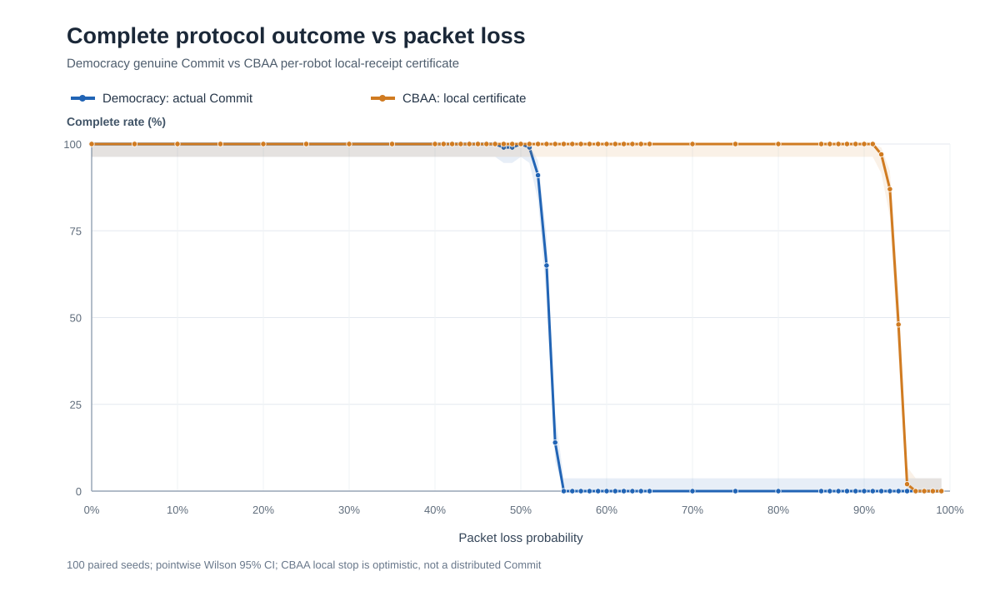

Democracy retained **100/100 full Commit** at sampled 50% loss, dropped to **91/100 at 52%**, **65/100 at 53%**, **14/100 at 54%**, and **0/100 at 55%**. Its first **non-perfect** sample was **48% (99/100)**, so discrete sample success is not strictly monotonic.

CBAA retained **100/100 locally certified outcomes** through **91%** loss, before declining to **97/100 at 92%**, **87/100 at 93%**, **48/100 at 94%**, and **2/100 at 95%**. These are **measured, guard-limited outcomes**, not mathematical maximum loss tolerances.

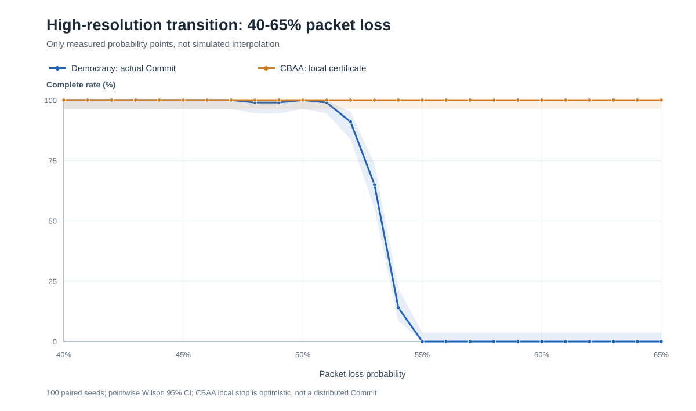

#### Experiment 2 — Communication volume and the performance trade-off

The table below is reproduced from the original **104-row verified summary CSV**, not from console output. **kB = 1,000 sender application Bytes**; incomplete and safety-guard-limited runs remain in the mean.

| Loss | Democracy full Commit | CBAA locally certified | CBAA external full agreement | Democracy mean sender (kB) | CBAA mean sender (kB) | CBAA guard hits |
|---:|---:|---:|---:|---:|---:|---:|
| 0% | 100/100 | 100/100 | 100/100 | 165.4 | 269.0 | 0/100 |
| 10% | 100/100 | 100/100 | 100/100 | 165.2 | 557.9 | 0/100 |
| 30% | 100/100 | 100/100 | 100/100 | 164.8 | 838.2 | 0/100 |
| 40% | 100/100 | 100/100 | 100/100 | 166.2 | 1,015.6 | 0/100 |
| 45% | 100/100 | 100/100 | 100/100 | 185.0 | 1,109.2 | 0/100 |
| 48% | 99/100 | 100/100 | 100/100 | 237.9 | 1,169.0 | 0/100 |
| 50% | 100/100 | 100/100 | 100/100 | 323.1 | 1,217.6 | 0/100 |
| 51% | 99/100 | 100/100 | 100/100 | 389.1 | 1,249.0 | 0/100 |
| 52% | 91/100 | 100/100 | 100/100 | 494.4 | 1,297.1 | 0/100 |
| 53% | 65/100 | 100/100 | 100/100 | 618.5 | 1,328.5 | 0/100 |
| 54% | 14/100 | 100/100 | 100/100 | 731.6 | 1,368.5 | 0/100 |
| 55% | 0/100 | 100/100 | 100/100 | 796.6 | 1,401.8 | 0/100 |
| 60% | 0/100 | 100/100 | 100/100 | 957.8 | 1,588.4 | 0/100 |
| 80% | 0/100 | 100/100 | 100/100 | 955.1 | 3,106.3 | 0/100 |
| 90% | 0/100 | 100/100 | 100/100 | 907.4 | 6,118.5 | 0/100 |
| 91% | 0/100 | 100/100 | 100/100 | 897.1 | 6,859.6 | 0/100 |
| 92% | 0/100 | 97/100 | 100/100 | 884.5 | 7,706.6 | 3/100 |
| 93% | 0/100 | 87/100 | 100/100 | 867.8 | 8,779.0 | 13/100 |
| 94% | 0/100 | 48/100 | 100/100 | 845.3 | 9,578.0 | 52/100 |
| 95% | 0/100 | 2/100 | 100/100 | 815.3 | 9,854.6 | 98/100 |
| 96% | 0/100 | 0/100 | 100/100 | 770.2 | 9,857.6 | 100/100 |
| 99% | 0/100 | 0/100 | 100/100 | 399.0 | 9,857.6 | 100/100 |

At **30% packet loss**, both methods achieved **100/100** of their respective full outcomes, while Democracy used **164,750.08 B** and CBAA used **838,160 B** per seed on average. This is **80.34% fewer modeled sender application Bytes** for Democracy **in that particular comparison condition**. It is not evidence of less communication for a *completed* task set at 55%+ loss, where Democracy frequently fails to finish.

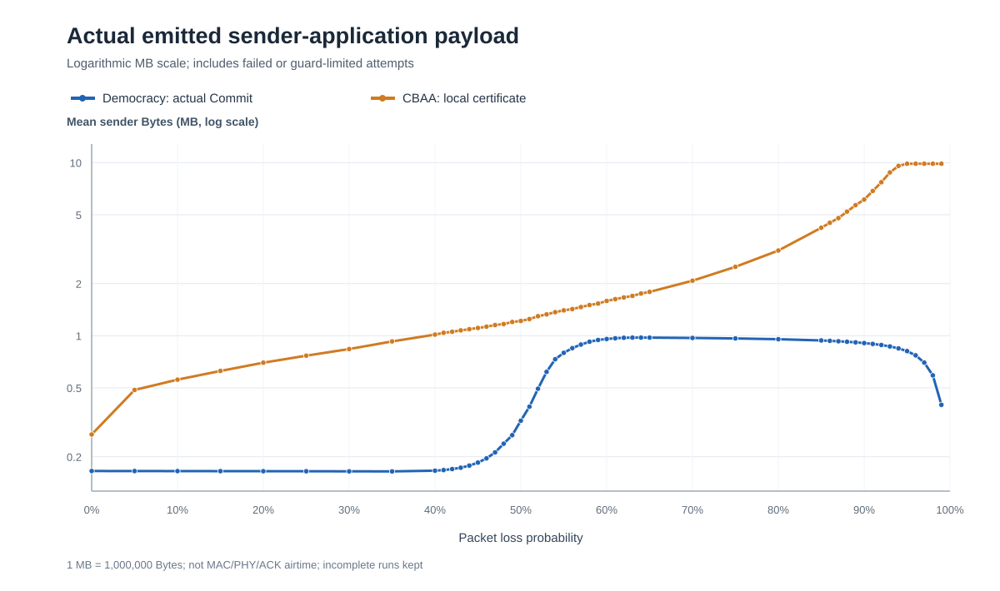

#### Experiment 3 — CBAA task agreement is different from knowing when to stop

The **external observer** found complete CBAA assignment agreement in **100/100 seeds at every tested loss probability through 99%**. In contrast, each robot having enough **received peer evidence** to certify global agreement became increasingly difficult; at 96–99% none of the 100 trials satisfied the full local-certificate condition within 160 iterations.

This is a **stopping-knowledge and resource-limit finding**, not evidence that CBAA necessarily lost the 50-task assignment. The current CBAA model's optimistic simulator-wide halt does **not** charge physical distributed stop-ACK/Commit communication.

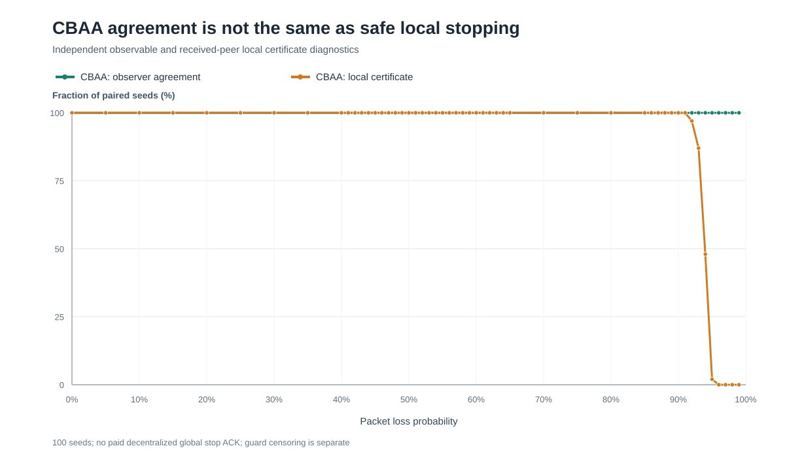

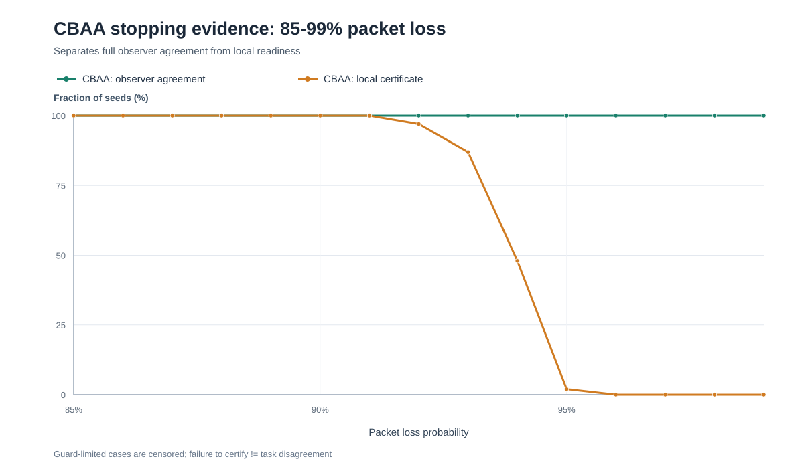

#### Experiment 4 — Which apparent failures are safety-guard censored?

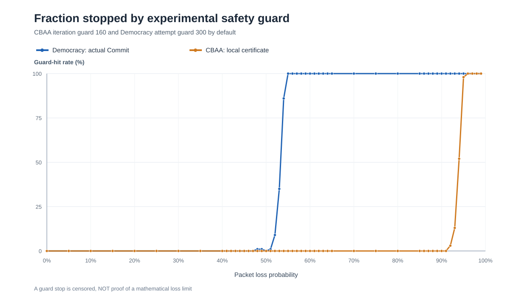

Democracy was allowed up to **300** task-voting attempts; CBAA up to **160** consensus iterations. Exceeding either guard does **not** prove that an algorithm could never finish with more time or transmissions. Comparisons of payload must include these stopped runs rather than selectively discarding them.

**Verified E9E evidence:** [Original 104-row result summary](docs/figures/e9e_dense/formal/summary_by_loss.csv) · [Experiment and figure SHA256 manifest](docs/figures/e9e_dense/formal/publication_manifest.json).


### 3.6 E9G — Evidence-backed Wi-Fi timing, contention and task-allocation scaling (**simplified-model evidence; no ns-3**)

**Research objective.** Explain the relationship between actual sender application Bytes, individual SEND operations, shared 802.11 airtime, congestion, and end-to-end completion of the original Greedy Voting task allocation. The first priority is a **Voting-only** R=T=N scaling study (N=5,10,...,100; 100 paired seeds; 0% application loss; one Cost copy), **not** an inter-algorithm win/loss contest. Earlier Rady-profile sampling estimated near-linear allocation time, but the conservative 531.535123 ms **per task-voting epoch** timeout dominates the estimate (~88% at N=100). It is **not** a measurement of real Wi-Fi 6E 100-robot airtime.

#### Published sources: explicit attribution, purpose and scientific boundary

Each numbered study has a stable BibTeX key in [E9G literature bibliography](docs/references/e9g_wifi_timing.bib). **Citing a paper does not imply that its radio traces are already implemented or that its authors tested our 100-robot MRTA scenario.**

| Source (cite in paper) | What it establishes / how E9G will use it | What it does **not** establish |
|---|---|---|
| **[Rady et al. (2024), *Ad Hoc Networks* 156, 103418](https://doi.org/10.1016/j.adhoc.2024.103418)** \`Rady2024IndustrialWifi6\` | Real industrial robotic Wi-Fi/ROS 2 application-layer delay and wireless performance; use the existing **pinned 60 m LoS, 6 GHz, 160 MHz** 121-sample empirical profile (33.594 ms mean; 531.535 ms max) as an external calibration/holdout target. [Exact pinned dataset and checksum](https://github.com/minarady1/wifi_for_industrial_robotics/tree/1996e5bb69b9ba4d25060cbc14838ddedf65cff2). | No 100-node simultaneous 802.11ax traffic/packet-size-specific delay distribution; ROS 2 delay already contains network/stack contributions and **must not be added wholesale to simulated PHY/MAC times**. |
| **[Liu & Choi (2023), *Proc. ACM Meas. Anal. Comput. Syst.*](https://doi.org/10.1145/3579451)** \`LiuChoi2023Wifi6Measurement\` | Empirical commercial Wi-Fi 6 device throughput, latency and OFDMA/aggregation behavior; use its [measurement artifacts](https://github.com/liux4189/wifi-ax-measurement) as a **separate small-population validation dataset once artifacts/versions are independently verified**. | Experimental users and equipment do not represent the extrapolated 100-robot industrial configuration. No calibrated parameters have been copied from this paper yet. |
| **[Montgomery & Candell (2024), NIST IR 8506](https://doi.org/10.6028/NIST.IR.8506)** \`MontgomeryCandell2024OfdmaIndustrial\` | Industrial uplink OFDMA activation can depend on offered load, AP and client implementation; compare EDCA baseline with **explicitly enabled** OFDMA as sensitivity. | **No universal “2 devices” or packet-rate threshold** can be imposed on all access points. |
| **[Bianchi (2000), *IEEE JSAC* 18(3)](https://doi.org/10.1109/49.840210)** \`Bianchi2000Dcf\` | DCF contention/backoff/collision foundational analytical model; reason about shared-medium scaling and why SEND count differs from elapsed time. | Traditional saturated DCF analysis alone does not model 802.11ax OFDMA, an actual AP, ROS/DDS, or the unsaturated MRTA burst pattern. |
| **[Riley & Henderson (2010), “The ns-3 Network Simulator”](https://doi.org/10.1007/978-3-642-12331-3_2)** \`RileyHenderson2010Ns3\` and [ns-3 official Wi-Fi model documentation](https://www.nsnam.org/docs/models/html/wifi-design.html) \`Ns3WifiModelDocumentation\` | Proposed trace-producing packet-level PHY/MAC/EDCA simulation backend; record ns-3 version, wifi model, MCS, AP/client roles, addresses, channel, transport, traffic scheduling, ACK/retries, random seeds and any OFDMA scheduler. | **Not installed or run by the current Python Voting simulator.** Version-specific features must be checked; bibliographic references are **not** a simulation result. |
| **[Choi, Brunet & How (2009), *IEEE T-RO* 25(4)](https://doi.org/10.1109/TRO.2009.2022423)** \`ChoiBrunetHow2009Auctions\` | Background citation for original consensus-based auctions in task allocation and separation of agreement from physical network cost. | Not a Wi-Fi timing calibration source; E9G currently runs **only our original Voting**. |

#### Proposed two-layer experiment and source-of-truth contract

**Layer A (existing, reproducible):** 0%-loss R=T scaling source events from the original \`coordination\` and \`task_information\` owners. Task / Cost / Vote / Score / Commit sender payloads are recorded once for physical broadcasts, never multiplied by nominal receivers. The previously uploaded Voting-only 100-seed scaling ZIP (20 groups, 2,000 runs) exists as user-provided exploratory analysis; its processed files are **not silently represented as formally committed E9G/ns-3 output**.

**Layer B (not yet implemented):** one external ns-3 run per seed/network configuration, using actual application SEND release times, sizes, sender/receiver roles, and packet types. E9G must export/import a **versioned per-packet network trace**, with a deterministic mapping from original application SEND to channel transmissions/deliveries. Preserve broadcast-vs-unicast semantics, AP uplink/downlink cost and lack of normal multicast ACK, and MAC ACK/retransmission only when corresponding to configured Wi-Fi network frames. Accounting must report separately (a) application sender Bytes/SENDs, (b) over-the-air transmissions/Bytes/airtime, (c) MAC backoff/queues/retries, (d) ROS/application residual delays, (e) original fixed protocol timeout/retries, and (f) real full-Commit endpoint. **Offline rescheduling of all already-generated packets is not enough:** if network arrivals affect vote eligibility/deadlines, the Voting owner must receive those actual arrivals during the original execution, rather than retrospectively rewriting a successful allocation. No second voting state machine or uncharged global clock.

For per-packet delay, write \`T_delivered = T_queue + T_backoff + T_PHY/MAC_service + T_stack_residual\`, where \`T_stack_residual\` can only be fitted from a **non-overlapping** measurement component. Do not add 33.594 ms to every ns-3 packet without double-count validation. Transport/application reliability assumptions (original reliable TASK, qualified Score, Commit vs lossy Cost and Vote), timeout decisions, packet loss, and censored runs must be disclosed. Use external measurements only within their supported equipment/traffic range; treat N=100 as **extrapolation**, not measurement.

**Acceptance gates before claiming results:** (1) source checksum/provenance and simulator version; (2) zero-loss original Voting/Cost/Score/Commit parity at N=5; (3) each SEND/delivery and PHY/MAC accounting auditable; (4) B=0/minimum and no-queue controls; (5) small-scale validation against published multi-user performance before N=100; (6) 100 seeds and immutable raw CSV + summary + manifest SHA256; (7) README plots *only after* verified executed runs. The original application Bytes at 0%-loss 1:1 scale follow \`B(N)=24N^2+92N+16 ceil(N/37)\` for the measured original one-attempt protocol path; that does **not** give a measured Wi-Fi airtime complexity. A log-log slope from 5..100 is an empirical finite-range exponent, not a theoretical Big-O proof.

#### Executable E9G-1 simplified shared-radio sensitivity (new; not ns-3)

A **new opt-in Python network-timing model is implemented on main**, driven by the **original Greedy Voting** packet emission and actual physical on-time Cost/Vote receipt decisions. It is deliberately called a **single-shared-medium/backoff proxy**, **NOT an IEEE 802.11ax/ns-3 implementation** and not direct measurement of 100 industrial robots. The executed 100-seed numerical results and limitations are published separately in §3.7 below; no measured RF network accuracy improvement is claimed.

| Named component | Mathematical/empirical role | Source and interpretation boundary |
|---|---|---|
| Per-packet payload-dependent service | For each modeled radio hop: assumed PHY preamble plus \`8 × (application Bytes + assumed headers) / modeled PHY rate\` | [Rady et al. 2024](https://doi.org/10.1016/j.adhoc.2024.103418) establishes Wi-Fi PHY/throughput trade-offs; **144/600/1200 Mbps are explicit modeling sensitivity choices, not verified 60 m measured throughput** |
| Shared medium and seeded backoff | Each original SEND waits for one shared channel; deterministic CWmin-based BE backoff is added per hop | [Bianchi 2000](https://doi.org/10.1109/49.840210) motivates DCF contention; simple serialization **does not simulate collisions, exponential retransmission, true EDCA per-station queues, or PHY rate adaptation** |
| Radio direction and ACK | Inter-robot Vote or Broadcast: modeled STA→AP→STA[s] two-hop path; external TASK: one AP downlink. Unicast ACK modeled on both radio hops, broadcast downlink without per-recipient ACK | [ns-3 Wi-Fi documentation](https://www.nsnam.org/docs/models/html/wifi-design.html) informs next full simulator, **but the current two-hop abstraction is an explicit assumption, not ns-3 output** |
| Rady network residual | Per-frame ROS 2 measured sample minus the *expected idle reference frame service*, clamped at zero, plus newly modeled queue/backoff/service | [Rady et al. 2024](https://doi.org/10.1016/j.adhoc.2024.103418) pinned 121-sample 60 m profile; **partial de-overlap remains approximate because paper does not supply directly identifiable per-frame residuals** |
| OFDMA and real AP activation | OFDMA is **OFF / not modeled** in this runnable proxy; AP-triggered uplink scheduling and RU allocation need later ns-3 implementation and validation | [NIST Montgomery & Candell 2024](https://doi.org/10.6028/NIST.IR.8506) observed hardware/load-specific activation; [Liu & Choi 2023](https://doi.org/10.1145/3579451) provides commercial small-client Wi-Fi 6 evidence, **not 100-client calibration** |
| Protocol and comparable fixed deadline | Original Vote/Score/Commit/Cost decision owners are reused; sender payload and physical observations are audited; one **common** deadline is calculated from pinned Rady maximum plus the most conservative selected grid's modeled one-stage radio burst | **Timeout is a declared model assumption**, never claimed as a paper-measured optimal MRTA deadline. Existing E1–E9F samplers and results stay unchanged. |

The runnable E9G study reports independent dimensions: actual application SEND count/Bytes; modeled AP radio-hop count and radio payload equivalents; modeled airtime, queue and backoff service sums; separately bootstrapped ROS/stack residuals; every seed's real original Voting full Commit/guard result; and a finite-size log-log exponent over R=T=N (5,10,...,100). Mean end-to-end **simulated protocol time is not the sum of all per-packet queue times**, as packets and residual processing overlap.

**Source evidence generated by the executed formal study:** \`per_seed_wifi_timing.csv\`, \`scaling_by_size_mode.csv\`, \`empirical_scaling_exponents.csv\`, \`manifest.json\` with exact model/scene seeds and SHA256. Canonical [§36](docs/EXPERIMENT_PROTOCOL.md) documents the executable configuration, diagnostic gates and local commands. This is an honest **intermediate sensitivity experiment**: ns-3 calibration, OFDMA, collisions/retries and true multi-client measurements remain uncompleted separate work.

**Current status:** literature citations, model limitations and source experiment design documented; **E9G-1 opt-in simplified shared-medium/backoff code and tests added**. The previous E9G-0 status (no implemented model) no longer applies. **The source 100-seed simplified shared-channel model data is independently verified and published in §3.7; no ns-3, OFDMA, or physical 100-client Wi-Fi measurement has been produced.**

### 3.7 E9G-2 — Verified 100-seed Voting-only Wi-Fi timing sensitivity (**formal simulation; NOT ns-3**) 

The original user-supplied `e9g_wifi_formal.zip` was **independently verified** against its per-file SHA256 manifest. The executed Voting source Git SHA was `910c5eac738367738907b18fce86e56adf86697d`. The raw has **8,000 original-protocol runs** (N=5,10,...,100; R=T=N; seeds 0..99; zero application loss; one Cost and Vote transmission; one Rady-only reference plus three *hypothetical* 144/600/1200 Mbps shared-medium/backoff proxies). **All 8,000/8,000 runs completed full task Commit**, with zero guard hits. The original 80 grouped means, program-defined P50/P95, and four independent finite-size exponent fits were recomputed from all 8,000 source rows; no failed run was excluded. All modeled rates are sensitivity assumptions, **not** measured Rady throughput. E9G does **not** implement IEEE 802.11ax collisions/ARQ, real AP queue dynamics, OFDMA, ns-3, or actual 100-client Wi-Fi.

**Allocation-time result:** 

| Robots = Tasks | Rady-only mean | 144 Mbps proxy | 600 Mbps proxy | 1200 Mbps proxy |
|---:|---:|---:|---:|---:|
| 5 | 3.514 s | 3.517 s | 3.517 s | 3.517 s |
| 20 | 13.857 s | 13.872 s | 13.871 s | 13.871 s |
| 50 | 34.102 s | 34.140 s | 34.138 s | 34.138 s |
| 100 | **68.143 s** | **68.224 s** | **68.219 s** | **68.218 s** |

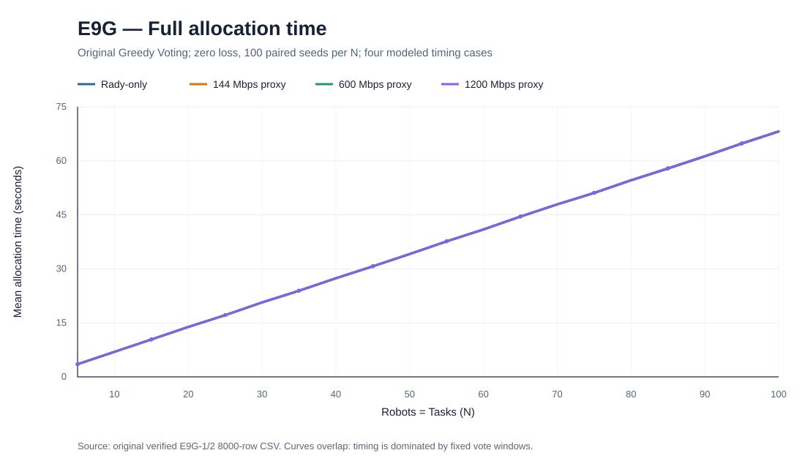

At **100 robots / 100 tasks**, adding the current modeled shared medium increased the **paired mean** by **81.722 ms at 144 Mbps** (95% paired-mean *t* CI 78.680–84.765 ms), **75.936 ms at 600 Mbps** (73.264–78.608 ms), and **75.022 ms at 1200 Mbps** (72.408–77.637 ms). These represent only **0.120%, 0.111%, and 0.110%** of the Rady-only mean allocation time in **this specific model**. In particular, there is no verified claim that *real* 100-station Wi-Fi contention is negligible.

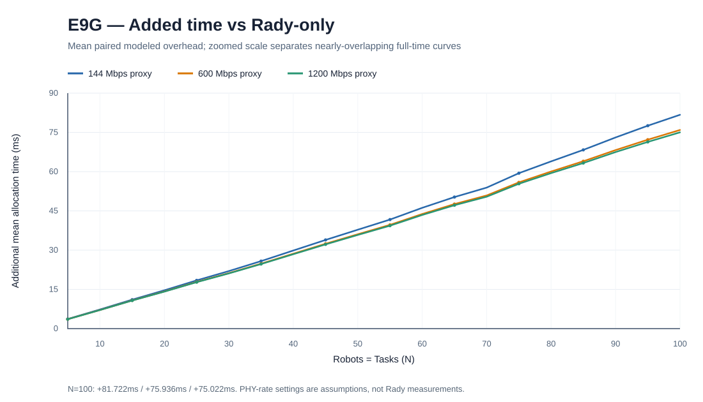

**Communication complexity:** With original Greedy Voting and zero-loss one-attempt full Commit, *every raw row* matches both exact source payload formulas:

```text
B(N) = 24 N^2 + 92 N + 16 ceil(N/37) bytes
M(N) = N(N-1)/2 + 3 N + ceil(N/37) application SENDs
```

Thus application sender payload and SEND count are analytically **Theta(N^2)** under this conditional protocol path. At N=5: **1,076 B and 26 SENDs**; at N=100: **249,248 B and 5,253 SENDs**. The observed finite-scale log-log exponents are **1.849026 Bytes** and **1.810077 SENDs**; these are *not* theoretical Big-O exponents.

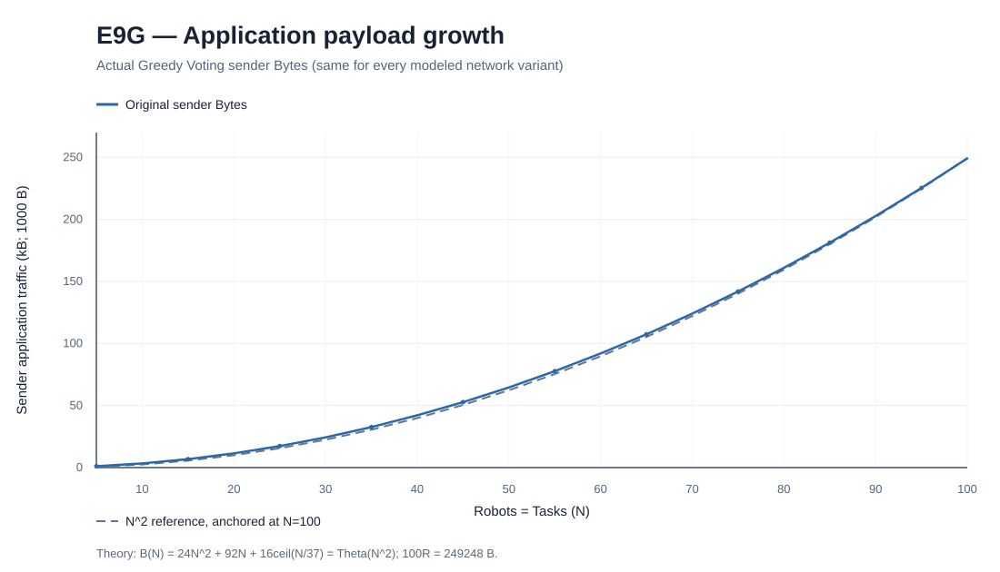

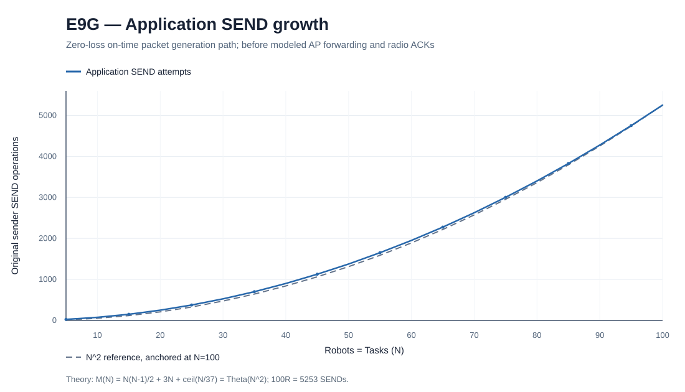

**Network mechanism and major confound:** At N=100 the modeled 144 Mbps proxy recorded mean summed PHY airtime **1.3252 s**, backoff sum **1.0662 s**, ACK sum **0.4590 s**, **10,503 modeled AP radio hops**, and **90.77 s summed per-packet queue waits**. The queue-wait sum is **NOT elapsed time** and cannot be added to the allocation clock: the same waiting intervals overlap across many packet-local records. The PHY airtime assumptions (radio hop duplication, 64 B extra headers, 120 μs preamble, CWmin=15 and related intervals) remain *simulator configuration*, not external industrial measurements.

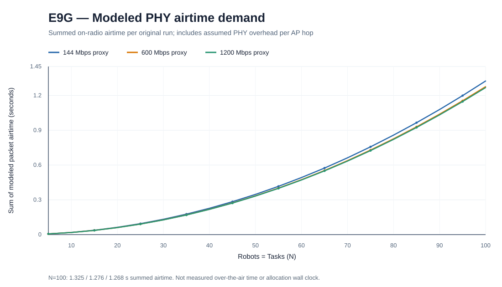

**Fixed-timeout domination:** All conditions used the same **609.11290078 ms phase timeout**, chosen from Rady's maximum observed application delay **plus a modeled conservative radio-burst envelope**. For 100 sequential tasks, the nominal `100 × timeout` window is **60.91129 s**, equivalent to **89.39%** of the Rady-only mean 68.14266 s. This is a **nominal deadline-budget comparison, not an additive proof of where every observed millisecond was spent**. The prior original Rady-only ~60.38 s run used a different 531.535 ms timeout and **must not be compared directly** to this 68.14 s figure as a pure network effect. The finite-range time exponents are **0.990166 (Rady)**, **0.990221 (144 Mbps)**, **0.990199 (600 Mbps)** and **0.990196 (1200 Mbps)**, showing that the **current fixed-deadline simulation** remains near-linear.

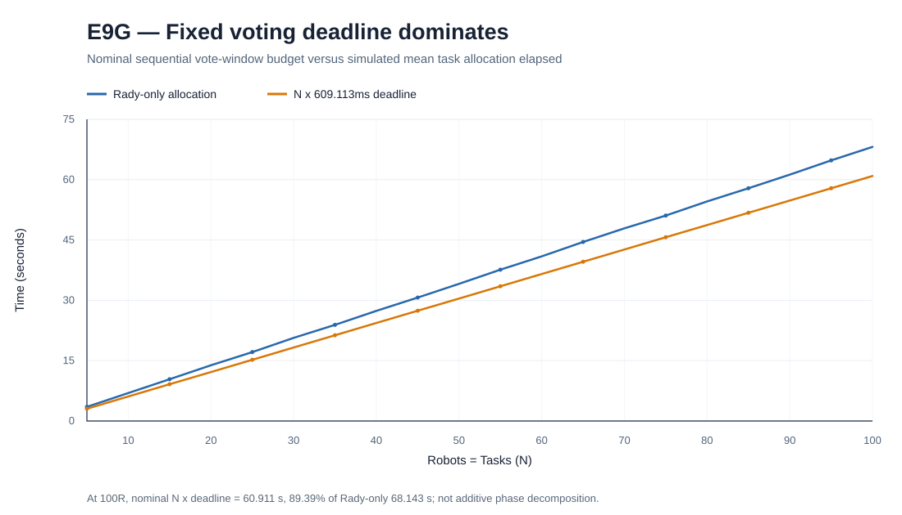

**Research implication:** The algorithm emits quadratic **application-layer** traffic but this fixed-window timing proxy gives near-linear simulated allocation duration and only a 75–82 ms additional critical-path mean at N=100. This does **not** validate real radio scalability. The next proper experiment requires actual ns-3 Wi-Fi 6E PHY/MAC + EDCA/CSMA and OFDMA sensitivity, explicitly calibrated at supported small station counts, and a separate frozen-timeout sensitivity ablation. These remain **future work**, not fabricated present results.

**Paper attribution and limits:** [Rady et al., 2024](https://doi.org/10.1016/j.adhoc.2024.103418) supplied the original 121 ROS delay observations; [Bianchi, 2000](https://doi.org/10.1109/49.840210) motivates contention/backoff but the full DCF analytical model was **not** solved here; [Montgomery & Candell, 2024, NIST IR 8506](https://doi.org/10.6028/NIST.IR.8506) and [Liu & Choi, 2023](https://doi.org/10.1145/3579451) motivate future OFDMA/multi-user validation but **their results were not fitted**; [Riley & Henderson, 2010](https://doi.org/10.1007/978-3-642-12331-3_2) and [ns-3 Wi-Fi documentation](https://www.nsnam.org/docs/models/html/wifi-design.html) describe a prospective detailed simulation backend, **not used in E9G**. [Choi, Brunet & How, 2009](https://doi.org/10.1109/TRO.2009.2022423) is task-allocation background rather than RF timing evidence. All works are also recorded in [E9G BibTeX](docs/references/e9g_wifi_timing.bib).

**Verifiable evidence:** [20-point independent, plot-driving verification table](docs/figures/e9g_wifi/formal/scaling_20points_verified.csv) · [publication manifest with original per-file SHA256](docs/figures/e9g_wifi/formal/publication_manifest.json). The **original 8,000-row raw CSV and 80-row summary remain in the user-supplied archive and are NOT falsely described as committed GitHub files**. Original SHA256: raw `ba79fd138d84d6d3bb7f04430a36a8c3e973d7ca0978834d4ad3a3b1d3f85be6`; summary `bdc2b784297d1465800e094fe2dd611c79578c20a7ec2efb04216faecd77a590`; exponent `5a36eab796192de8c95d18c06ee31ac573c9aae697e9648c71ebd3312866d62f`. The six linked source charts were derived from independently checked 20-point means, rounded to 0.001 unit for visualization; original precise statistics remain in the uploaded source.

### 3.8 E9H — Numeric adaptive vote deadline and received plurality (**runnable study; no formal 100-seed result yet**)

**Hypothesis:** the E9G-2 609.113 ms fixed per-task vote wait dominates 100R/100T simulated completion time. E9H tests whether a **bounded n-dependent time deadline** plus choosing the highest **actually received** vote count (rather than requiring >25% of the active electorate before a candidate may announce) reduces time **without unacceptable assignment quality, quorum safety, or radio load trade-offs**. This is a new *opt-in* experimental protocol; earlier formal E9E/E9F/E9G code/results remain unchanged. No 100-seed E9H numerical outcome is claimed before the actual Mac run.

#### Deadline formula: not a tuned constant

For current number of eligible robots \`n\`, original number of tasks \`T\`, frozen hypothesized design PHY rate \`R\` (Mbps), and predeclared margin factor \`k\`:

$
D_p(n,R,k)=\mu_{\mathrm{Rady}}+
k\max(0,P95_{\mathrm{Rady}}-\mu_{\mathrm{Rady}})
+2n\left[
\frac{T_{\mathrm{preamble}}+\mathrm{AIFS}+\frac{CW_{\min}}{2}T_{\mathrm{slot}}+T_{\mathrm{ACK}}}{1000}
+\frac{8(B_p+H)}{1000R}
\right]\quad\mathrm{ms}
$

Here \`B_cost=16+8T\` Bytes for the initial one-time all-robot Cost broadcast, \`B_vote=32\` Bytes for each subsequent per-task Vote; \`H=64\` modeled radio header Bytes per hop; \`T_preamble=120 μs, AIFS=34 μs, CWmin=15, T_slot=9 μs, ACK=45 μs\` are the **E9G simplifying assumptions, not industrial measurements**. The \`2n\` term is a bounded worst-burst proxy for n application SENDs over modeled STA→AP→peer infrastructure hops, **not** a calibrated 802.11ax MAC/PHY contention distribution. The primary \`k=1\` uses the pinned 121-sample **Rady [2024](https://doi.org/10.1016/j.adhoc.2024.103418)** mean ~33.594ms and P95 ~64.150ms; secondary \`k=0,2\` sensitivity is predeclared. The design rate **144 Mbps** is held identical for Rady-only and modeled sensitivity 144/600/1200 Mbps; it is a **hypothetical design constant** not Rady-measured throughput. The source sizes/Bytes were independently verified from the user's prior 8,000-case E9G ZIP (raw SHA256 \`ba79fd138d84d6d3bb7f04430a36a8c3e973d7ca0978834d4ad3a3b1d3f85be6\`, source SHA \`910c5eac738367738907b18fce86e56adf86697d\`), but **the previous aggregate run does not identify real per-packet queue or collision timing**.

Nominal analytical deadlines at \`k=1\`, reference 144 Mbps (not yet independently calibrated in a field deployment):

| Active robots \`n\` | 32-Byte Vote \`D_vote(n)\` | Initial full Cost \`D_cost(n)\` (for T=n) | Original fixed wait |
|---:|---:|---:|---:|
| 5 | 66.868 ms | 66.882 ms | 609.113 ms |
| 20 | 75.023 ms | 75.343 ms | 609.113 ms |
| 50 | 91.333 ms | 93.467 ms | 609.113 ms |
| 100 | 118.517 ms | 127.228 ms | 609.113 ms |

The deadline **shortens again as robots retire**; the first Cost phase uses the longer \`D_cost(N)\`. There is no post-hoc increasing of \`k\` to improve 100-seed evaluation scores. All cases share the same fixed original Cost and Vote send payload and the same Rady source, with the network model and loss explicitly recorded.

#### Clarification: received plurality versus absolute majority

A candidate broadcasts their final score **only if at least one unique, eligible, on-time vote was physically received and counted**. After a common deadline \`t_vote_start+D_vote(n)\`, every active robot compares the identical reliable Score announcements, chooses \`argmax_c received_votes(c)\`, and breaks any ties using **the smallest original candidate ID**. If no candidate received a valid ballot, **there is no Commit** and the original bounded retry/retirement owner handles the pending task. This is **relative plurality**, *not* \`>50%\` strict absolute-majority quorum. Only packets received by the deadline can vote; late packets are still physically charged, never silently erased. A candidate winning with 1/100 ballots is possible; **winner support, assignment cost vs full-information Hungarian observer, mismatch vs matched long-timeout reference, candidate ties and safety** must be reported.

#### Paired factorial experiment — isolate each causal choice

| Experiment arm | Per-phase deadline | Candidate Score entry requirement | Physical receipt cutoff |
|---|---|---|---|
| \`fixed_quarter\` | historical 609.113 ms | strictly >25% active electorate | enforced for controlled study |
| \`fixed_received\` | historical 609.113 ms | at least 1 counted vote | enforced |
| \`adaptive_k1_quarter\` | \`D_cost(N)\`, then \`D_vote(n)\` | strictly >25% active electorate | enforced |
| \`adaptive_k1_received\` | same adaptive deadline | at least 1 counted vote | enforced |

A full comparison runs original **Voting only** at N=5,10,...,100 with R=T=N, **100 independent paired seeds**, independent Cost/Vote packet loss probabilities **0 and 0.30**, and Rady-only + 144/600/1200 Mbps hypothetical network timing models. Original preregistered four-arm grid **64,000 original-protocol runs**; the expanded guarded-cost primary grid **96,000 original-protocol runs** \`20 N ×100 seeds ×2 loss ×4 network models ×4 arms\`, NOT 64,000 real Wi-Fi tests. A separately named margin experiment may use \`--margin-factors 0,1,2\`, adding 2 adaptive arms per new margin, predeclared before testing. Output: \`per_seed_e9h.csv\`, \`summary_e9h.csv\`, \`empirical_exponents_e9h.csv\`, \`deadline_curve_e9h.csv\`, SHA256 manifest, and censored failure statistics. Partial/failed allocations are never reported as successful completion time; the observer's globally optimal Hungarian cost **is never sent to a voter**.

**Literature-to-component attribution:** [Rady et al. (2024)](https://doi.org/10.1016/j.adhoc.2024.103418) = empirical ROS delay statistics only; [Bianchi (2000)](https://doi.org/10.1109/49.840210) = motivation for collision/backoff (not a full Bianchi or ns-3 implementation); [Montgomery & Candell (2024), NIST IR 8506](https://doi.org/10.6028/NIST.IR.8506) = warning that uplink OFDMA depends on equipment/load (no OFDMA implemented); [Liu & Choi (2023)](https://doi.org/10.1145/3579451) = external Wi-Fi 6 multi-device measurements to validate in a future stage (**not fitted**); [Riley & Henderson (2010)](https://doi.org/10.1007/978-3-642-12331-3_2) and [ns-3 Wi-Fi official design](https://www.nsnam.org/docs/models/html/wifi-design.html) = future detailed network backend (**not run**); [Choi, Brunet & How (2009)](https://doi.org/10.1109/TRO.2009.2022423) = decentralized auctions contextual reference, **not** evidence of this deadline equation. Full BibTeX: [docs/references/e9g_wifi_timing.bib](docs/references/e9g_wifi_timing.bib).


### One-time guarded-Cost ablation (E9H-4; added BEFORE formal 100-seed run)

The 100R/100T **1-seed CI smoke** at 0% loss exposed an important failure of the aggressively short Cost **source** deadline. Even though all 100 tasks committed, the external Hungarian-relative **cost ratio** grew from ~1.306 for fixed quarter to ~1.669 for short-cost adaptive decisions (an increase of 36.3 percentage points). This observation is explicitly a **pilot-driven research-design correction**, NOT a formal 100-seed claim. The protocol changes neither the original candidate Score nor Vote eligibility by secretly injecting oracle results; it adds one independently reported **Cost source time policy** to the original full-factor comparison.

For the initial once-only Cost broadcast we preregister an additional **finite guard** using Rady's **observed maximum**, rather than charging its rare tail before **every** individual task:

$
D_{\mathrm{Cost,guard}}(N,R)=
\max D_{\mathrm{Rady}}+2N\left[
\frac{T_{\mathrm{preamble}}+\mathrm{AIFS}+CW_{\min}T_{\mathrm{slot}}+T_{\mathrm{ACK}}}{1000}
+\frac{8(16+8T+H)}{1000R}
\right]+1\ \mathrm{ms}
$

This is the **previous verified E9G conservative burst envelope**, e.g. about **609.113 ms once at N=100 / design 144 Mbps**; it is never repeated for the N task Vote rounds. All following Vote deadlines continue to use the mean/P95-based \(D_{\mathrm{vote}}(n,R,k)\), recomputed for CURRENT active team size. In the E9G proxy, the maximum slot backoff plus pinned maximum empirical residual is designed to retain all *zero-loss* Cost source rows; this is **not** a field radio delivery guarantee. Relative to the original 609 ms per task, this one-time Cost guard should add little total latency while protecting decision information. Whether it preserves allocation quality must be tested, not asserted.

Added two separately named true original Voting arms per margin: \`adaptive_guarded_k1_quarter\` and \`adaptive_guarded_k1_received\`. The **original four arms are retained**, so the normal k1 formal 20N×100 seeds×2 loss×4 radio settings×**6 arms = 96,000 actual original-protocol simulator runs**. No CBAA, no ns-3 and no fixed-only cherry-picked success. This is an explicit information-fidelity versus time ablation, not a change to original source broadcasting or Vote/Score/Commit.

**Pre-formal GitHub Actions pilot (one source seed only; NOT a formal conclusion).** In the Rady-sampled **E9G 144 Mbps assumed shared radio proxy**, N=100, zero application loss, original original-Greedy decision events, [CI run 38195938305](https://github.com/andyfu35/Democracy-based-Task-Allocation-in-a-Large-scale-Multi-robot-System/actions/runs/38195938305) produced:

| Arm | Full Commit | Simulated allocation time | Total cost / external Hungarian optimum |
|---|---:|---:|---:|
| Fixed 609ms + 25% Score | 100/100 tasks | **69.280s** | **1.3061** |
| Fixed 609ms + positive Score | 100/100 tasks | 69.280s | 1.3061 |
| Short Cost + adaptive Vote + 25% Score | 100/100 tasks | **17.014s** | **1.6691** |
| Short Cost + adaptive Vote + positive Score | 100/100 tasks | 17.402s | 1.6691 |
| One-time guarded Cost + adaptive Vote + 25% Score | 100/100 tasks | **17.530s** | **1.3061** |
| One-time guarded Cost + adaptive Vote + positive Score | 100/100 tasks | **17.530s** | **1.3061** |

This one-seed pilot motivates preserving source **information completeness** while limiting per-task Vote deadlines: guarded-Cost with adaptive Vote was **74.70% faster** in the model without the short-Cost's `+36.3 percentage-point` excess Hungarian cost-ratio change. At 30% application packet loss the same 1-seed smoke also fully committed 100 tasks, but the guarded received-Plurality version used ~20.092s and had external cost ratio 1.3061, while the fixed-quarter comparison used ~69.873s with ratio 1.3341; this is **not** a population-average result. All this is **simplified simulator output**, not measured 100-station Wi-Fi. CI source SHA `57a02bc6640c6afdc956d67c627d5266a365c45a`, artifact `11723467031` SHA256 `b5591c89ebab0fe5e04fc11743175e7916abcdf1c10699e127e9e66bc3d5fea6`; read the 100-seed outputs before making claims.

#### Predeclared E9H acceptance targets (before formal 100-seed data)

Avoid selecting a Deadline purely because it makes the simulator faster. Report EVERY fixed/adaptive, quarter/positive-score arm, loss rate, N and timing setting, including incomplete/censored runs. These are **predeclared targets, not observed results**:

1. **Safety hard gate:** no duplicate robot/task Commit, fabricated Score, or zero-vote election; late physical Vote/Cost remains recorded and sender-paid but cannot enter the valid ledger.
2. **Reliability:** at zero application loss, adaptive received plurality should finish >=99/100 seeds for **each N and network model**; at 30% loss, report the matched completion-rate difference and flag a fall exceeding 5 percentage points versus the fixed-quarter baseline.
3. **Time:** for N=100, loss0 and paired successful seeds, target >=50% decrease in mean completed task-allocation time versus matched fixed-quarter, reporting P95 and separate all-seed stopped time when failures exist.
4. **Cost:** among paired fully committed seeds, mean excess *cost ratio over the external full-information Hungarian observer* should not increase by more than 5 percentage points; report assignment-change fraction, tie frequency and winning-vote support. The external optimizer **never** affects robot proposals.
5. **Validity:** packet model is still the simplified E9G proxy, not a true 802.11ax/ns-3 MAC, measured multi-client calibration or Byzantine-resistant consensus. Removing the 25% entry floor explicitly does **not** prove robustness against false candidate claims. Negative results must be retained, not silently fixed by retuning the margin.

**Current status:** E9H policy and numeric formula are implemented on \`main\` and the original Rady 5/20/100 CI pilot, focused tests and historical regression have passed. No user formal 100-seed E9H results or acceptance outcomes are claimed yet; upload independent primary ZIP before publishing new data-driven README figures.

## 4. Synthesis and conclusions

### 4.1 What the completed studies establish

1. **Correctness under complete information (E0):** the fixed-Hungarian decentralized voting protocol matched the assignment oracle in 500/500 tests with zero safety failures.
2. **Cost of decentralized quorum (E1):** votes and commits add substantial transmission volume and final-agreement latency, even when actionable decision latency is near the leader baseline.
3. **Communication efficiency in the sampled robust regime (E9E):** at **30% loss**, Democracy completed all 50 tasks in 100/100 scenarios using **80.34% fewer modeled sender application Bytes** than the CBAA reference under its own fully certified local outcome.
4. **High-loss resilience and termination knowledge (E9E):** the CBAA reference retained full *external observer assignment agreement* even at 99% sampled loss, while its **per-robot stopping certificate** reached 0/100 by 96% under the 160-iteration limit.
5. **Bounded robustness (E9E):** Democracy's complete Commit success rapidly declined across the densely sampled **52–55%** region; CBAA's observed local-certification success declined across **92–96%**.

### 4.2 Interpretation boundaries

The two algorithm families are **not interchangeable**: E0–E2 hold Hungarian fixed, whereas E9C/E9E compare Greedy voting with CBAA bidding. Their optimum-quality, success and network budgets cannot be equated without additional controls.

In E9E, **Democracy actual Commit**, **CBAA observer agreement**, and **CBAA locally certified termination** are distinct endpoints. Task announcement and Democracy qualified-score/Commit use reliability assumptions; CBAA's shared simulation stop omits actual termination-handshake traffic. This should be treated as a **conservative scientific disclosure**, not as proof of one protocol's universal superiority.

The current experiments report **simulated, attempted application-layer sender payload**, not measured 802.11 throughput, congestion, MAC/PHY/ACK overhead, or robot energy. Per-receiver Bernoulli loss does not reproduce correlated bursts, asymmetric topology, or real on-robot packet traces. A finite set of 100 seeds and a hard stopping guard is not a theoretical loss threshold.

### 4.3 Unfinished or separately tracked evaluations

| Research question | Current evidence status |
|---|---|
| E2 Hungarian per-ballot forensic correctness | 100-seed aggregate rerun recorded; **vote-level audit remains pending** |
| E3/E4 robot scaling and task-load saturation | Benchmark design and historical local runs described; **no independently verified formal scaling summary is published in this README** |
| Greedy 51%-majority vs pure 25% plurality, and fixed Vote-copy sensitivity | Historical experimental variants exist; not merged into E9E's two-algorithm benchmark without a matched original-data acceptance record |
| E5/E6/E7 burst loss, message-type fault attribution and external Wi-Fi trace replay | **Not yet a verified formal result here** |
| Equal on-wire byte budgets, paid CBAA distributed termination and final Commit, real radio measurements | Necessary future validation; not included in the reported 80.34% figure |

## 5. Evidence and references

| Evidence | Original source |
|---|---|
| E0: zero-loss Hungarian correctness | [E0 100-seed summary](results/e0_protocol_correctness/summary.csv) |
| E1: empirical Wi-Fi latency study | [E1 100-seed summary](results/e1_latency/summary.csv) |
| E2: one-round loss study and audit boundary | [E2 benchmark evidence notes](results/e2_packet_loss/README.md) |
| E9C: original-only CBAA sender-byte validation | [100-seed original-method CI record](https://github.com/andyfu35/Democracy-based-Task-Allocation-in-a-Large-scale-Multi-robot-System/actions/runs/38112992924) |
| E9E: 52-loss-level formal results | [Verified original summary](docs/figures/e9e_dense/formal/summary_by_loss.csv) |
| E9E: six original SVGs and exact evidence hashes | [Formal figures and publication manifest](docs/figures/e9e_dense/formal/publication_manifest.json) |
| Experimental definitions, assumptions, ownership and limitations | [Canonical experiment protocol](docs/EXPERIMENT_PROTOCOL.md) |

**E9E source experiment SHA:** `2808fa12fcd89aa8c2251e7e6438312a95a9df8f`  
**Original per-seed raw SHA256:** `e2337a157b96593d441c143b19d5b2b9b1c64604b4bc0a651da1e566c060c727`  
**Original summary SHA256:** `3408ccd1978ca66d58ff4dd195d3b31b8e2805c798e1adfa872d5d45ea6706db`

The original **10,400-row per-seed raw CSV** was independently verified from the user-supplied experiment archive; the repository publishes the **original 104-row summary and six exact original SVGs**. The full raw is **not** falsely represented as committed here.

**Literature:** [Rady et al., *Ad Hoc Networks* 156 (2024), 103418](https://doi.org/10.1016/j.adhoc.2024.103418) (industrial Wi-Fi application delay); [Choi, Brunet & How, *IEEE Transactions on Robotics* 25(4), 2009](https://doi.org/10.1109/TRO.2009.2022423) (consensus-based decentralized auctions).
