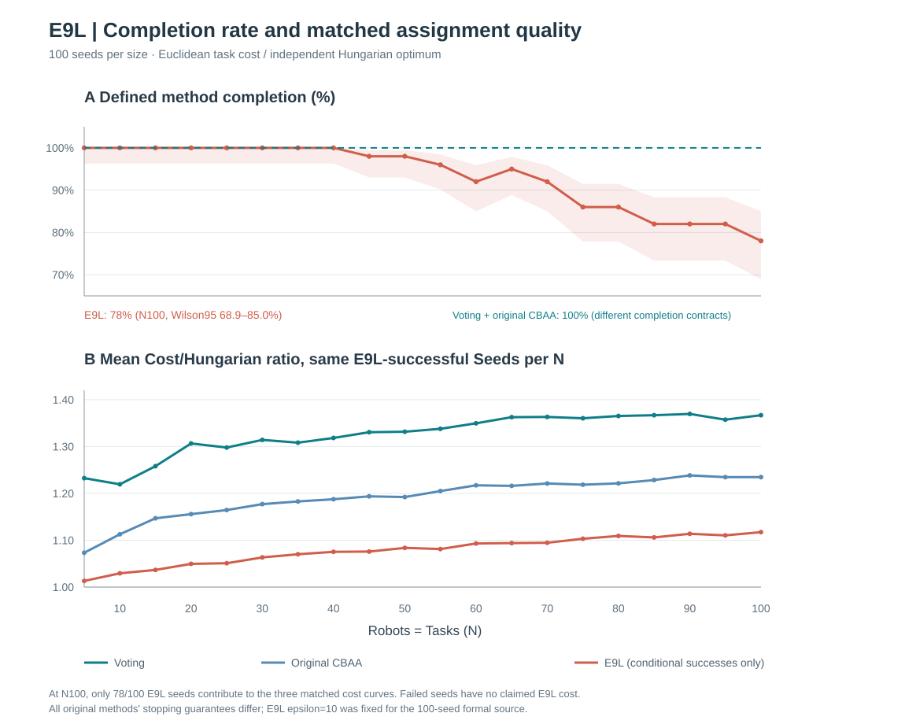

# Democracy-based Task Allocation in a Large-scale Multi-robot System

**Research focus:** Fully decentralized multi-robot task allocation under unreliable communication. We measure correctness, packet-loss resilience, attempted application-layer communication, and modeled coordination time. **Target venue:** IEEE Robotics and Automation Letters (RA-L).

**Last evidence audit: 2026-10-12.** This README contains only principal verified findings. The complete former README (27 images, all historical tables, exploratory results and run commands) is saved in [Detailed Experiment Results Archive](docs/EXPERIMENT_RESULTS_ARCHIVE_20261012.md). The [cross-experiment evidence audit](docs/EXPERIMENT_RESULTS_AUDIT_20261012.md) separates verified, provisional and pilot studies.

## 1. Method and comparison boundaries

| Study family | Methods / evaluation question | Essential condition |
|---|---|---|
| **E0–E2: controlled Hungarian** | All local proposals use the same Hungarian optimizer; test whether communication and quorum preserve the reference assignment | E0 zero-loss correctness; E1 trace-sampled delays; E2 one-round lossy votes (provisional) |
| **E9E: original Greedy Voting vs native CBAA** | Actual attempted sender Bytes, full task Commit, local consensus certification and observer agreement versus packet loss | **100 robots / 50 tasks**, independent per-receiver loss, fixed synthetic timing |
| **E9I and E9J: adaptive-plurality Voting vs native CBAA** | Same robot/task seeds; compare deadline, original SEND payload, modeled elapsed time and Hungarian-relative cost | **N robots = N tasks**, N=5,10,...,100; 100 seeds/N; original Cost/Vote **30%** loss, native CBAA Bid/Winner **30%** loss |

Voting's **full, reliable final Commit** and CBAA's **local consensus certificate + posthoc external observer agreement** are **different completion guarantees**. The current CBAA model uses a simulator-wide *free* stop check rather than paying a real distributed stop/Commit protocol. It must not be presented as an identical endpoint.

## 2. Principal verified findings

### A. Correctness and decentralized agreement overhead — E0 / E1

**E0:** The original 500 zero-loss Hungarian-controlled scenarios yielded **500/500 complete assignments**, zero optimality gap, zero oracle mismatch and zero recorded voting/safety failures. [500-row original source](results/e0_protocol_correctness/raw/e0_corrected_20261009T141508Z.csv) · [summary](results/e0_protocol_correctness/summary.csv).

**E1:** Re-aggregation of the repository's **2,000 original records** reproduces 20 official source groups. At **100 robots / 50 tasks**, Democracy–Hungarian required **477.7 ms** to reach an actionable decision, **796.2 ms** for global agreement and **201,400 sender Bytes**. Leader–Hungarian global agreement was **477.4 ms** with **41,600 Bytes**. This demonstrates the additional cost of distributed agreement, **not** a universal speed advantage. Delays are resampled from measured industrial ROS application traces, not measured on 100 robots. [Original rows](results/e1_latency/raw/e1_20261009T144026Z.csv) · [summary](results/e1_latency/summary.csv).

### B. Packet-loss robustness and transmitted data — E9E

**Formal study:** 52 loss probabilities × 100 seeds × two original methods = **10,400 original executions**, using **100 robots / 50 tasks** and synthetic transmission-time assumptions.

| Loss | Voting complete Commit | CBAA local certificate | Key observation |
|---|---:|---:|---|
| **30%** | 100/100 | 100/100 | Voting sent **164,750 B** vs CBAA **838,160 B** per seed on average: **80.34% fewer application sender Bytes** |
| **55%** | 0/100 | 100/100 | Voting no longer completed all 50 tasks within its original safety guard |
| **96%** | 0/100 | 0/100 | CBAA's external observer still saw 100/100 agreeing assignments, but robots lacked enough received evidence to certify global termination |

**Interpretation:** Voting strongly reduces sender traffic while **both methods complete** under the sampled 30% condition, but CBAA maintains locally certifiable assignment at much higher loss rates. Observer agreement is not the same as local knowledge or final Commit. The discrete 55% and 96% outcomes are **guard-dependent experimental results, not theoretical failure thresholds**. [104-row source summary](docs/figures/e9e_dense/formal/summary_by_loss.csv) · [SHA/source manifest](docs/figures/e9e_dense/formal/publication_manifest.json).

### C. Communication-time and deadline sensitivity — E9G / E9I

**E9G, supporting control:** In the simplified zero-loss N=100 study, the fixed-deadline Rady bootstrap took **68.143 s** versus **68.224 s** under the *assumed* 144 Mbps shared-medium proxy, an additional **81.722 ms** in that particular model. This highlights the dominating effect of the fixed **609.113 ms** task wait; it is **not** evidence of negligible real Wi-Fi contention. [20-point data](docs/figures/e9g_wifi/formal/scaling_20points_verified.csv) · [manifest](docs/figures/e9g_wifi/formal/publication_manifest.json).

**E9I formal:** Cost loss = **30%**, Vote loss = **30%**, 100 seeds per N. With **100 robots / 100 tasks**, changing from historical *fixed received-plurality deadline* to **one-time guarded Cost + adaptive Vote deadlines** reduced average simulated completion time from **71.918 s to 20.132 s**, or **72.01%**. Both selected arms fully committed at N100 in 100/100 seeds. There was **no comparable 72% saving in transmitted Bytes**; making the initial Cost deadline too short reduced local cost visibility and worsened the assignment oracle ratio.

The full original E9I experiment contains 16,000 arm/case records; **15,998 completed full Commit**. The two failures belonged to the legacy **fixed-quarter** control rather than the selected guarded-received variant. [20-point plot source](docs/figures/e9i_cost30/formal/formal_20point_plot_data.csv) · [original raw-source SHA/failed-case manifest](docs/figures/e9i_cost30/formal/formal_publication_manifest.json).

### D. Native CBAA vs frozen Voting baseline — E9J

**Formal study:** N=T=5..100 step 5; **100 seeds per N**. Original Cost/Vote receiver loss is 30% for Voting; native CBAA Bid/Winner loss is 30%. The original E9I Voting results are reused **without retraining/rerunning**. The source contains **2,000 native CBAA cases** plus **8,000 offline comparison rows** across the archived two Vote loss settings and two Voting controls.

| N = 100 robots and 100 tasks | Voting guarded adaptive | CBAA native, optimistic stop |
|---|---:|---:|
| Mean modeled allocation / stop time | **20.132 s** | **13.647 s** |
| Original attempted sender payload | **255.5 kB** | **2,693.0 kB** |
| Mean assignment Cost / independent Hungarian optimum | **1.362** | **1.235** |
| Own separately defined success | **100/100 real full Commit** | **100/100 local certificate + observer agreement**; no paid stop/Commit |

CBAA transmitted **10.54×** as many application Bytes but had **32.21% shorter modeled elapsed time** relative to guarded Voting at N100 (paired-bootstrap 95% CI **30.34%–34.06%**). The crossover around N55–60 is statistically inconclusive at 95%, while the paired mean time difference from N65 excludes zero in this model. CBAA also showed better observer-evaluated assignment cost. **Voting is not universally faster or higher-quality.**

The original [E9J optimistic baseline time/Bytes chart](docs/figures/e9j_cbaa/formal/primary_time_and_sender_bytes.svg) is preserved; the following three-algorithm figure below includes these unchanged original results.

For the original 2-method result, see the [E9J independent cost-quality figure](docs/figures/e9j_cbaa/formal/primary_cost_quality.svg). The updated E9L three-algorithm conditional quality figure appears below.

**Fairness limit:** CBAA's simulated all-robots-certified stopping condition is free; a physically distributed stop/Commit would introduce additional traffic and delay. Its original Bid/Winner packet contents differ from Voting Cost/Vote/Score. This is an **algorithm-native modeled trade-off**, not an equal on-wire-budget or physically equivalent-finalization result. [20-point plot source](docs/figures/e9j_cbaa/formal/plot_source_20point_rounded.csv) · [E9J provenance](docs/figures/e9j_cbaa/formal/source_manifest.json).

### E. Distributed price auction — E9L (formal 100 Seeds)

**Actual new user-run source verified:** Same N=T=5..100 (step5), 100 Seeds per N, 30% independent BID/AWARD drops, epsilon10.0 physical cost units, original 28B BID/AWARD packets and reliable paid TASK announcement. Original E9I Voting and E9J native CBAA are the two official frozen algorithm baselines; neither was rerun. The historical E9L input also retained E9K's technical-protocol record, which is excluded from all algorithm rankings. E9L is a networked **Bertsekas-style price auction variant**, **not original CBBA**, and its end condition is still optimistic all-local AWARD certification plus observer.

The [original E9L three-method modeled time/Bytes figure](docs/figures/e9l_price/formal/primary_three_algorithm_time_and_sender_bytes.svg) remains preserved. The new **five-method capacity-one** primary comparison appears in Section G below.

E9L locally completed **1,867/2,000** cases; **133** reached the 160-round guard. The observer found a full assignment in 1,880 cases, including 13 not locally certifiable — therefore observer agreement and local distributed evidence are **not interchangeable**.

| N=100, all 100 Seeds unless marked | Voting | Original CBAA | **Price Auction E9L** |
|---|---:|---:|---:|
| Completion under each method's own rule | 100/100 | 100/100 | **78/100** |
| Mean modeled stop time (all Seeds) | 20.132 s | 13.647 s | **135.828 s** (guard-censored) |
| Mean time of successful cases only | 20.132 s | 13.647 s | **122.329 s** (78 Seeds) |
| Mean attempted sender payload (all Seeds) | 255.5 kB | 2,693.0 kB | **353.9 kB** |

E9L's finished-assignment Cost/Hungarian ratio is **1.1173** versus Voting **1.3668** and CBAA **1.2348** **on exactly the same 78 E9L-successful N100 Seeds**, not all 100. In that matched subset E9L−Voting successful time was **+102.13s** (paired Bootstrap CI95 **+93.83 to +110.48s**) and E9L−CBAA Cost ratio was **−0.11743** (paired CI95 **−0.13170 to −0.10409**). This shows a **conditional quality advantage but poor latency and declining success** at high N; it does not show a universally better allocator. E9L sends **38.5% more application Bytes than Voting**, despite 28B small packets.

**Major caveat:** E9L and original CBAA use free simulator aggregation of local evidence; Voting pays a reliable Commit. Their stopping guarantees differ. Rady+hypothetical 144Mbps is **not** physical Wi-Fi ns-3. ε=10 was a fixed design-stage setting and cannot be retrospectively tuned to improve these archived formal results. [Detailed formal audit](docs/E9L_FORMAL_100SEED.md) · [derived 20-point CSV](docs/figures/e9l_price/formal/plot_source_20point_rounded.csv) · [original source SHA manifest](docs/figures/e9l_price/formal/source_manifest.json). Original E9J figures and all immutable source ZIP records remain unchanged; E9K's internal protocol-extension data remain in the technical archive, not the algorithm comparison.

### F. E9M — separately verified capacity-four multi-task experiment

The [corrected E9M original-ZIP audit](docs/E9M_CORRECTED_ORIGINAL_ZIP_AUDIT_100SEED.md) confirms 25 Robots, 100 Tasks, capacity4, 100 paired Seeds and 30% Loss. Voting Multi-task modeled time63.023s, 116.83 kB versus original CBBA 6.878s, 1,006.87 kB, both 100/100. **E9M capacity4 is not mixed with E9N capacity1** in the new figure. Source ZIP remains in the user Library with cryptographic identity.

### G. E9N — original five-method capacity-one comparison, complete source audit

**Formal original user ZIP received and independently verified:** N=T=5..100 in steps of5, C1, 30% loss, 100 Seeds per N. Two **newly executed** algorithms (Voting Multi-task/CBBA: 4,000 original per-seed cases) are plotted alongside three frozen previously audited E9I/J/L series (6,000 historical cases). The five series share capacity-one original scene geometry, but method-specific traffic, termination and source commits differ.

| 100 Robots/Tasks, C1, 30% Loss | Voting E9I | CBAA E9J | Price Auction E9L | Voting Multi-task E9N | CBBA E9N |
|---|---:|---:|---:|---:|---:|
| Mean modeled stop seconds | 20.132 | 13.647 | 135.828 | 101.919 | **12.368** |
| Sender application kB | 255.50 | 2,693.04 | 353.94 | 305.39 | 6,488.06 |
| Completion available in frozen plotted CSV / new raw | n/a | n/a | 78/100 | **100/100** | **100/100** |

For the **two newly executed E9N methods only**, CBBA has **8.24× shorter modeled observer-stop time** but requires **21.24× sender Bytes** relative to Voting Multi-task C1; CBBA has shorter total travel, whereas Voting has shorter mean maximum route/makespan. These modeled native endpoints are **not identical distributed finalization guarantees**. E9I/J per-N success counts are deliberately not fabricated from the frozen aggregate figure; E9L has guard-censored cases. The network uses Rady delay traces plus assumed 144 Mbps, **not physical Wi-Fi**. Paid CBAA E9K remains excluded.

[Original E9N 4,000-row source audit, SHA and N100 route analysis](docs/E9N_FORMAL_100SEED.md) · [original five-method source CSV](docs/figures/e9n/formal/original_five_method_common_cap1_source.csv) · [machine-readable audit](docs/figures/e9n/formal/verified_original_zip_audit_100seed.json).

## 3. Other studies: status only

| Study | Status | Evidence / explanation |
|---|---|---|
| **E2** | **Provisional:** original Hungarian Cost/Vote one-round aggregate has not passed full per-vote forensic acceptance | [E2 notes](results/e2_packet_loss/README.md) |
| **E9C** | Sender packet-size/SEND accounting **control**, not a certified dynamic-stop comparison | [Historical results](docs/EXPERIMENT_RESULTS_ARCHIVE_20261012.md) |
| **E9N** | **Original 4,000-row capacity-one ZIP verified:** 20 sizes, 100 Seeds, two new methods 100% complete; figure adds frozen E9I/J/L source without rerun | [Original ZIP audit](docs/E9N_FORMAL_100SEED.md) |
| **E9M** | **Original corrected 100-seed source ZIP verified:** two methods complete 100/100; original SHA, path and packet ledgers audited; observer vs paid-Commit end conditions differ | [Original ZIP source audit](docs/E9M_CORRECTED_ORIGINAL_ZIP_AUDIT_100SEED.md) |
| **E9L** | **Formal user-run 100-seed source verified:** 1,867/2,000 full local certificates; 133 guard-censored; original source SHA auditable. | [Results report](docs/E9L_FORMAL_100SEED.md) |
| **E9H** | Implemented deadline hypothesis and pilot, but its **full original factorial 100-seed study is not published**; E9I is a separate completed Cost30 follow-up | [Canonical design](docs/EXPERIMENT_PROTOCOL.md) |
| **E9F, E3–E7, older pilots** | Historical/incomplete for present core claims; preserve rather than merge into E9E/E9J | [Full history](docs/EXPERIMENT_RESULTS_ARCHIVE_20261012.md) |

## 4. Data provenance and scientific limits

The four main figures above preserve verified historical evidence and use a publication-layout-only E9N SVG derived from the original user source; no original numeric plot data are overwritten. **All former figures, source tables, old pilot notes and run commands remain accessible in the archive and experiment-specific directories**; no original experiment is deleted.

The loss model uses independent Bernoulli drops **per receiver** and pays each original broadcast sender payload once, whether received or dropped. This is **application-layer attempted transmission**, not measured Wi-Fi MAC/PHY, actual ACK/retry cost or radio energy. Only sampled Rady ROS application delay is an empirical timing input. The 144 Mbps shared-radio/backoff service is hypothetical; **no verified ns-3 or 100-robot RF test** is claimed.

**Do not combine E9E's 80.34% saving (100R/50T, synthetic timing) and E9J's 10.54× payload ratio (100R/100T, modeled shared channel) as results from identical conditions.** Future publication-grade timing fairness requires separately modeling native **paid distributed CBAA termination and Commit**, then validating with packet-level Wi-Fi/MAC and physical traces.

**Project references:** [Complete detailed experiment history](docs/EXPERIMENT_RESULTS_ARCHIVE_20261012.md) · [Independent evidence audit and source identities](docs/EXPERIMENT_RESULTS_AUDIT_20261012.md) · [Canonical experiment specification](docs/EXPERIMENT_PROTOCOL.md) · [Change continuity](docs/CHANGE_CONTINUITY.md) · [Bibliography](docs/references/e9g_wifi_timing.bib).

**Original evidence:** the E0/E1 per-seed CSVs and E9E published 104-row summary are available here. The full E9E/E9G/E9I/E9J source archives are referenced by immutable SHA256 manifests; in studies where complete per-seed raw records remain in prior user ZIPs, GitHub's 20-point plotting CSV is **derived display evidence, not a substitute for the source raw**.
