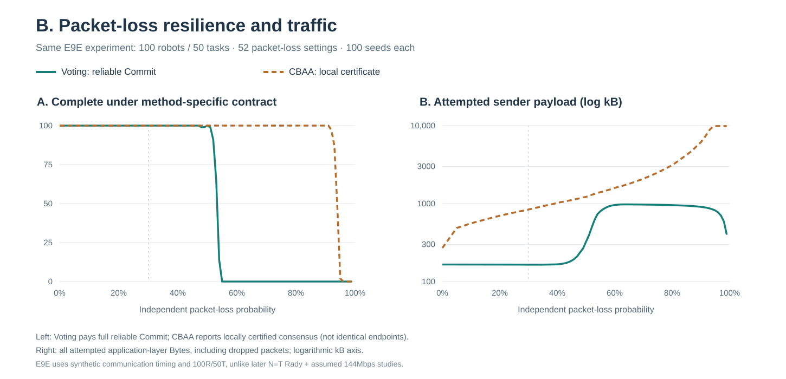
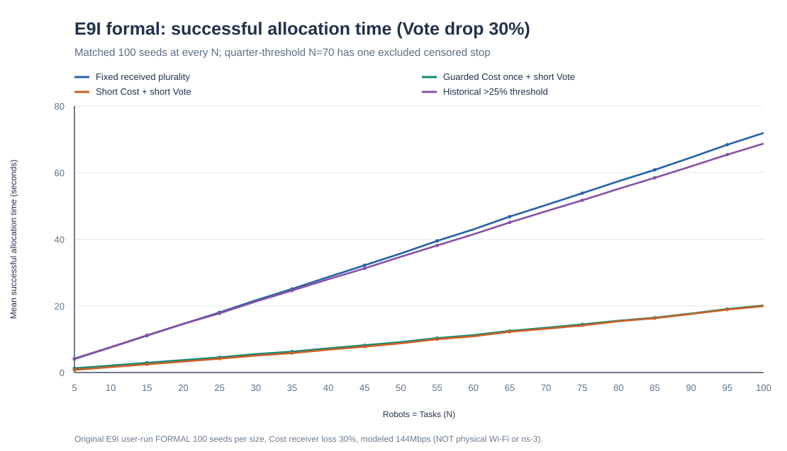
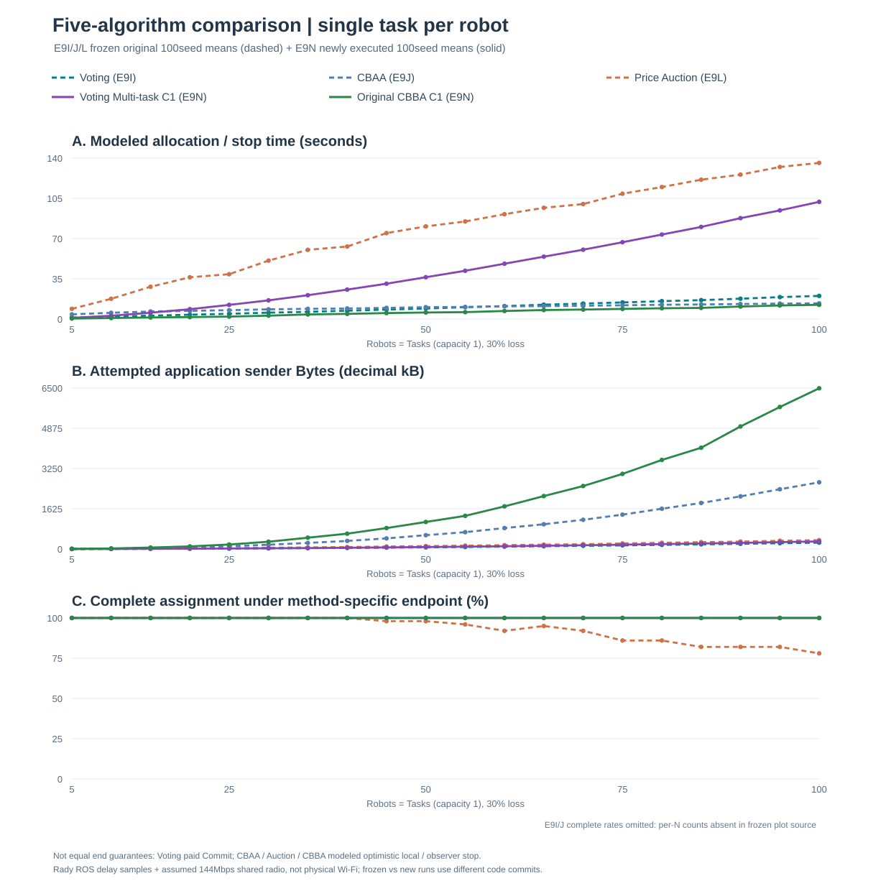

# Democracy-based Task Allocation in a Large-scale Multi-robot System

**Research focus:** fully decentralized multi-robot task allocation under unreliable communication. The experiments test assignment correctness, robustness to packet loss, communication delay, and the cost of distributed agreement. **Target venue:** IEEE Robotics and Automation Letters (RA-L).

> **Read the conditions before comparing numbers.** "Time" means simulated protocol allocation/stop time, not Python runtime or measured robot communication time. Sender Bytes are attempted **application-layer** payload, including dropped packets. The Rady timing traces are measured application delays; the later 144 Mbps shared-medium model is an **assumption**, not validated Wi-Fi MAC/PHY or ns-3.

## Research and experiment map

The README follows four **research questions**, not the historical E0-E9 implementation order.

| Group | Research question | Main experiments | What can be combined? |
|---|---|---|---|
| **[A. Correctness](#a-correctness-and-agreement)** | Can distributed decisions reproduce the reference assignment? | E0, E1; E2 provisional | Same-optimizer controls only; E0 and E1 have different experimental conditions |
| **[B. Packet loss](#b-packet-loss-robustness-and-communication-volume)** | How do full completion, local consensus and sender traffic change with loss? | E9D/E9E | **One E9E two-panel figure** for completion and Bytes on the same 100R/50T seeds |
| **[C. Time and deadlines](#c-communication-time-and-deadline-design)** | What does deadline choice change, and what does the radio proxy add? | E9G, E9I | E9I deadline variants share one figure; E9G is a separate zero-loss timing control |
| **[D. Algorithms](#d-algorithm-comparison-and-multi-task-extension)** | How do native allocation methods scale, and what changes with task capacity? | E9J, E9L, E9N; E9M | **Five methods in one capacity-one figure**; E9M capacity-four is a separate comparison |

### Protocol and code architecture

```text
Reliable task announcement
  -> Local robot-to-task cost or marginal route utility
  -> Method-owned coordination (no permanent central allocator)
     - Voting: Cost -> candidate-targeted Vote -> Score -> paid Commit
     - CBAA: local bid -> native max-consensus / local certificate
     - Price Auction: price -> bid -> task-home award
     - CBBA: ordered bundle/path -> winner/bid/timestamp consensus
  -> Read-only audit: assignment coverage, duplicates, capacity, quality
  -> Physical message ledger: SENDs, sender Bytes, receipts, drops, modeled time
```

| Responsibility | Source of truth |
|---|---|
| Task announcements and voting coordination | [`task_information.py`](democracy_mrta/task_information.py), [`coordination.py`](democracy_mrta/coordination.py), [`voting_multitask.py`](democracy_mrta/voting_multitask.py) |
| Native alternative algorithms | [`cbaa.py`](democracy_mrta/cbaa.py), [`price_auction.py`](democracy_mrta/price_auction.py), [`cbba_multitask.py`](democracy_mrta/cbba_multitask.py) |
| Network model and native packet accounting | [`network.py`](democracy_mrta/network.py), [`multitask_wire.py`](democracy_mrta/multitask_wire.py) |
| Scenes, route scores and external audit | [`scenario.py`](democracy_mrta/scenario.py), [`multitask_scenario.py`](democracy_mrta/multitask_scenario.py), [`multitask_evaluation.py`](democracy_mrta/multitask_evaluation.py) |
| Reproducible seed runners and figures | [`experiments/`](experiments/), [`Canonical Experiment Protocol`](docs/EXPERIMENT_PROTOCOL.md) |

**Endpoint distinction:** Voting completes a reliable, physically charged Commit; CBAA/CBBA/Price Auction use their own local certificate and/or simulator-observed stop. These are **not identical termination guarantees**, even when the scene and packet-loss probability match. The external observer evaluates outcomes but must not repair an agent's assignment.

## A. Correctness and agreement

**Question:** if local decision optimization is held constant, can decentralized messages preserve correct assignment? This is a **Hungarian-controlled** research family, not a comparison with Greedy Voting or CBBA.

| Experiment | Setting | Verified result |
|---|---|---|
| **E0: zero-loss correctness** | Complete information; 5 robot/task scales, 100 Seeds each | **500/500** full assignments; 0% optimality gap, zero reference mismatches or recorded safety failures |
| **E1: agreement overhead** | Original 2,000 records, 20 source groups; 100R/50T representative cell | Democracy-Hungarian: **477.7 ms** actionable, **796.2 ms** global agreement, **201,400 B**. Leader-Hungarian: **477.4 ms** global agreement, **41,600 B** |
| **E2: lossy votes** | Historical one-round lossy-Hungarian experiment | **Provisional**; not promoted to a formally verified comparison |

**Interpretation:** correctness at zero loss does not imply low agreement overhead. E0 and E1 should not be merged into a single numerical speed comparison because they answer different questions.

Source: [E0 original CSV](results/e0_protocol_correctness/raw/e0_corrected_20261009T141508Z.csv) / [summary](results/e0_protocol_correctness/summary.csv); [E1 original CSV](results/e1_latency/raw/e1_20261009T144026Z.csv) / [summary](results/e1_latency/summary.csv); [E2 provisional record](results/e2_packet_loss/README.md).

## B. Packet-loss robustness and communication volume

**Question:** under the **same** 100-robot/50-task E9E experiment, how do sender traffic and full task completion change as receiver packet loss increases?

**E9E formal:** 52 loss probabilities, 100 Seeds per probability and method, **10,400 method executions**; independent per-receiver loss; fixed synthetic timing. Voting and original CBAA send their own native messages, so compare their **native** completion definitions separately.



| Receiver loss | Voting full Commit | CBAA local certificate | Consequence |
|---|---:|---:|---|
| **30%** | 100/100 | 100/100 | Voting **164,750 B**, CBAA **838,160 B** average attempted sender payload; Voting uses **80.34% fewer Bytes** |
| **55%** | 0/100 | 100/100 | Voting reached its configured guard before completing all tasks |
| **96%** | 0/100 | 0/100 | CBAA observer still saw agreement in 100/100, **without** local proof of completion |

**Interpretation:** fewer Bytes do not automatically mean greater loss resilience; guard-hit percentages are **empirical outcomes of the declared settings**, not theoretical packet-loss thresholds. The combined plot's right panel uses a logarithmic kB axis; no model time from E9I/E9N is mixed into E9E.

Sources: [104 original summary rows](docs/figures/e9e_dense/formal/summary_by_loss.csv) / [original publication manifest](docs/figures/e9e_dense/formal/publication_manifest.json) / [new two-panel figure identity](docs/figures/e9e_dense/formal/primary_loss_completion_and_bytes_manifest.json). [Historical precursor and other loss pilots](docs/EXPERIMENT_RESULTS_ARCHIVE_20261012.md).

## C. Communication time and deadline design

**Question:** how much time is spent waiting for cost/vote messages, and how much is added by a modeled shared radio?

### E9I: deadline policy, common N=T and Cost/Vote loss

20 sizes N=T=5..100, 100 Seeds each; Cost loss **30%**, Vote loss **30%**. The figure keeps only compatible E9I deadline variants on the same axes.



At **100 robots / 100 tasks**, the historical fixed-received-plurality policy averaged **71.918 s** versus **20.132 s** with guarded one-time Cost and adaptive Vote deadlines (**72.01% less modeled time**). Both selected arms completed all 100 tasks on 100/100 N100 Seeds. This was **not** a 72% reduction in sender Bytes; shorter Cost deadlines also reduced local information and could worsen assignment quality. Across the 16,000 original arm/case records, **15,998** completed; two failed in a legacy fixed-quarter control.

Source: [E9I original 20-point plotting CSV](docs/figures/e9i_cost30/formal/formal_20point_plot_data.csv) / [full source SHA and failure manifest](docs/figures/e9i_cost30/formal/formal_publication_manifest.json).

### E9G: separate shared-radio timing sensitivity control

At **N=100, zero packet loss**, the fixed-deadline Rady-sampled bootstrap modeled **68.143 s**; adding an *assumed* 144 Mbps shared radio yielded **68.224 s** (about **81.7 ms** extra). The task wait was fixed at **609.113 ms**, so this result does **not** demonstrate negligible actual wireless contention. E9G and E9I use different conditions; their seconds are deliberately **not combined in the same figure**.

Source: [E9G original 20-point timing data](docs/figures/e9g_wifi/formal/scaling_20points_verified.csv) / [manifest](docs/figures/e9g_wifi/formal/publication_manifest.json).

## D. Algorithm comparison and multi-task extension

**Question:** at a common assignment capacity, how do Voting, original CBAA, Price Auction and original CBBA trade modeled time, application Bytes and completion?

### D1. Capacity one: five methods on one figure (E9I/J/L/N)

**Common workload:** N=T=5,10,...,100; each robot may execute **at most one task**; 100 Seeds per N; 30% receiver loss on method-native packet types. The first three curves reuse **6,000 historical E9I/J/L method cases**; newly executed Voting Multi-task C1 and CBBA C1 contribute **4,000 E9N method cases**. This is not a fresh five-method rerun from one source commit, and success endpoints differ.



| N=T=100; capacity 1; 30% loss | Voting (E9I) | CBAA (E9J) | Price Auction (E9L) | Voting Multi-task C1 (E9N) | CBBA C1 (E9N) |
|---|---:|---:|---:|---:|---:|
| Mean modeled time | 20.132 s | 13.647 s | 135.828 s | 101.919 s | **12.368 s** |
| Sender application traffic | 255.50 kB | 2,693.04 kB | 353.94 kB | 305.39 kB | 6,488.06 kB |
| Complete outcomes **supported by this plot source** | n/a | n/a | 78/100 | **100/100** | **100/100** |

Here **n/a** means the frozen E9I/J plotting source does not contain per-N completion numerators; it is **not** a failure count. E9L's all-seed time includes its 22/100 N100 guard-censored trials. In the 4,000 **new** E9N cases, both methods complete all tasks at every N; at N100 CBBA models **8.24x shorter observer-stop time** but **21.24x more sender Bytes** than Voting Multi-task. That is a protocol-native trade-off, not equal paid termination or a measured Wi-Fi result.

**Assignment quality needs a controlled subset.** At N100, original Price Auction's Hungarian cost ratio **1.1173** versus Voting **1.3668** and CBAA **1.2348** is evaluated **only on the same 78 seeds on which Price Auction finished**. Do not combine these ratios with E9N's path-discounted reward. [Original three-method conditional-quality chart](docs/figures/e9l_price/formal/primary_three_algorithm_completion_and_quality.svg) / [E9J two-method quality chart](docs/figures/e9j_cbaa/formal/primary_cost_quality.svg).

Sources: [E9N fully audited 4,000-row ZIP report](docs/E9N_FORMAL_100SEED.md) / [100-row five-method original figure source](docs/figures/e9n/formal/original_five_method_common_cap1_source.csv) / [source-audit JSON](docs/figures/e9n/formal/verified_original_zip_audit_100seed.json) / [E9L formal audit](docs/E9L_FORMAL_100SEED.md) / [E9J source manifest](docs/figures/e9j_cbaa/formal/source_manifest.json).

### D2. Capacity four: genuine multi-task CBBA versus Voting (E9M)

**Different workload; intentionally NOT added to the capacity-one graph.** 25 robots, 100 tasks, maximum 4 tasks/robot, 30% loss, 100 paired Seeds. The corrected original raw ZIP was independently SHA-, route-, and message-ledger verified.

| E9M (25R / 100T / capacity 4) | Voting Multi-task | Original CBBA |
|---|---:|---:|
| Complete assignments | **100/100** | **100/100** |
| Mean modeled allocation/stop | 63.023 s | **6.878 s** |
| Attempted sender payload | **116.83 kB** | 1,006.87 kB |
| Mean total robot travel | 1,319.76 m | **1,209.48 m** |
| Mean longest robot route / makespan | **134.55 s** | 148.64 s |

CBBA reduces modeled observer-stop time and total route length, whereas Voting sends fewer application Bytes and has a shorter average maximum route. **Makespan is physical route duration (at 1 m/s), not coordination time.** The two capacity conditions must remain independent in scientific comparisons.

Source: [E9M independent original ZIP/route/packet audit](docs/E9M_CORRECTED_ORIGINAL_ZIP_AUDIT_100SEED.md) / [E9M experiment procedure](docs/E9M_CBBA_MULTITASK.md). The pre-fix E9M Vote-broadcast run is retained as superseded, not substituted for the corrected 100-seed data.

## Evidence, limitations and reproducibility

- **Data provenance:** original ZIPs, Git SHAs, failure/guard cases and source audits are retained; the E9M and E9N original binaries are also archived in the project Library. All older tables, figures and pilot experiments remain in the [historical results archive](docs/EXPERIMENT_RESULTS_ARCHIVE_20261012.md).
- **Native endpoint fairness:** Voting pays reliable Score/Commit; CBAA, CBBA and Price Auction rely on their own local certificates and/or optimistic observer stopping. Those times are not equal guarantees of distributed completion, and E9K Paid CBAA is a separate protocol extension, not a literature-original comparator.
- **No real RF measurement claim:** application-layer attempted Bytes and a Rady plus hypothetical 144 Mbps radio model are **not** actual Wi-Fi airtime, radio energy or a 100-robot deployment. E9E uses different synthetic timing.
- **Publication boundary:** figures group only source-compatible experimental cohorts. Capacity-one N=T curves are never pooled with E9M's 25R/100T/capacity-four results; path-discounted rewards are never interpreted as Hungarian ratios.

**Documents:** [Canonical Experiment Protocol](docs/EXPERIMENT_PROTOCOL.md) | [Experiment evidence audit](docs/EXPERIMENT_RESULTS_AUDIT_20261012.md) | [Change Continuity](docs/CHANGE_CONTINUITY.md) | [E9N source audit](docs/E9N_FORMAL_100SEED.md) | [E9M source audit](docs/E9M_CORRECTED_ORIGINAL_ZIP_AUDIT_100SEED.md) | [Bibliography](docs/references/e9g_wifi_timing.bib).

**Source and runners:** [`experiments/`](experiments/) | [E9N capacity-one run guide](docs/E9N_ONE_TASK_FIVE_METHOD.md) | [E9M multi-task run guide](docs/E9M_CBBA_MULTITASK.md). New experiments must keep their exact Git SHA, config, per-seed CSV, summary, original network SEND ledger and guard outcomes.
