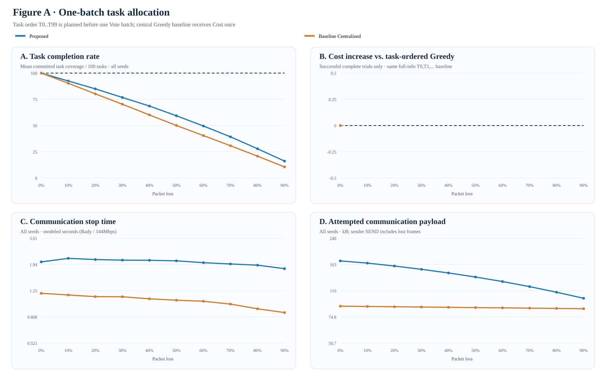
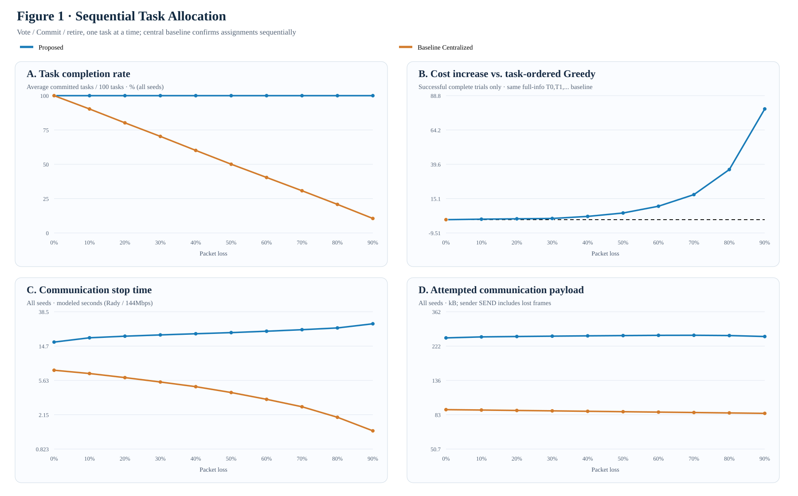
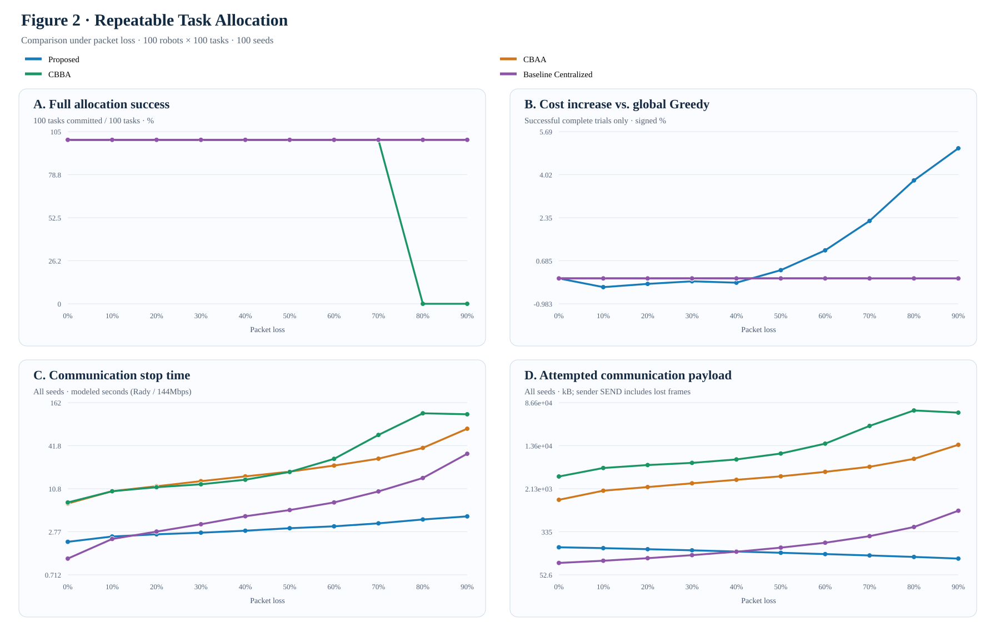
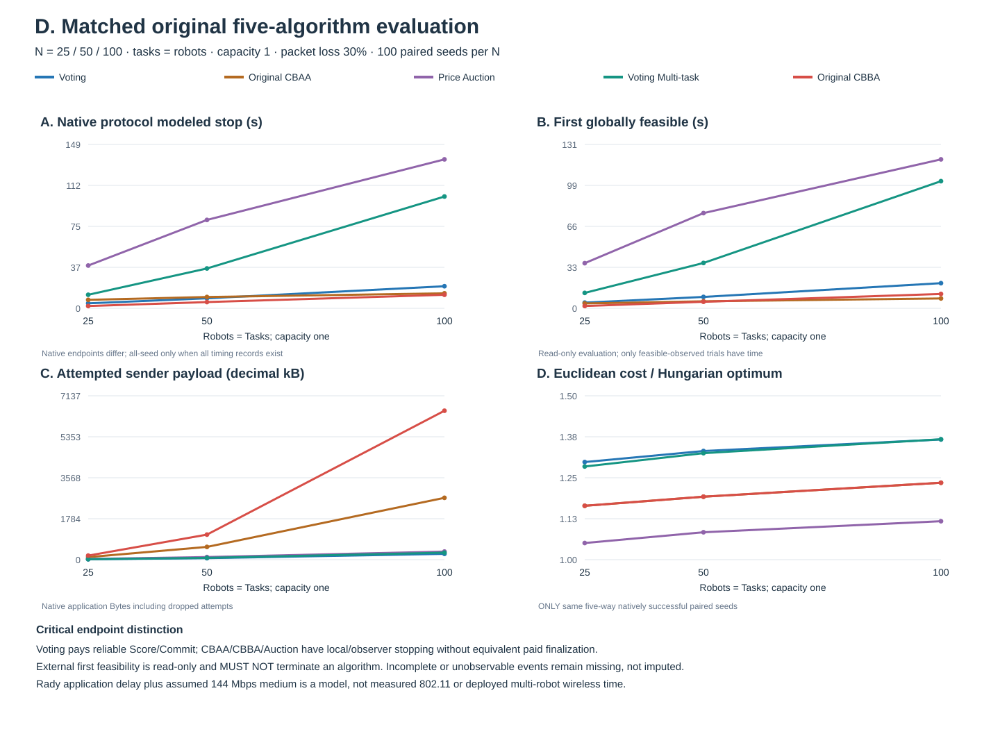

# Democracy-based Task Allocation in a Large-scale Multi-robot System

**Language:** **English** | [繁體中文](README.zh-TW.md)

**Research goal:** fully decentralized multi-robot task allocation under unreliable communication, with reproducible experiments on assignment correctness, packet loss, coordination time, and alternative algorithms. **Target venue:** IEEE Robotics and Automation Letters (RA-L).

> **Measurement boundary.** All reported communication times are **simulated protocol allocation/stop time**, not Python execution time or measurements from a 100-robot wireless deployment. Sender Bytes are attempted **application-layer** payload (including dropped packets). Rady provides real application-delay traces, but the shared **144 Mbps radio service is a hypothetical model**, not verified Wi-Fi MAC/PHY or ns-3. Voting pays reliable Commit; other algorithms use different native stopping conditions.

## Research map

There are **four experiment families**. Internal development IDs are kept out of this overview and documented separately in the [historical study index](docs/EXPERIMENT_LEGACY_INDEX.md).

| Family | Scientific question | Accepted evidence |
|---|---|---|
| **[A. Correctness](#a-correctness-and-distributed-agreement)** | Does decentralized assignment preserve a controlled optimal decision, and how costly is agreement? | Perfect-information and trace-bootstrap controlled Hungarian experiments |
| **[B. Packet loss](#b-packet-loss-resilience-and-communication-traffic)** | How does packet loss affect single-round versus iterative assignment success, Bytes, modeled stop time and assignment cost? | P2D/P2E two four-panel 100-seed comparisons, 0–90% loss |
| **[C. Time](#c-coordination-time-and-deadline-design)** | How much delay comes from waiting and deadlines versus the radio model? | 30% Loss adaptive-deadline experiment and separate zero-loss timing control |
| **[D. Algorithms](#d-algorithm-comparison-and-task-capacity)** | How do native Voting, CBAA, Price Auction and CBBA compare under common capacity? | Five-series single-task comparison; separate capacity-four multi-task study |

### Implementation ownership

| Concern | Owning module |
|---|---|
| Task announcement and voting | [Task announcements](democracy_mrta/task_information.py), [Voting coordination](democracy_mrta/coordination.py), [multi-task Voting](democracy_mrta/voting_multitask.py) |
| Alternative allocators | [Original CBAA](democracy_mrta/cbaa.py) and [original CBBA](democracy_mrta/cbba_multitask.py) (current branch); [Price Auction (historical source branch)](https://github.com/andyfu35/Democracy-based-Task-Allocation-in-a-Large-scale-Multi-robot-System/blob/experiment/e9l-distributed-price-auction/democracy_mrta/price_auction.py) |
| Transport, loss, modeled time | [Network](democracy_mrta/network.py), [native multi-task packets](democracy_mrta/multitask_wire.py) |
| Scene / route / independent assessment | [Single-task scenes](democracy_mrta/scenario.py), [capacity-aware scenes](democracy_mrta/multitask_scenario.py), [route audit](democracy_mrta/multitask_evaluation.py) |
| Reproduction | [Experiment runners](experiments/), [canonical protocol](docs/EXPERIMENT_PROTOCOL.md), [change continuity](docs/CHANGE_CONTINUITY.md) |

**Architecture:** task announcement → each robot's local Cost / route utility → method-owned voting, bidding, auction or bundle consensus → externally audited assignment and physical message ledger. The observer **does not** inject a global solution or constitute a paid distributed termination protocol.

## Communication model (equations, symbols, parameters)

The communication model consists of **(1) sampled measured ROS control-message latency, (2) an optional causal, single-shared-radio PHY/MAC *proxy*, (3) receiver-side packet loss and timeliness, and (4) attempted application-layer SEND bytes**. This is the implemented model, not an equation asserted verbatim by any one paper. The code owners are [network.py](democracy_mrta/network.py) (**load_rady_latency_profile**, **EmpiricalLatencySampler.sample_ms**, **BernoulliLossSampler.is_delivered**, **WifiCausalTimingSampler.sample_packet_ms**, **summarize_network**) and the original protocol message senders in [coordination.py](democracy_mrta/coordination.py). Some legacy studies sample Rady latency *without* the shared-radio proxy; the packet equations below describe the **opt-in shared-medium model** used for the newer radio-proxy experiments.

### 1. Measured latency data and model inputs

The pinned [Rady et al. (2024) industrial robotics dataset](https://github.com/minarady1/wifi_for_industrial_robotics/tree/1996e5bb69b9ba4d25060cbc14838ddedf65cff2) supplies the **ROS application-level control delay**, not a packet-level trace from 100 simulated robots. The default profile selects location **2 (approximately 60 m line of sight)**, configuration **ax_160mhz_6ghz (Wi-Fi 6E / 6 GHz / 160 MHz)**, and **120–181 seconds** of the published control-time series; the pinned valid profile has **121 delay samples**. Only finite nonnegative delay values in that inclusive time window enter the sample set. For each SEND key and experiment seed, a SHA-256-based index deterministically selects one of these samples, denoted $D_i^{\mathrm{Rady}}$ (ms). This is **per-packet resampling, not replay of temporal or spatial correlations**.

The Rady-only legacy backend uses the sampled delay directly, whereas the opt-in shared-radio backend uses its *nonoverlapping residual* as defined below. The simulated robot-to-robot links are **not** individually calibrated by the robots' geometric separation.

### 2. Causal packet transmission and latency

For an attempted application-layer SEND $i$, let $L_i$ be its payload in **bytes** and $R$ be an assumed PHY rate in **Mbps**. With a hypothetical additional per-hop MAC overhead $H$, the **one-hop airtime** is:

$$
T_{\mathrm{air},i}
=\frac{t_{\mathrm{pre}}}{1000}
+\frac{8(L_i+H)}{1000R}
\qquad[\mathrm{ms}].
$$

Every modeled radio hop incurs an AIFS wait and a seeded contention backoff. The total backoff and **radio service time** of one SEND are:

$$
T_{\mathrm{bo},i}
=\sum_{\ell=0}^{h_i-1}
\frac{t_{\mathrm{AIFS}}+k_{i\ell}t_{\mathrm{slot}}}{1000},
\qquad
k_{i\ell}\in\{0,\ldots,CW_{\min}\},
$$

$$
S_i=h_iT_{\mathrm{air},i}
+T_{\mathrm{bo},i}
+a_i\frac{t_{\mathrm{ACK}}}{1000}.
$$

Here $h_i$ is the number of modeled wireless hops, $a_i$ is the number of ACK-charged hops, and $k_{i\ell}$ is a deterministic seeded pseudo-random integer derived from the packet key and hop. It is **not** a collision-driven exponential retry simulation. An infrastructure AP and **one serialized shared radio resource** are assumed:

| Application SEND type | $h_i$ | $a_i$ | Assumed radio path |
|---|---:|---:|---|
| TASK announcement | 1 | 0 | AP downlink broadcast |
| Inter-robot broadcast (e.g. Cost / Vote / Score / Commit when broadcast) | 2 | 1 | Robot uplink to AP (ACK), then AP downlink broadcast (no receiver-by-receiver ACK) |
| Inter-robot unicast (e.g. Cost sent to the centralized coordinator) | 2 | 2 | Robot → AP → recipient; ACK charged on both hops |

Let $e_i$ be the beginning of the current decision epoch, $s_i$ the packet's within-epoch SEND time, and $r_i=e_i+s_i$ its **absolute release time**. If $f_{i-1}$ is when the previous SEND freed the one shared medium (initially $f_0=0$), then:

$$
Q_i=\max(0,f_{i-1}-r_i),
\qquad
f_i=\max(r_i,f_{i-1})+S_i.
$$

The measured ROS control delay already contains some physical communication service. To avoid simply **double-counting** it, the model subtracts an *assumed* mean service time of a reference 16-byte single-hop ACKed packet:

$$
T_{\mathrm{ref}}
=\frac{t_{\mathrm{pre}}}{1000}
+\frac{8(L_{\mathrm{ref}}+H)}{1000R}
+\frac{t_{\mathrm{AIFS}}+\tfrac12 CW_{\min}t_{\mathrm{slot}}+t_{\mathrm{ACK}}}{1000}.
$$

The added empirical residual is $\varepsilon_i=\max(0,D_i^{\mathrm{Rady}}-T_{\mathrm{ref}})$, giving the packet's **modeled arrival time** and **communication latency**:

$$
t_i^{\mathrm{arrival}}=f_i+\varepsilon_i,
\qquad
T_i^{\mathrm{comm}}=t_i^{\mathrm{arrival}}-r_i
=Q_i+S_i+\varepsilon_i.
$$

Combining the terms, the **full implemented opt-in communication equation** is:

$$
\boxed{
T_i^{\mathrm{comm}}=
Q_i+
h_i\left(\frac{t_{\mathrm{pre}}}{1000}
+\frac{8(L_i+H)}{1000R}\right)
+\sum_{\ell=0}^{h_i-1}
\frac{t_{\mathrm{AIFS}}+k_{i\ell}t_{\mathrm{slot}}}{1000}
+a_i\frac{t_{\mathrm{ACK}}}{1000}
+\max(0,D_i^{\mathrm{Rady}}-T_{\mathrm{ref}})
}
$$

All terms in this final equation are **milliseconds**. Importantly, the medium becomes free at $f_i$, *before* the Rady residual necessarily finishes. Subsequent radio transmissions can overlap earlier packets' residual delays. **Protocol stop / allocation time is determined by actual modeled event/Commit/deadline chronology; it is NOT the sum of every packet's $T_i^{\mathrm{comm}}$.**

### 3. Symbol glossary

| Symbol | Exact definition | Unit / interpretation |
|---|---|---|
| $i$ | Application-layer SEND event, in nondecreasing release-time order | Packet index |
| $j$ | A potential receiver of SEND $i$ | Receiver index |
| $\ell$ | Radio hop index within SEND $i$ | $0,\ldots,h_i-1$ |
| $L_i$ | Size of SEND $i
**Scientific question:** holding the **Hungarian optimizer fixed**, does decentralized coordination preserve a correct assignment?

| Completed experiment | Formal condition | Verified finding |
|---|---|---|
| Perfect-information correctness | 5 robot/task scales × 100 Seeds, zero loss | **500/500 complete**, zero optimality gap and reference mismatches |
| Trace-sampled agreement overhead | 2,000 original records, 20 cells | At 100 robots/50 tasks, Democracy-Hungarian takes **796.2 ms** for global agreement and **201,400 B**; Leader-Hungarian **477.4 ms** and **41,600 B** |

The study establishes correctness when information is complete, but decentralized agreement adds communication. Its Hungarian-controlled results **must not be pooled** with Greedy Voting versus CBAA or CBBA optimization-quality claims.

**Original evidence:** [correctness raw](results/e0_protocol_correctness/raw/e0_corrected_20261009T141508Z.csv) / [summary](results/e0_protocol_correctness/summary.csv); [agreement raw](results/e1_latency/raw/e1_20261009T144026Z.csv) / [summary](results/e1_latency/summary.csv).

The earlier one-round lossy Hungarian Vote pilot did not receive full per-vote acceptance. It is **archived, not an outstanding requirement** for these two completed claims. [Historical study index](docs/EXPERIMENT_LEGACY_INDEX.md).

### Archived one-batch Voting comparison (non-sequential)

**Protocol distinction:** This is the audited **P2G one-batch**, not P2H sequential Voting. Each robot first greedily plans the task order T0–T99 using its locally received Cost, then broadcasts **one batch Vote** containing its entire proposed allocation. The original Score/Commit resolution processes that batch; **there is no per-task Vote–Commit–retire–replan cycle**. The Centralized baseline receives remote Cost once and makes a corresponding one-batch task-ordered assignment. Both methods use the same 100 robots, 100 tasks, capacity one, 100 paired seeds per loss level, and full-information **task-ordered Greedy** cost reference as P2H Figure 1. Different native packet timing and assignment/Commit patterns remain method-specific.

Panel A shows **average committed task coverage across all seeds**, reconstructed from the independently audited P2G summary rather than binary all-task success. At 90% loss, one-batch Proposed covers **16.12%** versus **10.54%** for this Centralized baseline; neither has any 100/100 complete seeds. By contrast, the newer sequential P2H Figure 1 in Section B has **100%** committed coverage for Proposed at the same loss, but with far greater communications and a distinct execution protocol. This is a **descriptive cross-experiment comparison**, not an isolated causal estimate of sequential voting: both the Vote schedule and communication/Commit timing differ. For incomplete seeds the full-success-only cost is undefined, not zero; failed runs' shorter modeled stop is not faster successful completion. Sender application Bytes count attempted packets including receiver losses. [Original P2G audit](docs/P2G_TWO_FIGURES.md) · [20 audited figure cells](docs/figures/p2g/formal/verified_figureA_20point_summary.csv).

## B. Packet-loss resilience and communication traffic

**Accepted main experiment direction (2026-10-20):** Figure 1 uses TRUE sequential one-task-at-a-time Voting versus a specific task-ordered Centralized Greedy baseline, each with one initial Cost exchange and no Cost retransmissions. Figure 2 preserves the independent repeatable coordination comparison: Proposed, CBAA, CBBA, Baseline Centralized. All plotted studies use 100 robots, 100 tasks, capacity 1, packet loss 0%–90% at 10% steps and 100 paired seeds per point. **The two figures have distinct greedy reference costs and native termination contracts; their cost percentages cannot be compared as if they used the same denominator.**

### Figure 1 — Sequential task allocation

Each task T0 through T99 is voted on once, followed by native Score/Commit and robot retirement before the next task. The centralized reference issues and pays for its own sequential Assignment/Commit events, using only its one-time received Cost rows. The figure's panel A reports **mean committed task coverage**, not all-or-nothing complete success. At 90% loss, Proposed achieves 100% committed task coverage and 100/100 complete allocations, whereas this **specific no-Cost-retry centralized baseline** achieves 10.54% mean coverage and 0/100 complete. Proposed at PL90 uses 254.23 kB and stops at 27.50 modeled seconds; Centralized uses 84.58 kB and stops at 1.37 s *after incomplete allocation*, which is not a faster successful completion. Proposed's mean full-success cost increase is +79.26% against the **full-information task-ID-ordered Greedy**, not global-minimum-pair Greedy.

At zero loss both methods complete 100/100, with exactly 0% task-order Greedy cost increase. Proposed takes 16.47 s and 249.25 kB versus Centralized 7.48 s and 89.23 kB. P2H contains **2,000 formal cases / 20 cells**, independently checked with **266,856 validations, 0 failures**. The source-bound audit notes that Proposed's 100% completion depends strongly on local self-votes, a one-vote received-plurality threshold and reliable Score/Commit; it is not an RF-wide resilience guarantee.

[Independent P2H formal audit](docs/P2H_FORMAL_100SEED_AUDIT.md) · [Verified 20-point data](docs/figures/p2h/formal/verified_20point_summary.csv) · [Canonical P2H protocol](docs/P2H_INTERACTIVE_FIGURE1.md).

### Figure 2 — Repeatable task allocation

This remains the prior accepted P2G Figure 2. **Proposed, CBAA, CBBA, Baseline Centralized** are exactly the displayed method names. The Centralized reference here retries missing Cost acquisition (unlike Figure 1), and represents one particular centralized baseline, not every centralized design. At 90% loss, Proposed has 100/100 complete, +5.04% cost increase against **full-info global minimum-pair Greedy**, 4.49 s and 105.67 kB; the Centralized retry reference has 100/100 complete, 0% cost increase against that same global Greedy, 32.40 s and 828.93 kB. Native CBAA is 100/100 complete, 71.38 s and 14,135.60 kB; CBBA reaches its native guard without full completion (0/100), with 71.90% conflict-free *observer* coverage at 90% loss. Observed CBAA/CBBA termination is not equivalent to paid Proposed Commit.

**Measurement boundaries:** Both figures report attempted sender **application** Bytes, including dropped SENDs; elapsed times are modeled using measured Rady ROS delay samples plus a hypothetical shared 144 Mbps medium, **not real 100-robot Wi-Fi MAC/PHY measurements**. Cost is only defined for fully completed native assignments, never filled with zero for failures. The finalized P2H study replaces the older one-batch Figure 1 as the primary paper illustration; past P2D/P2E/P2G plots remain in the repository as historical and source-auditable evidence, not parallel primary claims.

## C. Coordination time and deadline design

**Historical-protocol figure:** the E9G/E9I deadline experiments here used earlier sequential-task Voting (or their stated original control), **not** the new P2-B batched Greedy Voting. Their source curves and data are preserved and must not be interpreted as the current batch-protocol latency across robot sizes. Updating these plots would require **new Voting-only runs at the original E9I sizes and seeds**, not rerunning unchanged native baselines.

**Scientific question:** does the communication delay come mostly from waiting for late Cost / Vote packets or from modeled shared-medium packet service?

### Adaptive deadlines under 30% packet loss

**Formal setting:** robots=tasks, 5–100 in steps of 5, 100 Seeds per size; both Cost and Vote drop probabilities are **30%**. Original baseline and revised deadline policy use matched settings.

At **100 robots/100 tasks**, the old fixed received-plurality deadline averaged **71.918 s** versus **20.132 s** with guarded one-time Cost and adaptive Vote deadlines (**72.01% lower modeled time**). Both compared arms completed 100/100 Seeds at that size; this **does not** imply 72% less sender payload or better optimality. [20-point original source](docs/figures/e9i_cost30/formal/formal_20point_plot_data.csv) · [source manifest](docs/figures/e9i_cost30/formal/formal_publication_manifest.json).

### Radio-model sensitivity — separate control

With 100 robots, zero application-layer loss, and a **fixed 609.113 ms task wait**, the Rady-delay-only model yielded **68.143 s**, versus **68.224 s** with the *assumed* 144 Mbps shared radio (**81.722 ms** more). This is a **zero-loss control**, not an empirical 100-robot Wi-Fi result or a second curve of the 30%-Loss deadline experiment. [Source](docs/figures/e9g_wifi/formal/scaling_20points_verified.csv) · [manifest](docs/figures/e9g_wifi/formal/publication_manifest.json).

## D. Algorithm comparison and task capacity

**Historical P1 benchmark, not current P2-B:** this archived P1 figure was executed under the earlier serialized Voting protocol, before batch Greedy. It also retains a five-method archival extension; **Voting Multi-task is not part of the current official four-method P2-B comparison**. All original P1 cases remain historical evidence. The current new batched Voting N=T=100 comparison is README B; other P1 sizes require separate matched Voting-only runs.

**Scientific question:** on common task-capacity and geometry, what are the trade-offs among original assignment algorithms?

### Five original algorithms — matched capacity-one, original 100 Seeds verified

**P1 formal original ZIP independently audited — zero data-integrity errors.** Same N=T=25,50,100, capacity **one**, packet Loss **30%** on each original method-native lossy packet, **100 paired Seeds per N**. All **five methods were newly run in the same source commit (1,500 original method cases)**, rather than mixing frozen historical three-algorithm averages with newer runs. An external observer records the first globally unique feasible assignment **after an originally incurred communication phase**; it neither adds messages nor stops or changes a robot. Native method-specific termination/guard is recorded **separately**.

| N=100; 30% Loss; 100 Seeds | Voting | Original CBAA | Price Auction | Voting Multi-task | Original CBBA |
|---|---:|---:|---:|---:|---:|
| **External first globally feasible (s)** | 20.132 | **7.898** | 119.400¹ | 101.919 | 11.539 |
| Original protocol modeled stop (s) | 20.132 | 13.647 | 135.828 | 101.919 | **12.368** |
| Attempted application sender (decimal kB) | **255.50** | 2,693.04 | 353.94 | 305.39 | 6,488.06 |
| **Native complete** | 100/100 | 100/100 | **78/100** | 100/100 | 100/100 |
| First feasible observable | 100/100 | 100/100 | 79/100 | 100/100 | 100/100 |
| Euclidean/Hungarian ratio² (lower better) | 1.3668 | 1.2348 | **1.1173** | 1.3673 | 1.2348 |

¹ Auction first-feasible time averages **79 observed Seeds**; 22 guard-limited failures remain in the **all-100-Seed native stop and sender Bytes**. Missing first-feasible timestamps are **not** imputed. ² Hungarian ratios are conditioned on the **same 78 Seeds where all five native methods completed**; this is explicitly different from the unconditional success counts.

**Key discovery — rankings reverse under a common observed event.** At 100 robots CBAA's first feasible assignment is **7.898 s**, ahead of CBBA **11.539 s in all 100 paired Seeds**, but CBBA reaches its **original native stop** sooner (**12.368 s** vs CBAA **13.647 s**). The paired mean CBAA−CBBA first-feasible difference is **−3.640 s** (10k paired-bootstrap 95% CI **[−3.939,−3.364]**). CBAA and CBBA produced **the exact same final assignment on all 300 N/Seed paired scenes**; CBBA transmitted **2.41×** the CBAA application Bytes at N100. Thus this observation isolates their packet and native stopping trade-off, not a change in CBAA/CBBA allocation quality.

**Completion and quality trade-off:** Price Auction has the lowest matched Hungarian cost ratio, but N100 native completion is just **78%**. Of the **1,500 complete original cases**, 1,476 natively completed and 1,478 ever formed a first externally feasible assignment. All **24 original native guard failures** belong to Auction (2 at N50, 22 at N100); two failed native endpoints already had an externally feasible snapshot, proving the two time/stop definitions cannot be substituted.

**Limits:** original Voting pays Score/Commit while CBAA, CBBA and Price Auction have native local/observer stopping; **first feasible is a read-only simulator event, not paid distributed termination or common knowledge**. Lossy native packet classes and objective formulations still differ, even with identical geometry/Seed/measurement. Timing combines Rady application-delay traces with a **hypothetical 144Mbps shared radio**, not measured 100-robot Wi-Fi latency.

**Formal evidence:** [Original ZIP independent audit/report](docs/P1_FORMAL_100SEED.md) · [original 15-row summary](docs/figures/p1/formal/original_summary_p1.csv) · [same-five-success quality](docs/figures/p1/formal/original_same_success_quality_p1.csv) · [machine audit](docs/figures/p1/formal/p1_independent_original_zip_audit.json) · [pre-registered implementation](docs/P1_MATCHED_FIVE_NATIVE.md). The previous original **20-size historical descriptive comparison** is retained separately in the [E9N source audit](docs/E9N_FORMAL_100SEED.md) and [archived source figure](docs/figures/e9n/formal/primary_five_method_time_bytes_success.svg), not overwritten or relabeled.

### Multi-task assignment — separate capacity-four cohort

**Formal cell:** 25 robots, 100 tasks, maximum **4 tasks per robot**, 30% loss, 100 paired Seeds; corrected full source ZIP, route and packet ledgers independently verified.

| Capacity-four metric | Voting Multi-task | Original CBBA |
|---|---:|---:|
| Assignment complete | **100/100** | **100/100** |
| Modeled allocation/stop | 63.023 s | **6.878 s** |
| Sender payload | **116.83 kB** | 1,006.87 kB |
| Total robot travel | 1,319.76 m | **1,209.48 m** |
| Longest robot route (makespan) | **134.55 s** | 148.64 s |

Total route length and longest route duration are **different** objectives; physical route makespan is not allocation time. This capacity-four cohort is deliberately **not** a point on the capacity-one plot. [Source-verified multi-task report](docs/E9M_CORRECTED_ORIGINAL_ZIP_AUDIT_100SEED.md).

## Remaining acceptance work — P1 completed; next tests conditional

The previously identified **first-priority five-original-method fairness-of-external-measurement study is now COMPLETE and source-verified**. We will not automatically rerun historical pilots or open new optimization baselines. [Bounded closure plan](docs/RESEARCH_CLOSURE_PLAN.md).

| Conditional need | Next action |
|---|---|
| **Claim actual network / Wi-Fi communication time** | First validate the hypothetical 144Mbps radio service and packet timing against a packet-level or controlled multi-host setting. Not needed for claims explicitly limited to **modeled communication time**. |
| **Claim capacity-four multi-task scalability** | One prespecified additional C4 scale (e.g. 50R/200T) if needed; current 25R/100T original result is a single accepted C4 point, not a scaling curve. |
| **Incomplete exploratory controls** | Archive only; no required backfilling. |

## Reproducibility, archives and limitations

- [Historical internal study IDs, names and status](docs/EXPERIMENT_LEGACY_INDEX.md) · [Detailed historical results](docs/EXPERIMENT_RESULTS_ARCHIVE_20261012.md) · [prior README snapshot](docs/README_PRE_ABCD_20261013.md).
- [Cross-experiment audit](docs/EXPERIMENT_RESULTS_AUDIT_20261012.md) · [canonical protocol](docs/EXPERIMENT_PROTOCOL.md) · [change continuity](docs/CHANGE_CONTINUITY.md) · [bibliography](docs/references/e9g_wifi_timing.bib).
- [Matched five-original-method source audit](docs/P1_FORMAL_100SEED.md) · [previous original single-task source audit](docs/E9N_FORMAL_100SEED.md) · [original multi-task source audit](docs/E9M_CORRECTED_ORIGINAL_ZIP_AUDIT_100SEED.md). Original ZIPs are retained unchanged in the user's personal Library with documented SHA-256 identities.

**Comparison boundaries:** *method-native* modeled endpoint ≠ shared paid terminal guarantee; synthetic-timing loss study ≠ Rady radio-proxy experiment; capacity 1 ≠ capacity 4; aggregate historical source ≠ newly rerun paired original source. These limits are preserved in the reports. No actual 100-robot Wi-Fi deployment is claimed.
s actual application payload, before MAC overhead | Bytes; depends on native method/packet |
| $R$ | Assumed PHY bit rate, **not** measured link throughput | Mbps |
| $H$ | Assumed additional headers/overhead per modeled radio hop | Bytes |
| $h_i$ | Modeled number of radio hops | 1 (TASK) or 2 (peer packet) |
| $a_i$ | Number of hops charged a MAC ACK | 0, 1 or 2; see topology table |
| $k_{i\ell}$ | Seeded backoff slot count for packet $i$, hop $\ell$ | Integer in $[0,CW_{\min}]$ |
| $t_{\mathrm{pre}},t_{\mathrm{AIFS}},t_{\mathrm{slot}},t_{\mathrm{ACK}}$ | Preamble, access inter-frame spacing, backoff slot and MAC ACK assumptions | Microseconds ($\mu$s); divide by 1,000 to obtain ms |
| $CW_{\min}$ | Initial contention window maximum slot index | Dimensionless integer |
| $e_i,s_i,r_i$ | Epoch start, within-epoch send time, absolute release time ($r_i=e_i+s_i$) | ms |
| $f_{i-1},f_i$ | Previous/current simulated shared-medium service completion | ms, absolute simulated time |
| $Q_i$ | Waiting time until the single shared medium is available | ms |
| $T_{\mathrm{air},i},T_{\mathrm{bo},i},S_i$ | One-hop airtime, all-hop backoff, and whole-SEND radio service | ms |
| $D_i^{\mathrm{Rady}}$ | Seed/key-resampled measured ROS control delay | ms |
| $L_{\mathrm{ref}},T_{\mathrm{ref}}$ | Reference ROS payload and its assumed single-hop service | Bytes / ms |
| $\varepsilon_i$ | Nonoverlapping measured-delay residual after reference subtraction | ms |
| $t_i^{\mathrm{arrival}},T_i^{\mathrm{comm}}$ | Modeled receiver arrival time and release-to-arrival latency | Absolute ms / duration ms |

| $p_{\mathrm{loss}}$ | Configured probability that an eligible receiver misses a Cost/Vote message | Probability in $[0,1]$; phase dependent |
| $u_{ij}$ | Seed/key-determined pseudo-random value for SEND $i$ to receiver $j$ | Uniform pseudo-random value in $[0,1)$ |
| $X_{ij}$ | Receiver-delivery indicator: 1 = received, 0 = lost | Binary, depends on $u_{ij}$ and $p_{\mathrm{loss}}$ |
| $d_{ij}$ | Decision deadline applying to a receiving robot's message (when enforced) | Absolute modeled ms |
| $Y_{ij}$ | Usable on-time received-message indicator (loss and deadline both pass) | Binary; without deadline $Y_{ij}=X_{ij}$ |
| $\mathcal{S}_{\mathrm{emitted}}$ | All actual emitted SEND events, excluding budget-denied events | Set of attempted physical sender packets |
| $B_{\mathrm{app}}^{\mathrm{sender}}$ | Total sender attempted application payload, regardless of receiver success | Bytes; plotted kB = Bytes/1,000 |
| $B_{\mathrm{hop,proxy}}$ | Hop-count-weighted radio payload diagnostic (not measured on-air traffic) | Modeled byte-equivalent |

### 4. Current parameter values and provenance

| Parameter | Value used in the primary shared-radio proxy | Where it comes from |
|---|---:|---|
| Profile location/configuration | Location 2; 60 m LoS; Wi-Fi 6E 6 GHz / 160 MHz | Pinned Rady measured-data selection |
| Profile time window / valid samples | 120–181 s / 121 samples | Filtered Rady ROS control delays |
| $R$ | **144 Mbps** | **Hypothetical**, not fitted throughput; 600 / 1,200 Mbps were separate E9G sensitivities |
| $H$ | **64 bytes** per hop | Hypothetical MAC overhead |
| $t_{\mathrm{pre}}$ | **120 $\mu$s** | Hypothetical PHY preamble |
| $t_{\mathrm{AIFS}}$ | **34 $\mu$s** | Hypothetical channel-access spacing |
| $t_{\mathrm{slot}}$ | **9 $\mu$s** | Hypothetical contention slot |
| $CW_{\min}$ | **15** (so $k_{i\ell}=0,\ldots,15$) | Hypothetical contention-window setting |
| $t_{\mathrm{ACK}}$ | **45 $\mu$s** per ACKed hop | Hypothetical MAC ACK service |
| $L_{\mathrm{ref}}$ | **16 bytes** | Assumed reference ROS control packet |
| $L_i$ | Actual packet-specific encoded payload size | Original method's real SEND/packet owner, **not** a fixed 16 B |
| $p_{\mathrm{loss}}$ | Set per experiment (often 0–90% in 10% steps) | Experimental Bernoulli loss input, **not** fitted from Rady control loss |

### 5. Receiver loss, deadline and communication-volume equations

For a lossy transmission from sender event $i$ to eligible receiver $j$, the deterministic keyed pseudo-random uniform $u_{ij}\in[0,1)$ drives a receiver-side Bernoulli decision:

$$
X_{ij}=\mathbf{1}\{u_{ij}\ge p_{\mathrm{loss}}\},
\qquad
\Pr(X_{ij}=1)=1-p_{\mathrm{loss}}.
$$

For message types with a decision deadline $d_{ij}$, **usable on-time reception** is:

$$
Y_{ij}=X_{ij}\,
\mathbf{1}\{t_i^{\mathrm{arrival}}\le d_{ij}\}.
$$

A successfully transmitted but **late** Cost/Vote frame may therefore be recorded as physically received but excluded from the decision. Message types without an applicable deadline use $Y_{ij}=X_{ij}$. For the stated Voting loss studies, Cost and Vote receiver delivery can be lossy; TASK, Score and Commit follow their specifically modeled reliable-control assumption. This is not a model of correlated burst loss, collisions or distance-dependent fading, and no Wi-Fi retransmissions are added by this network proxy.

**Attempted sender application bytes**, charged once per actual SEND (even when every receiver drops the packet), are:

$$
B_{\mathrm{app}}^{\mathrm{sender}}
=\sum_{i\in\mathcal{S}_{\mathrm{emitted}}}L_i,
\qquad
B_{\mathrm{app}}^{\mathrm{sender}}[\mathrm{kB}]
=\frac{B_{\mathrm{app}}^{\mathrm{sender}}[\mathrm{B}]}{1000}.
$$

One broadcast is **one sender SEND**, not one SEND per recipient. A SEND denied *before emission* by a payload budget is not counted. The distinct modeled **radio hop-equivalent diagnostic** is:

$$
B_{\mathrm{hop,proxy}}=\sum_{i\in\mathcal{S}_{\mathrm{emitted}}}h_i(L_i+H).
$$

This latter diagnostic is **not** the plotted application sender Bytes and is **not** measured over-the-air traffic including retransmissions. The simulated time to a method's own successful completion/guard must likewise be distinguished from packet latency or Python runtime.

### 6. Worked example (illustrative, not a measured packet)

Consider **one 100-byte peer broadcast** at $R=144$ Mbps ($h_i=2$, $a_i=1$), with seeded backoff slots $k_{i0}=4$, $k_{i1}=10$, an idle shared medium ($Q_i=0$), and an *illustrative* Rady sample $D_i^{\mathrm{Rady}}=20$ ms. Then:

$$
T_{\mathrm{air},i}=0.129111\ \mathrm{ms/hop},\quad
T_{\mathrm{bo},i}=0.194000\ \mathrm{ms},\quad
S_i=0.497222\ \mathrm{ms},
$$

$$
T_{\mathrm{ref}}=0.270944\ \mathrm{ms},\quad
\varepsilon_i=19.729056\ \mathrm{ms},\quad
\boxed{T_i^{\mathrm{comm}}\approx20.226278\ \mathrm{ms}}.
$$

The packet charges **100 B** to application sender traffic and **328 B** to the modeled two-hop radio-equivalent diagnostic; a dropped receiver copy changes neither emitted quantity.

### 7. Literature, code attribution and limitations

| Reference | What is used (or deliberately not used) |
|---|---|
| [Rady et al. (2024), *How does Wi-Fi 6 fare? An industrial outdoor robotic scenario*](https://doi.org/10.1016/j.adhoc.2024.103418) | **Measured industrial ROS control-delay samples**, with pinned [source commit/data](https://github.com/minarady1/wifi_for_industrial_robotics/tree/1996e5bb69b9ba4d25060cbc14838ddedf65cff2); not 100-robot network measurements |
| [Bianchi (2000), IEEE 802.11 DCF analysis](https://doi.org/10.1109/49.840210) | **Motivation** for carrier contention/backoff; the code does **not** solve Bianchi's DCF collision/retry fixed-point equations |
| [Montgomery & Candell (2024), NIST IR 8506](https://doi.org/10.6028/NIST.IR.8506) | Empirical caution about OFDMA activation; **OFDMA is not implemented** |
| [Liu & Choi (2023), Wi-Fi 6 measurement](https://doi.org/10.1145/3579451) | External multi-client measurement context; **no measured Liu/Choi latency sample is fitted into this model** |
| [ns-3 Wi-Fi model documentation](https://www.nsnam.org/docs/models/html/wifi-design.html) | Candidate future packet-level calibration; **not** an ns-3 execution |

This model contains **no explicit AP contention collisions, adaptive CW growth, per-STA EDCA queues, OFDMA/RU scheduling, MAC retries, or correlated spatial interference**. Its 144 Mbps is not a real 60 m LoS achieved rate; empirical delay residual separation is an approximation, not a separately measured component. Therefore, results legitimately support **modeled application communication time and sender payload**, not a claim of actual 100-robot Wi-Fi PHY/MAC timing. See [canonical experiment protocol](docs/EXPERIMENT_PROTOCOL.md) §§35–38 and [reference bibliography](docs/references/e9g_wifi_timing.bib) for the frozen assumptions.

## A. Correctness and distributed agreement

**Scientific question:** holding the **Hungarian optimizer fixed**, does decentralized coordination preserve a correct assignment?

| Completed experiment | Formal condition | Verified finding |
|---|---|---|
| Perfect-information correctness | 5 robot/task scales × 100 Seeds, zero loss | **500/500 complete**, zero optimality gap and reference mismatches |
| Trace-sampled agreement overhead | 2,000 original records, 20 cells | At 100 robots/50 tasks, Democracy-Hungarian takes **796.2 ms** for global agreement and **201,400 B**; Leader-Hungarian **477.4 ms** and **41,600 B** |

The study establishes correctness when information is complete, but decentralized agreement adds communication. Its Hungarian-controlled results **must not be pooled** with Greedy Voting versus CBAA or CBBA optimization-quality claims.

**Original evidence:** [correctness raw](results/e0_protocol_correctness/raw/e0_corrected_20261009T141508Z.csv) / [summary](results/e0_protocol_correctness/summary.csv); [agreement raw](results/e1_latency/raw/e1_20261009T144026Z.csv) / [summary](results/e1_latency/summary.csv).

The earlier one-round lossy Hungarian Vote pilot did not receive full per-vote acceptance. It is **archived, not an outstanding requirement** for these two completed claims. [Historical study index](docs/EXPERIMENT_LEGACY_INDEX.md).

### Archived one-batch Voting comparison (non-sequential)

**Protocol distinction:** This is the audited **P2G one-batch**, not P2H sequential Voting. Each robot first greedily plans the task order T0–T99 using its locally received Cost, then broadcasts **one batch Vote** containing its entire proposed allocation. The original Score/Commit resolution processes that batch; **there is no per-task Vote–Commit–retire–replan cycle**. The Centralized baseline receives remote Cost once and makes a corresponding one-batch task-ordered assignment. Both methods use the same 100 robots, 100 tasks, capacity one, 100 paired seeds per loss level, and full-information **task-ordered Greedy** cost reference as P2H Figure 1. Different native packet timing and assignment/Commit patterns remain method-specific.

Panel A shows **average committed task coverage across all seeds**, reconstructed from the independently audited P2G summary rather than binary all-task success. At 90% loss, one-batch Proposed covers **16.12%** versus **10.54%** for this Centralized baseline; neither has any 100/100 complete seeds. By contrast, the newer sequential P2H Figure 1 in Section B has **100%** committed coverage for Proposed at the same loss, but with far greater communications and a distinct execution protocol. This is a **descriptive cross-experiment comparison**, not an isolated causal estimate of sequential voting: both the Vote schedule and communication/Commit timing differ. For incomplete seeds the full-success-only cost is undefined, not zero; failed runs' shorter modeled stop is not faster successful completion. Sender application Bytes count attempted packets including receiver losses. [Original P2G audit](docs/P2G_TWO_FIGURES.md) · [20 audited figure cells](docs/figures/p2g/formal/verified_figureA_20point_summary.csv).

## B. Packet-loss resilience and communication traffic

**Accepted main experiment direction (2026-10-20):** Figure 1 uses TRUE sequential one-task-at-a-time Voting versus a specific task-ordered Centralized Greedy baseline, each with one initial Cost exchange and no Cost retransmissions. Figure 2 preserves the independent repeatable coordination comparison: Proposed, CBAA, CBBA, Baseline Centralized. All plotted studies use 100 robots, 100 tasks, capacity 1, packet loss 0%–90% at 10% steps and 100 paired seeds per point. **The two figures have distinct greedy reference costs and native termination contracts; their cost percentages cannot be compared as if they used the same denominator.**

### Figure 1 — Sequential task allocation

Each task T0 through T99 is voted on once, followed by native Score/Commit and robot retirement before the next task. The centralized reference issues and pays for its own sequential Assignment/Commit events, using only its one-time received Cost rows. The figure's panel A reports **mean committed task coverage**, not all-or-nothing complete success. At 90% loss, Proposed achieves 100% committed task coverage and 100/100 complete allocations, whereas this **specific no-Cost-retry centralized baseline** achieves 10.54% mean coverage and 0/100 complete. Proposed at PL90 uses 254.23 kB and stops at 27.50 modeled seconds; Centralized uses 84.58 kB and stops at 1.37 s *after incomplete allocation*, which is not a faster successful completion. Proposed's mean full-success cost increase is +79.26% against the **full-information task-ID-ordered Greedy**, not global-minimum-pair Greedy.

At zero loss both methods complete 100/100, with exactly 0% task-order Greedy cost increase. Proposed takes 16.47 s and 249.25 kB versus Centralized 7.48 s and 89.23 kB. P2H contains **2,000 formal cases / 20 cells**, independently checked with **266,856 validations, 0 failures**. The source-bound audit notes that Proposed's 100% completion depends strongly on local self-votes, a one-vote received-plurality threshold and reliable Score/Commit; it is not an RF-wide resilience guarantee.

[Independent P2H formal audit](docs/P2H_FORMAL_100SEED_AUDIT.md) · [Verified 20-point data](docs/figures/p2h/formal/verified_20point_summary.csv) · [Canonical P2H protocol](docs/P2H_INTERACTIVE_FIGURE1.md).

### Figure 2 — Repeatable task allocation

This remains the prior accepted P2G Figure 2. **Proposed, CBAA, CBBA, Baseline Centralized** are exactly the displayed method names. The Centralized reference here retries missing Cost acquisition (unlike Figure 1), and represents one particular centralized baseline, not every centralized design. At 90% loss, Proposed has 100/100 complete, +5.04% cost increase against **full-info global minimum-pair Greedy**, 4.49 s and 105.67 kB; the Centralized retry reference has 100/100 complete, 0% cost increase against that same global Greedy, 32.40 s and 828.93 kB. Native CBAA is 100/100 complete, 71.38 s and 14,135.60 kB; CBBA reaches its native guard without full completion (0/100), with 71.90% conflict-free *observer* coverage at 90% loss. Observed CBAA/CBBA termination is not equivalent to paid Proposed Commit.

**Measurement boundaries:** Both figures report attempted sender **application** Bytes, including dropped SENDs; elapsed times are modeled using measured Rady ROS delay samples plus a hypothetical shared 144 Mbps medium, **not real 100-robot Wi-Fi MAC/PHY measurements**. Cost is only defined for fully completed native assignments, never filled with zero for failures. The finalized P2H study replaces the older one-batch Figure 1 as the primary paper illustration; past P2D/P2E/P2G plots remain in the repository as historical and source-auditable evidence, not parallel primary claims.

## C. Coordination time and deadline design

**Historical-protocol figure:** the E9G/E9I deadline experiments here used earlier sequential-task Voting (or their stated original control), **not** the new P2-B batched Greedy Voting. Their source curves and data are preserved and must not be interpreted as the current batch-protocol latency across robot sizes. Updating these plots would require **new Voting-only runs at the original E9I sizes and seeds**, not rerunning unchanged native baselines.

**Scientific question:** does the communication delay come mostly from waiting for late Cost / Vote packets or from modeled shared-medium packet service?

### Adaptive deadlines under 30% packet loss

**Formal setting:** robots=tasks, 5–100 in steps of 5, 100 Seeds per size; both Cost and Vote drop probabilities are **30%**. Original baseline and revised deadline policy use matched settings.

At **100 robots/100 tasks**, the old fixed received-plurality deadline averaged **71.918 s** versus **20.132 s** with guarded one-time Cost and adaptive Vote deadlines (**72.01% lower modeled time**). Both compared arms completed 100/100 Seeds at that size; this **does not** imply 72% less sender payload or better optimality. [20-point original source](docs/figures/e9i_cost30/formal/formal_20point_plot_data.csv) · [source manifest](docs/figures/e9i_cost30/formal/formal_publication_manifest.json).

### Radio-model sensitivity — separate control

With 100 robots, zero application-layer loss, and a **fixed 609.113 ms task wait**, the Rady-delay-only model yielded **68.143 s**, versus **68.224 s** with the *assumed* 144 Mbps shared radio (**81.722 ms** more). This is a **zero-loss control**, not an empirical 100-robot Wi-Fi result or a second curve of the 30%-Loss deadline experiment. [Source](docs/figures/e9g_wifi/formal/scaling_20points_verified.csv) · [manifest](docs/figures/e9g_wifi/formal/publication_manifest.json).

## D. Algorithm comparison and task capacity

**Historical P1 benchmark, not current P2-B:** this archived P1 figure was executed under the earlier serialized Voting protocol, before batch Greedy. It also retains a five-method archival extension; **Voting Multi-task is not part of the current official four-method P2-B comparison**. All original P1 cases remain historical evidence. The current new batched Voting N=T=100 comparison is README B; other P1 sizes require separate matched Voting-only runs.

**Scientific question:** on common task-capacity and geometry, what are the trade-offs among original assignment algorithms?

### Five original algorithms — matched capacity-one, original 100 Seeds verified

**P1 formal original ZIP independently audited — zero data-integrity errors.** Same N=T=25,50,100, capacity **one**, packet Loss **30%** on each original method-native lossy packet, **100 paired Seeds per N**. All **five methods were newly run in the same source commit (1,500 original method cases)**, rather than mixing frozen historical three-algorithm averages with newer runs. An external observer records the first globally unique feasible assignment **after an originally incurred communication phase**; it neither adds messages nor stops or changes a robot. Native method-specific termination/guard is recorded **separately**.

| N=100; 30% Loss; 100 Seeds | Voting | Original CBAA | Price Auction | Voting Multi-task | Original CBBA |
|---|---:|---:|---:|---:|---:|
| **External first globally feasible (s)** | 20.132 | **7.898** | 119.400¹ | 101.919 | 11.539 |
| Original protocol modeled stop (s) | 20.132 | 13.647 | 135.828 | 101.919 | **12.368** |
| Attempted application sender (decimal kB) | **255.50** | 2,693.04 | 353.94 | 305.39 | 6,488.06 |
| **Native complete** | 100/100 | 100/100 | **78/100** | 100/100 | 100/100 |
| First feasible observable | 100/100 | 100/100 | 79/100 | 100/100 | 100/100 |
| Euclidean/Hungarian ratio² (lower better) | 1.3668 | 1.2348 | **1.1173** | 1.3673 | 1.2348 |

¹ Auction first-feasible time averages **79 observed Seeds**; 22 guard-limited failures remain in the **all-100-Seed native stop and sender Bytes**. Missing first-feasible timestamps are **not** imputed. ² Hungarian ratios are conditioned on the **same 78 Seeds where all five native methods completed**; this is explicitly different from the unconditional success counts.

**Key discovery — rankings reverse under a common observed event.** At 100 robots CBAA's first feasible assignment is **7.898 s**, ahead of CBBA **11.539 s in all 100 paired Seeds**, but CBBA reaches its **original native stop** sooner (**12.368 s** vs CBAA **13.647 s**). The paired mean CBAA−CBBA first-feasible difference is **−3.640 s** (10k paired-bootstrap 95% CI **[−3.939,−3.364]**). CBAA and CBBA produced **the exact same final assignment on all 300 N/Seed paired scenes**; CBBA transmitted **2.41×** the CBAA application Bytes at N100. Thus this observation isolates their packet and native stopping trade-off, not a change in CBAA/CBBA allocation quality.

**Completion and quality trade-off:** Price Auction has the lowest matched Hungarian cost ratio, but N100 native completion is just **78%**. Of the **1,500 complete original cases**, 1,476 natively completed and 1,478 ever formed a first externally feasible assignment. All **24 original native guard failures** belong to Auction (2 at N50, 22 at N100); two failed native endpoints already had an externally feasible snapshot, proving the two time/stop definitions cannot be substituted.

**Limits:** original Voting pays Score/Commit while CBAA, CBBA and Price Auction have native local/observer stopping; **first feasible is a read-only simulator event, not paid distributed termination or common knowledge**. Lossy native packet classes and objective formulations still differ, even with identical geometry/Seed/measurement. Timing combines Rady application-delay traces with a **hypothetical 144Mbps shared radio**, not measured 100-robot Wi-Fi latency.

**Formal evidence:** [Original ZIP independent audit/report](docs/P1_FORMAL_100SEED.md) · [original 15-row summary](docs/figures/p1/formal/original_summary_p1.csv) · [same-five-success quality](docs/figures/p1/formal/original_same_success_quality_p1.csv) · [machine audit](docs/figures/p1/formal/p1_independent_original_zip_audit.json) · [pre-registered implementation](docs/P1_MATCHED_FIVE_NATIVE.md). The previous original **20-size historical descriptive comparison** is retained separately in the [E9N source audit](docs/E9N_FORMAL_100SEED.md) and [archived source figure](docs/figures/e9n/formal/primary_five_method_time_bytes_success.svg), not overwritten or relabeled.

### Multi-task assignment — separate capacity-four cohort

**Formal cell:** 25 robots, 100 tasks, maximum **4 tasks per robot**, 30% loss, 100 paired Seeds; corrected full source ZIP, route and packet ledgers independently verified.

| Capacity-four metric | Voting Multi-task | Original CBBA |
|---|---:|---:|
| Assignment complete | **100/100** | **100/100** |
| Modeled allocation/stop | 63.023 s | **6.878 s** |
| Sender payload | **116.83 kB** | 1,006.87 kB |
| Total robot travel | 1,319.76 m | **1,209.48 m** |
| Longest robot route (makespan) | **134.55 s** | 148.64 s |

Total route length and longest route duration are **different** objectives; physical route makespan is not allocation time. This capacity-four cohort is deliberately **not** a point on the capacity-one plot. [Source-verified multi-task report](docs/E9M_CORRECTED_ORIGINAL_ZIP_AUDIT_100SEED.md).

## Remaining acceptance work — P1 completed; next tests conditional

The previously identified **first-priority five-original-method fairness-of-external-measurement study is now COMPLETE and source-verified**. We will not automatically rerun historical pilots or open new optimization baselines. [Bounded closure plan](docs/RESEARCH_CLOSURE_PLAN.md).

| Conditional need | Next action |
|---|---|
| **Claim actual network / Wi-Fi communication time** | First validate the hypothetical 144Mbps radio service and packet timing against a packet-level or controlled multi-host setting. Not needed for claims explicitly limited to **modeled communication time**. |
| **Claim capacity-four multi-task scalability** | One prespecified additional C4 scale (e.g. 50R/200T) if needed; current 25R/100T original result is a single accepted C4 point, not a scaling curve. |
| **Incomplete exploratory controls** | Archive only; no required backfilling. |

## Reproducibility, archives and limitations

- [Historical internal study IDs, names and status](docs/EXPERIMENT_LEGACY_INDEX.md) · [Detailed historical results](docs/EXPERIMENT_RESULTS_ARCHIVE_20261012.md) · [prior README snapshot](docs/README_PRE_ABCD_20261013.md).
- [Cross-experiment audit](docs/EXPERIMENT_RESULTS_AUDIT_20261012.md) · [canonical protocol](docs/EXPERIMENT_PROTOCOL.md) · [change continuity](docs/CHANGE_CONTINUITY.md) · [bibliography](docs/references/e9g_wifi_timing.bib).
- [Matched five-original-method source audit](docs/P1_FORMAL_100SEED.md) · [previous original single-task source audit](docs/E9N_FORMAL_100SEED.md) · [original multi-task source audit](docs/E9M_CORRECTED_ORIGINAL_ZIP_AUDIT_100SEED.md). Original ZIPs are retained unchanged in the user's personal Library with documented SHA-256 identities.

**Comparison boundaries:** *method-native* modeled endpoint ≠ shared paid terminal guarantee; synthetic-timing loss study ≠ Rady radio-proxy experiment; capacity 1 ≠ capacity 4; aggregate historical source ≠ newly rerun paired original source. These limits are preserved in the reports. No actual 100-robot Wi-Fi deployment is claimed.
