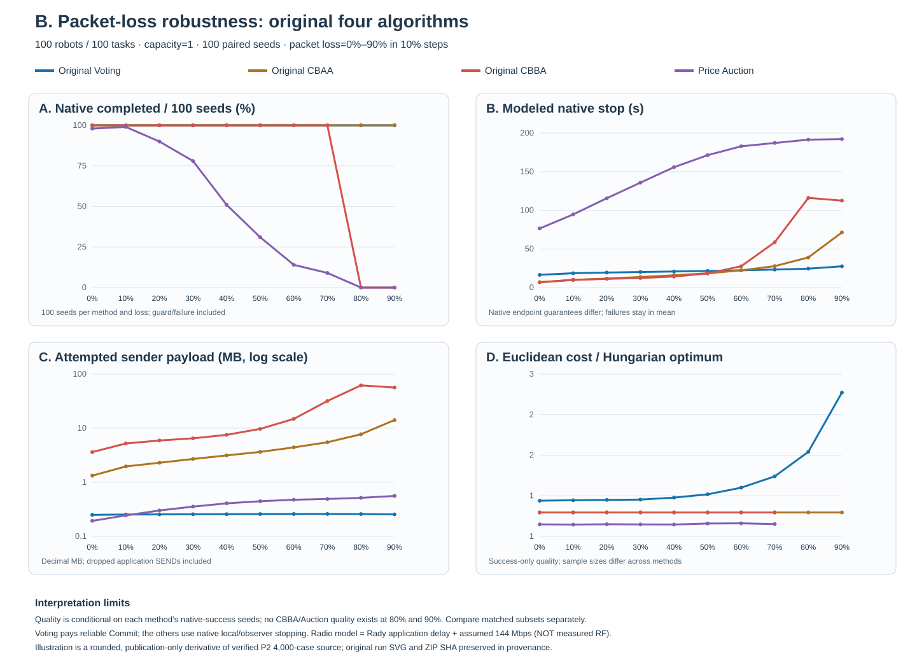

# Democracy-based Task Allocation in a Large-scale Multi-robot System

**Research goal:** fully decentralized multi-robot task allocation under unreliable communication, with reproducible experiments on assignment correctness, packet loss, coordination time, and alternative algorithms. **Target venue:** IEEE Robotics and Automation Letters (RA-L).

> **Measurement boundary.** All reported communication times are **simulated protocol allocation/stop time**, not Python execution time or measurements from a 100-robot wireless deployment. Sender Bytes are attempted **application-layer** payload (including dropped packets). Rady provides real application-delay traces, but the shared **144 Mbps radio service is a hypothetical model**, not verified Wi-Fi MAC/PHY or ns-3. Voting pays reliable Commit; other algorithms use different native stopping conditions.

## Research map

There are **four experiment families**. Internal development IDs are kept out of this overview and documented separately in the [historical study index](docs/EXPERIMENT_LEGACY_INDEX.md).

| Family | Scientific question | Accepted evidence |
|---|---|---|
| **[A. Correctness](#a-correctness-and-distributed-agreement)** | Does decentralized assignment preserve a controlled optimal decision, and how costly is agreement? | Perfect-information and trace-bootstrap controlled Hungarian experiments |
| **[B. Packet loss](#b-packet-loss-resilience-and-communication-traffic)** | How does packet loss affect native completion guarantees and attempted sender Bytes? | 52-rate, 100-seed robustness sweep of Voting vs original CBAA |
| **[C. Time](#c-coordination-time-and-deadline-design)** | How much delay comes from waiting and deadlines versus the radio model? | 30% Loss adaptive-deadline experiment and separate zero-loss timing control |
| **[D. Algorithms](#d-algorithm-comparison-and-task-capacity)** | How do native Voting, CBAA, Price Auction and CBBA compare under common capacity? | Five-series single-task comparison; separate capacity-four multi-task study |

### Implementation ownership

| Concern | Owning module |
|---|---|
| Task announcement and voting | [Task announcements](democracy_mrta/task_information.py), [Voting coordination](democracy_mrta/coordination.py), [multi-task Voting](democracy_mrta/voting_multitask.py) |
| Alternative allocators | [Original CBAA](democracy_mrta/cbaa.py) and [original CBBA](democracy_mrta/cbba_multitask.py) (current branch); [Price Auction (historical source branch)](https://github.com/andyfu35/Democracy-based-Task-Allocation-in-a-Large-scale-Multi-robot-System/blob/experiment/e9l-distributed-price-auction/democracy_mrta/price_auction.py) |
| Transport, loss, modeled time | [Network](democracy_mrta/network.py), [native multi-task packets](democracy_mrta/multitask_wire.py) |
| Scene / route / independent assessment | [Single-task scenes](democracy_mrta/scenario.py), [capacity-aware scenes](democracy_mrta/multitask_scenario.py), [route audit](democracy_mrta/multitask_evaluation.py) |
| Reproduction | [Experiment runners](experiments/), [canonical protocol](docs/EXPERIMENT_PROTOCOL.md), [change continuity](docs/CHANGE_CONTINUITY.md) |

**Architecture:** task announcement → each robot's local Cost / route utility → method-owned voting, bidding, auction or bundle consensus → externally audited assignment and physical message ledger. The observer **does not** inject a global solution or constitute a paid distributed termination protocol.

## A. Correctness and distributed agreement

**Scientific question:** holding the **Hungarian optimizer fixed**, does decentralized coordination preserve a correct assignment?

| Completed experiment | Formal condition | Verified finding |
|---|---|---|
| Perfect-information correctness | 5 robot/task scales × 100 Seeds, zero loss | **500/500 complete**, zero optimality gap and reference mismatches |
| Trace-sampled agreement overhead | 2,000 original records, 20 cells | At 100 robots/50 tasks, Democracy-Hungarian takes **796.2 ms** for global agreement and **201,400 B**; Leader-Hungarian **477.4 ms** and **41,600 B** |

The study establishes correctness when information is complete, but decentralized agreement adds communication. Its Hungarian-controlled results **must not be pooled** with Greedy Voting versus CBAA or CBBA optimization-quality claims.

**Original evidence:** [correctness raw](results/e0_protocol_correctness/raw/e0_corrected_20261009T141508Z.csv) / [summary](results/e0_protocol_correctness/summary.csv); [agreement raw](results/e1_latency/raw/e1_20261009T144026Z.csv) / [summary](results/e1_latency/summary.csv).

The earlier one-round lossy Hungarian Vote pilot did not receive full per-vote acceptance. It is **archived, not an outstanding requirement** for these two completed claims. [Historical study index](docs/EXPERIMENT_LEGACY_INDEX.md).

## B. Packet-loss resilience and communication traffic

**P2-B revised Voting communication-flow experiment — source ready, fresh results pending:** The original verified 4,000-case P2 results **below** were produced by **sequential per-task Greedy voting** (although TASK and Cost were already announced just once). They are preserved as *historical pre-correction evidence*, **not** the timing or communication performance of the new one-TASK/one-Cost **batched Greedy Vote/Score** protocol. The newly implemented protocol is documented in [P2-B corrected batching contract](docs/P2_BATCH_GREEDY_PROTOCOL.md) and must run **only 1,000 new Voting cases**, reuse the **3,000 previously audited baseline cases** by pinned original ZIP SHA, and rebuild **all four P2 graph panels** from 4,000 explicitly source-attributed records before replacing any numerical comparison here. Original CBAA/CBBA/Price native algorithms remain unchanged.

**Research question:** at identical 100-robot/100-task geometry and capacity **one**, how do the **four original assignment algorithms** trade original native completion, modeled stop-time, attempted sender Bytes and assignment quality as packet loss rises? The historical user-authored **Voting Multi-task** C1 variant and Paid CBAA are **not official comparison methods**.

**NEW verified formal P2 source:** original ZIP independently audited, **4,000 original method cases**, 10 loss levels (0%..90% every 10%), 100 paired Seeds per loss, exactly `Original Voting / original CBAA / original CBBA / Price Auction`, Rady sampled ROS delay + *hypothetical* shared 144Mbps. All original 4,000 geometry/Hungarian/assignment and native sender/receiver ledgers, 40 group summaries, 4,000 original Terminal rows and the original P1 30%-loss 400-row control verified with **zero audit errors**. The source contains **730 native guard failures** (200 CBBA + 530 Price Auction); no failure was removed from the denominator.

| Loss | Voting complete | Original CBAA complete | Original CBBA complete | Price Auction complete |
|---|---:|---:|---:|---:|
| **0%** | 100/100 | 100/100 | 100/100 | **98/100** |
| **30%** | 100/100 | 100/100 | 100/100 | 78/100 |
| **50%** | 100/100 | 100/100 | 100/100 | 31/100 |
| **70%** | 100/100 | 100/100 | 100/100 | 9/100 |
| **80%** | 100/100 | 100/100 | **0/100** | **0/100** |
| **90%** | 100/100 | 100/100 | **0/100** | **0/100** |

At **90% loss**, Voting used **254.23 kB/seed** original attempted application payload versus CBAA **14,135.60 kB/seed** (**98.20% fewer Bytes**); native modeled stop averaged **27.497 s** versus CBAA **71.383 s**, but this is **not equal paid termination**. Importantly, CBAA observed its **first full feasible assignment at 12.770 s**, earlier than Voting at 27.497 s. Original CBBA and Auction both hit the configured round-160 guard in all 100 Seeds at 80% and 90%; Auction also failed two **0%-loss** Seeds, so its failure is not purely packet-loss induced. These are guard-dependent simulation results, **not theoretical packet-loss thresholds**.

**Critical quality trade-off:** Among the **same 100 fully successful Voting/CBAA Seeds at 90%**, their mean independent Euclidean/Hungarian cost ratios were **2.4175 (Voting)** versus **1.2353 (CBAA)** (lower is better). Voting maintains completion with far less communication at a substantial cost-quality penalty. The four-method all-success intersection is **zero** at 80–90%, so no four-way paired quality figure is defined there. The presented success-only quality panel uses **different successful-sample subsets** where methods fail, and must not be read as a fair all-seed ranking of Auction.

**Limits:** Voting charges reliable Score/Commit; original CBAA's local certificate, CBBA simulator agreement and Auction optimistic stop are not equivalent paid terminal knowledge. These are **attempted sender application Bytes**, not physical RF airtime or MAC retries. [Complete original-ZIP audit](docs/P2_FORMAL_100SEED.md) · [10-point figure source](docs/figures/p2/formal/verified_10point_plot_source.csv) · [exact ZIP/manifest identity](docs/figures/p2/formal/source_manifest.json).

The **older independent loss-control** (100R/50T, 52 loss points, older *synthetic* channel, Voting/CBAA only) remains unchanged as [its original combined graph](docs/figures/e9e_dense/formal/primary_loss_completion_and_bytes.svg) and [104-row original source](docs/figures/e9e_dense/formal/summary_by_loss.csv). Its 55%-loss Voting guard finding is **not comparable** to P2's 100R/100T newer guarded/Rady protocol; never pool the two cohorts.

## C. Coordination time and deadline design

**Scientific question:** does the communication delay come mostly from waiting for late Cost / Vote packets or from modeled shared-medium packet service?

### Adaptive deadlines under 30% packet loss

**Formal setting:** robots=tasks, 5–100 in steps of 5, 100 Seeds per size; both Cost and Vote drop probabilities are **30%**. Original baseline and revised deadline policy use matched settings.

At **100 robots/100 tasks**, the old fixed received-plurality deadline averaged **71.918 s** versus **20.132 s** with guarded one-time Cost and adaptive Vote deadlines (**72.01% lower modeled time**). Both compared arms completed 100/100 Seeds at that size; this **does not** imply 72% less sender payload or better optimality. [20-point original source](docs/figures/e9i_cost30/formal/formal_20point_plot_data.csv) · [source manifest](docs/figures/e9i_cost30/formal/formal_publication_manifest.json).

### Radio-model sensitivity — separate control

With 100 robots, zero application-layer loss, and a **fixed 609.113 ms task wait**, the Rady-delay-only model yielded **68.143 s**, versus **68.224 s** with the *assumed* 144 Mbps shared radio (**81.722 ms** more). This is a **zero-loss control**, not an empirical 100-robot Wi-Fi result or a second curve of the 30%-Loss deadline experiment. [Source](docs/figures/e9g_wifi/formal/scaling_20points_verified.csv) · [manifest](docs/figures/e9g_wifi/formal/publication_manifest.json).

## D. Algorithm comparison and task capacity

**Scientific question:** on common task-capacity and geometry, what are the trade-offs among original assignment algorithms?

### Five original algorithms — matched capacity-one, original 100 Seeds verified

**P1 formal original ZIP independently audited — zero data-integrity errors.** Same N=T=25,50,100, capacity **one**, packet Loss **30%** on each original method-native lossy packet, **100 paired Seeds per N**. All **five methods were newly run in the same source commit (1,500 original method cases)**, rather than mixing frozen historical three-algorithm averages with newer runs. An external observer records the first globally unique feasible assignment **after an originally incurred communication phase**; it neither adds messages nor stops or changes a robot. Native method-specific termination/guard is recorded **separately**.

| N=100; 30% Loss; 100 Seeds | Voting | Original CBAA | Price Auction | Voting Multi-task | Original CBBA |
|---|---:|---:|---:|---:|---:|
| **External first globally feasible (s)** | 20.132 | **7.898** | 119.400¹ | 101.919 | 11.539 |
| Original protocol modeled stop (s) | 20.132 | 13.647 | 135.828 | 101.919 | **12.368** |
| Attempted application sender (decimal kB) | **255.50** | 2,693.04 | 353.94 | 305.39 | 6,488.06 |
| **Native complete** | 100/100 | 100/100 | **78/100** | 100/100 | 100/100 |
| First feasible observable | 100/100 | 100/100 | 79/100 | 100/100 | 100/100 |
| Euclidean/Hungarian ratio² (lower better) | 1.3668 | 1.2348 | **1.1173** | 1.3673 | 1.2348 |

¹ Auction first-feasible time averages **79 observed Seeds**; 22 guard-limited failures remain in the **all-100-Seed native stop and sender Bytes**. Missing first-feasible timestamps are **not** imputed. ² Hungarian ratios are conditioned on the **same 78 Seeds where all five native methods completed**; this is explicitly different from the unconditional success counts.

**Key discovery — rankings reverse under a common observed event.** At 100 robots CBAA's first feasible assignment is **7.898 s**, ahead of CBBA **11.539 s in all 100 paired Seeds**, but CBBA reaches its **original native stop** sooner (**12.368 s** vs CBAA **13.647 s**). The paired mean CBAA−CBBA first-feasible difference is **−3.640 s** (10k paired-bootstrap 95% CI **[−3.939,−3.364]**). CBAA and CBBA produced **the exact same final assignment on all 300 N/Seed paired scenes**; CBBA transmitted **2.41×** the CBAA application Bytes at N100. Thus this observation isolates their packet and native stopping trade-off, not a change in CBAA/CBBA allocation quality.

**Completion and quality trade-off:** Price Auction has the lowest matched Hungarian cost ratio, but N100 native completion is just **78%**. Of the **1,500 complete original cases**, 1,476 natively completed and 1,478 ever formed a first externally feasible assignment. All **24 original native guard failures** belong to Auction (2 at N50, 22 at N100); two failed native endpoints already had an externally feasible snapshot, proving the two time/stop definitions cannot be substituted.

**Limits:** original Voting pays Score/Commit while CBAA, CBBA and Price Auction have native local/observer stopping; **first feasible is a read-only simulator event, not paid distributed termination or common knowledge**. Lossy native packet classes and objective formulations still differ, even with identical geometry/Seed/measurement. Timing combines Rady application-delay traces with a **hypothetical 144Mbps shared radio**, not measured 100-robot Wi-Fi latency.

**Formal evidence:** [Original ZIP independent audit/report](docs/P1_FORMAL_100SEED.md) · [original 15-row summary](docs/figures/p1/formal/original_summary_p1.csv) · [same-five-success quality](docs/figures/p1/formal/original_same_success_quality_p1.csv) · [machine audit](docs/figures/p1/formal/p1_independent_original_zip_audit.json) · [pre-registered implementation](docs/P1_MATCHED_FIVE_NATIVE.md). The previous original **20-size historical descriptive comparison** is retained separately in the [E9N source audit](docs/E9N_FORMAL_100SEED.md) and [archived source figure](docs/figures/e9n/formal/primary_five_method_time_bytes_success.svg), not overwritten or relabeled.

### Multi-task assignment — separate capacity-four cohort

**Formal cell:** 25 robots, 100 tasks, maximum **4 tasks per robot**, 30% loss, 100 paired Seeds; corrected full source ZIP, route and packet ledgers independently verified.

| Capacity-four metric | Voting Multi-task | Original CBBA |
|---|---:|---:|
| Assignment complete | **100/100** | **100/100** |
| Modeled allocation/stop | 63.023 s | **6.878 s** |
| Sender payload | **116.83 kB** | 1,006.87 kB |
| Total robot travel | 1,319.76 m | **1,209.48 m** |
| Longest robot route (makespan) | **134.55 s** | 148.64 s |

Total route length and longest route duration are **different** objectives; physical route makespan is not allocation time. This capacity-four cohort is deliberately **not** a point on the capacity-one plot. [Source-verified multi-task report](docs/E9M_CORRECTED_ORIGINAL_ZIP_AUDIT_100SEED.md).

## Remaining acceptance work — P1 completed; next tests conditional

The previously identified **first-priority five-original-method fairness-of-external-measurement study is now COMPLETE and source-verified**. We will not automatically rerun historical pilots or open new optimization baselines. [Bounded closure plan](docs/RESEARCH_CLOSURE_PLAN.md).

| Conditional need | Next action |
|---|---|
| **Claim actual network / Wi-Fi communication time** | First validate the hypothetical 144Mbps radio service and packet timing against a packet-level or controlled multi-host setting. Not needed for claims explicitly limited to **modeled communication time**. |
| **Claim capacity-four multi-task scalability** | One prespecified additional C4 scale (e.g. 50R/200T) if needed; current 25R/100T original result is a single accepted C4 point, not a scaling curve. |
| **Incomplete exploratory controls** | Archive only; no required backfilling. |

## Reproducibility, archives and limitations

- [Historical internal study IDs, names and status](docs/EXPERIMENT_LEGACY_INDEX.md) · [Detailed historical results](docs/EXPERIMENT_RESULTS_ARCHIVE_20261012.md) · [prior README snapshot](docs/README_PRE_ABCD_20261013.md).
- [Cross-experiment audit](docs/EXPERIMENT_RESULTS_AUDIT_20261012.md) · [canonical protocol](docs/EXPERIMENT_PROTOCOL.md) · [change continuity](docs/CHANGE_CONTINUITY.md) · [bibliography](docs/references/e9g_wifi_timing.bib).
- [Matched five-original-method source audit](docs/P1_FORMAL_100SEED.md) · [previous original single-task source audit](docs/E9N_FORMAL_100SEED.md) · [original multi-task source audit](docs/E9M_CORRECTED_ORIGINAL_ZIP_AUDIT_100SEED.md). Original ZIPs are retained unchanged in the user's personal Library with documented SHA-256 identities.

**Comparison boundaries:** *method-native* modeled endpoint ≠ shared paid terminal guarantee; synthetic-timing loss study ≠ Rady radio-proxy experiment; capacity 1 ≠ capacity 4; aggregate historical source ≠ newly rerun paired original source. These limits are preserved in the reports. No actual 100-robot Wi-Fi deployment is claimed.
