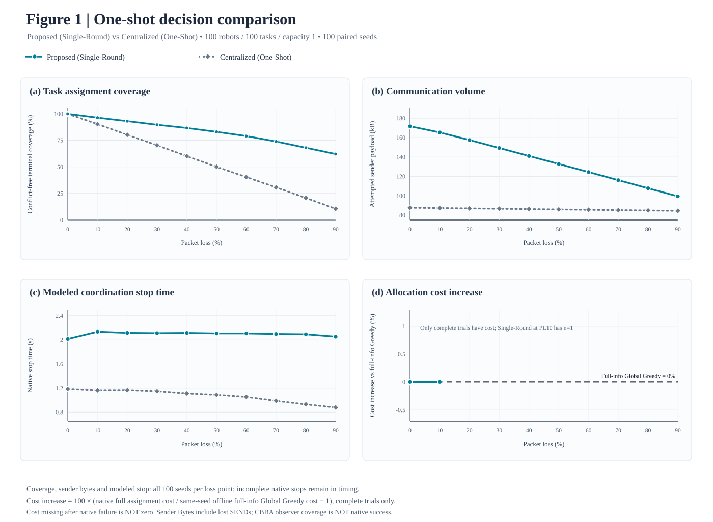
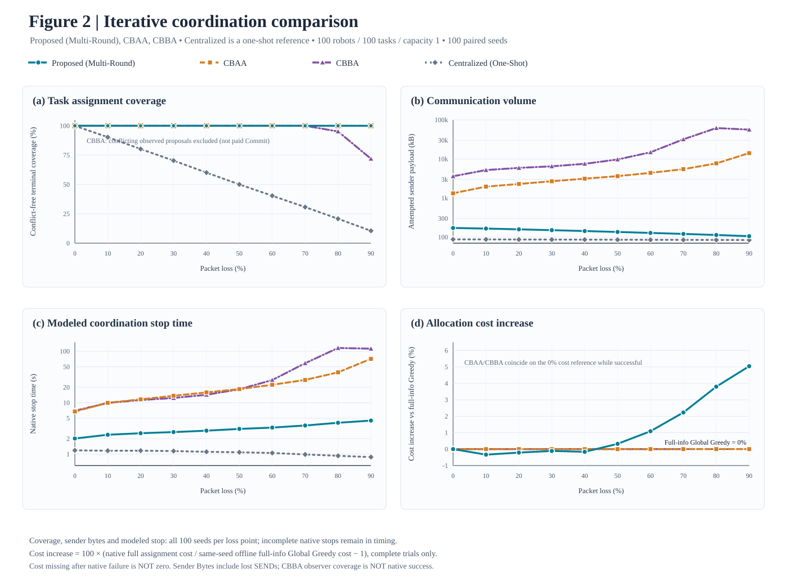

# 大規模多機器人系統之民主式任務分配

**研究目標：**在不可靠通訊環境下，研究完全去中心化的多機器人任務分配（Multi-Robot Task Allocation, MRTA），並以可重現的實驗評估任務分配正確性、封包遺失率、協調時間與其他原生演算法的表現。**目標期刊：**IEEE Robotics and Automation Letters（RA-L）。

**語言：**[English](README.md) | **繁體中文**

> **測量邊界（請先閱讀）：**本文的「通訊時間」是模擬協定的任務分配／停止時間，**不是** Python 程式執行時間，也**不是**在 100 台實體機器人無線網路上量測的時間。Sender Bytes 指嘗試發送的**應用層**負載，**包含遭丟棄的封包**。模型採用 Rady 等人的真實應用層延遲軌跡，但共享 **144 Mbps 無線服務速率是假設模型**，未經 Wi-Fi MAC/PHY 或 ns-3 驗證。Voting 支付可靠 Commit 通訊成本；其餘演算法依原生停止條件結束，因此其完成保證不完全相同。

## 研究架構與實驗分類

本研究整理成 **A／B／C／D 四大實驗家族**。舊開發編號不再作為主要章節，詳見[歷史實驗索引](docs/EXPERIMENT_LEGACY_INDEX.md)。

| 類別 | 主要研究問題 | 已接受的實驗證據 |
|---|---|---|
| **[A. 正確性](#a-任務分配正確性與分散式共識)** | 去中心化協調能否維持受控的最佳化結果？共識需要多少通訊？ | 完整資訊的 Hungarian 驗證、軌跡抽樣的共識成本 |
| **[B. 掉包率](#b-封包遺失韌性與通訊流量)** | 單輪／多輪方法如何隨掉包率改變完成率、通訊量、模擬時間與成本？ | P2D／P2E 兩張四面板曲線，0%～90%，100 Seeds |
| **[C. 時間](#c-協調時間與-deadline-設計)** | 等待、截止時間與共享無線模型各占多少延遲？ | 30% 掉包下的 Deadline 測試及獨立零掉包控制 |
| **[D. 演算法](#d-演算法比較與多任務容量)** | 在相同容量與幾何條件下，原生演算法如何取捨？ | 單任務五方法歷史實驗、獨立容量四的多任務比較 |

### 實作模組與責任

| 責任 | 主要模組 |
|---|---|
| 任務公告與投票 | [任務資訊](democracy_mrta/task_information.py)、[Voting 協調](democracy_mrta/coordination.py)、[多任務 Voting](democracy_mrta/voting_multitask.py) |
| 其他分配演算法 | [原生 CBAA](democracy_mrta/cbaa.py)、[原生 CBBA](democracy_mrta/cbba_multitask.py)；[Price Auction 歷史原始分支](https://github.com/andyfu35/Democracy-based-Task-Allocation-in-a-Large-scale-Multi-robot-System/blob/experiment/e9l-distributed-price-auction/democracy_mrta/price_auction.py) |
| 網路、掉包與模擬時間 | [Network](democracy_mrta/network.py)、[多任務封包](democracy_mrta/multitask_wire.py) |
| 場景、路線與獨立驗證 | [單任務場景](democracy_mrta/scenario.py)、[容量感知場景](democracy_mrta/multitask_scenario.py)、[路線驗證](democracy_mrta/multitask_evaluation.py) |
| 重現實驗 | [實驗程式](experiments/)、[Canonical Protocol](docs/EXPERIMENT_PROTOCOL.md)、[變更紀錄](docs/CHANGE_CONTINUITY.md) |

**架構：**任務公告 → 各機器人自行計算 Cost／路線效用 → 各方法原生的投票、出價、拍賣或 Bundle Consensus → 獨立觀察者驗證分配與訊息紀錄。觀察者**不會**注入全域最佳解，也不代表已支付的分散式終止協定。

## A. 任務分配正確性與分散式共識

**研究問題：**當 **Hungarian 最佳化器固定相同**時，去中心化協調是否仍能達成正確的任務分配？

| 已完成實驗 | 條件 | 驗證結果 |
|---|---|---|
| 完整資訊正確性 | 5 種 Robot／Task 規模，各 100 Seeds，0% 掉包 | **500/500 成功完成**，最佳化差距為零，參考指派無不一致 |
| 真實延遲軌跡抽樣的共識成本 | 2,000 筆原始紀錄，20 個測試 Cell | 100 台機器人／50 個任務時，Democracy-Hungarian：**796.2 ms、201,400 B**；Leader-Hungarian：**477.4 ms、41,600 B** |

完整資訊下可維持最佳化正確性，但去中心化共識仍有額外通訊成本。**本節 Hungarian 控制組不可與 B 節的 Greedy Voting、CBAA 或 CBBA 最佳化品質數據混合比較。**

**原始證據：**[正確性原始資料](results/e0_protocol_correctness/raw/e0_corrected_20261009T141508Z.csv)／[彙總](results/e0_protocol_correctness/summary.csv)；[共識延遲原始資料](results/e1_latency/raw/e1_20261009T144026Z.csv)／[彙總](results/e1_latency/summary.csv)。

先前一次性掉包 Hungarian Voting 探索未達完整逐票接受條件，已歸檔，**不是**上述兩項已完成主張的待補驗證。詳見[歷史索引](docs/EXPERIMENT_LEGACY_INDEX.md)。

## B. 封包遺失韌性與通訊流量

**最新正式主要比較（2026-10-15）：P2D／P2E，100 Seeds。** 固定 **100 Robots、100 Tasks、每台容量 1**，掉包率為 0%～90%（每 10% 一點），各方法使用相同的 **100 個配對 Seeds**。研究分成兩張四面板曲線圖：「單輪決策」比較 **Proposed (Single-Round)** 與 **Centralized (One-Shot)**；「多輪協調」比較 **Proposed (Multi-Round)**、**CBAA**、**CBBA**，並以 Centralized 作單輪參考。合計 **5,000 個獨立方法 × 掉包率 × Seed 案例**：P2E 新執行的 Proposed 2,000 筆、P2D 新執行 Centralized 1,000 筆，以及沿用原始驗證的 CBAA／CBBA 2,000 筆。P2D 另含 1,000 筆歷史 Proposed，與 P2E Multi-Round 配對原生結果一致，**不重複計算**。P2D／P2E 獨立稽核為 **73,463 項檢查、0 錯誤**。

### 圖一：單輪決策比較

**Proposed (Single-Round)** 最多只有一個原生決策 Epoch；**Centralized (One-Shot)** 則由遠端機器人各自單次 Unicast Cost 給協調者，接著單次分配，**不重傳 Cost**。在 0% 掉包，兩方法都 **100/100** 完整成功；在 10% 掉包，雖然嚴格的完整成功次數僅 **1/100** 與 **0/100**，實際**平均最終無衝突任務覆蓋率**仍有 **96.36%** 與 **90.29%**。到 90% 掉包時，Proposed 單輪仍達 **62.11%**，Centralized 為 **10.54%**。未全部完成的 Seed 會計入部分分配進展，不會被誤認為完全成功。這裡的單輪指「決策次數限制」，**不是兩種協定具有相同封包數或相同終止保證**。

### 圖二：多輪協調比較（含集中式參考線）

Proposed Multi-Round 最多可進行 300 個原生分配決策 Epoch，**不是重傳原始 Cost 或 Vote 封包**。CBAA／CBBA 保持原生共識與停止機制（Guard 160）；Centralized 只作**單輪參考線**，不是多輪共識方法。所有曲線只連接真實的 10 個掉包率測試點，**沒有平滑補值或偏移結果**。CBBA 在 PL80／PL90 仍分別有 **95.16%／71.90%** 的最終無衝突觀測配對，雖然其原生完整完成率為 0/100；這些只是觀測到的提案，**並非已支付 Commit 或完成共識的證明**。

| 90% 掉包率 · 100 Seeds | Proposed 單輪 | **Proposed 多輪** | CBAA | CBBA | Centralized 單輪 |
|---|---:|---:|---:|---:|---:|
| **最終無衝突任務覆蓋率** | 62.11% | **100.00%** | 100.00% | 71.90%¹ | 10.54% |
| **原生完整成功（嚴格條件）** | 0/100 | **100/100** | 100/100 | 0/100 | 0/100 |
| **嘗試發送量（十進位 kB）** | 99.42 | **105.67** | 14,135.60 | 56,343.95 | 84.43 |
| **模擬原生停止時間（s），含失敗** | 2.05 | **4.49** | 71.38 | 112.53 | 0.88 |
| **相對完整資訊 Global Greedy 成本上升率** | — | **+5.04%** | 0.00% | — | — |

¹ CBBA 這個比例來自最終外部觀測的**無衝突提案**，不是已完成 Commit 的任務數。對互相衝突的任務，不臆測或指定勝者，全部排除。

在**本次模型與原生 Guard 設定**下，CBAA 在 90% 掉包仍有 **100/100** 完整成功；CBBA 在 80% 與 90% 均為 **0/100**。這是實驗觀察，**不是兩演算法普遍的掉包理論極限**。PL90 時 Proposed Multi-Round 與 CBAA 都完全成功，但 Proposed 的應用層發送負載約少 **134 倍**、模擬原生停止時間約短 **15.9 倍**；分配成本則較完整資訊 Global Greedy 約高 **5.04%**。Centralized 在掉包後更早停止，是因為**尚未完成分配就停止**，不能宣稱其成功完成速度更快。

**四個子圖的共同統計：**(a) 100 Seeds 平均最終無衝突任務覆蓋率、(b) **實際嘗試發送**的應用層負載（kB = 1,000 B，包含遭接收端丟棄的 SEND）、(c) 100 Seeds 平均**模擬原生停止時間**（包含失敗／Guard 案例）、(d) **成功 Seeds** 的分配成本上升率。成本針對每個成功 Seed 計算 `100 ×（該方法的總歐氏分配成本／同一 Seed 完整資訊 Global Greedy 總成本 − 1）`，再取成功 Seed 平均。黑色水平虛線固定在 **0%**，所有方法都使用**相同的完整資訊 Global Greedy**，**不是各方法自己的 0% 掉包成本，也不是 Hungarian 最佳解**。負值是可能的，因 Greedy 並非全域最優解。若該方法沒有完整成功案例，成本**留空，絕不補零**；Proposed 單輪在 10% 的成本只含 **n=1**。

**覆蓋率與全部完成的區別：**每個 Seed 讀取原生最後的 Robot–Task 配對快照，只計算該 Robot 與 Task 都恰好出現一次的配對，除以 100 個任務，再對全部 100 Seeds 平均。若 CBBA 多台機器人競爭同一任務，**所有衝突提案都排除**，不擅自決定勝者；PL80／PL90 每 Seed 平均排除 **4.73／28.05** 個衝突配對。Proposed／Centralized 是有支付原生 Commit 的分配；CBAA／CBBA 是尚未等價支付 Commit 的最終外部觀測快照。因此**無衝突覆蓋率是部分分配進展，不是全域共識證明**；嚴格的全部完成率仍保留在表格。

**研究限制：**模型時間結合 Rady 應用層延遲與假設的共享 144 Mbps 無線速率，**不是實際 Wi-Fi MAC／PHY 量測**。掉包假設作用於 Cost／Vote 接收端；TASK／Score／Commit 在模型中可靠。CBAA／CBBA 原生停止證明與 Proposed 已支付的 Commit 不同，因此曲線可描述特定實驗條件下的速度／通訊量／成功率取捨，不能主張完全相同的分散式終止保證。

**繪圖原始彙總與來源：**[50 組曲線資料與成功樣本數](docs/figures/p2de/formal/verified_50point_summary.csv) · [原始 ZIP SHA256、成本公式及方法限制](docs/figures/p2de/formal/README.md) · [P2D／P2E 研究分支 Canonical](https://github.com/andyfu35/Democracy-based-Task-Allocation-in-a-Large-scale-Multi-robot-System/blob/experiment/p2e-redecision-ablation/docs/EXPERIMENT_PROTOCOL.md)。舊 [P2-C 四方法 Price Auction 比較圖](docs/figures/p2c/formal/p2c_packet_loss_four_panel.svg) 與[來源驗證報告](docs/P2C_FORMAL_100SEED.md)保留作歷史查證，不再作為最新 README 主圖。

## C. 協調時間與 Deadline 設計

**歷史方法注意事項：**本節 E9G／E9I Deadline 圖使用早期序列式 Voting（或各控制組明示的舊協定），**不是**現在 P2-B／P2-C 的批次 Greedy Voting。因此其機器人數量／時間曲線，不能宣稱為當前批次協定的規模延遲。要更新此圖，需要以相同 E9I 規模和 Seeds **只重跑新的 Voting**，而不須重跑未改變的原生 Baseline。

**研究問題：**通訊時間主要來自等待遲到的 Cost／Vote，還是模擬共享媒介封包服務？

### 30% 掉包下的自適應 Deadline

**正式條件：**機器人數 = 任務數，從 5 到 100，每次增加 5；每個規模 **100 Seeds**，Cost 與 Vote 封包遺失率都設定為 **30%**。舊基準與新的 Deadline 策略採配對條件。

在 **100 Robots／100 Tasks** 時，舊的固定 Deadline＋收到票數相對多數決，平均模擬時間 **71.918 s**；採用受保護的一次 Cost 傳輸與自適應 Vote Deadline 後為 **20.132 s**，**模擬時間下降 72.01%**。該規模兩組都完成 **100/100 Seeds**。**不表示**發送資料量也降低 72%，更不表示最佳化品質提升。[20 點原始資料](docs/figures/e9i_cost30/formal/formal_20point_plot_data.csv) · [來源 Manifest](docs/figures/e9i_cost30/formal/formal_publication_manifest.json)。

### 無線模型敏感度：獨立零掉包控制

固定 **100 台機器人、0% 應用層掉包、609.113 ms 任務等待**時，只使用 Rady 延遲的模型為 **68.143 s**，增加假設的 144 Mbps 共享無線服務後為 **68.224 s**，差 **81.722 ms**。這是**零掉包控制**，不是 30% Deadline 實驗的第二條曲線，也不是 100 台實體 Wi-Fi 的量測。[原始資料](docs/figures/e9g_wifi/formal/scaling_20points_verified.csv) · [Manifest](docs/figures/e9g_wifi/formal/publication_manifest.json)。

## D. 演算法比較與多任務容量

**歷史 P1 基準，非最新 P2-C：**以下 P1 圖採早期序列式 Voting，早於批次 Greedy。歷史圖保留五方法擴充比較；**Voting Multi-task 不屬於目前 P2-C 的正式四方法主比較**。P1 原始案例作為歷史證據保留。目前新批次 Voting 的 N=T=100 比較請看 B 節；其他規模需要新的配對 Voting 實驗。

**研究問題：**在相同容量和場景幾何條件下，各演算法的原生分配品質、協調時間、流量和完成率如何取捨？

### 單任務容量一：歷史五原生演算法比較

**P1 正式來源 ZIP 已獨立審計：零資料完整性錯誤。**N=T=25、50、100；每台機器人最多執行 **1 項任務**；各方法原生有損封包的掉包率為 **30%**；每個規模 **100 配對 Seeds**。**五個方法在相同來源 Commit 下都重新執行**，共 **1,500 個原始方法案例**，並非拼接舊的三方法平均數。外部觀察者只在實際原生通訊階段完成後，紀錄首次出現全域唯一可行分配的時刻，不另行送訊息，也不改變機器人；各演算法的原生停止／Guard 另行記錄。

| N=100；30% 掉包；100 Seeds | Voting | 原生 CBAA | Price Auction | Voting Multi-task | 原生 CBBA |
|---|---:|---:|---:|---:|---:|
| **外部首次全域可行（s）** | 20.132 | **7.898** | 119.400¹ | 101.919 | 11.539 |
| 原生協定模擬停止（s） | 20.132 | 13.647 | 135.828 | 101.919 | **12.368** |
| 嘗試發送應用層資料（十進位 kB） | **255.50** | 2,693.04 | 353.94 | 305.39 | 6,488.06 |
| **原生完整完成** | 100/100 | 100/100 | **78/100** | 100/100 | 100/100 |
| 曾觀察到首次可行 | 100/100 | 100/100 | 79/100 | 100/100 | 100/100 |
| 歐氏成本／Hungarian²（越低越好） | 1.3668 | 1.2348 | **1.1173** | 1.3673 | 1.2348 |

¹ Auction 首次可行時間僅對**已觀察到的 79 Seeds**平均；另外 22 個 Guard 失敗案例仍納入 **100 Seeds 的原生停止時間與 Sender Bytes**，未觀察到的首次可行時間**不補值**。² Hungarian 成本比僅採**五方法共同原生完成的相同 78 Seeds**，與表中的無條件成功次數不同。

**重要發現：以相同觀測事件比較，速度排序會反轉。**N100 時，CBAA 首次可行平均為 **7.898 s**，在全部 100 個配對 Seeds 都早於 CBBA 的 **11.539 s**；但 CBBA 自身原生停止平均 **12.368 s**，快於 CBAA 的 **13.647 s**。配對平均差（CBAA − CBBA 首次可行）為 **−3.640 s**，10,000 次配對 Bootstrap 的 95% CI 為 **[−3.939, −3.364] s**。CBAA 與 CBBA 在全部 **300 個 N／Seed 配對場景**產生**完全相同的最終指派**，但 N100 時 CBBA 發送 **2.41 倍**於 CBAA 的應用層 Bytes。因此，此比較主要凸顯原生訊息與停止條件的差別，並非 CBAA／CBBA 指派品質差別。

**完成率與品質取捨：**Price Auction 的共同成功樣本 Hungarian 成本比最低，但在 N100 原生完成率僅 **78%**。1,500 個原始案例中，**1,476** 原生完成、**1,478** 曾出現首次外部可行解；全部 **24** 次原生 Guard 失敗都屬 Auction（N50 有 2 次、N100 有 22 次）。其中 2 個原生終點失敗已先有外部可行解，證明**原生停止與外部首次可行不可互換**。

**限制：**Voting 會支付 Score／Commit 通訊成本，其餘方法採自身原生停止或觀察者終止條件；首次可行只是一個唯讀模擬事件，**不是**已支付的分散式終止或共同知識。即使幾何、Seeds 和測量方式匹配，各方法的有損封包類別與目標函數仍有差異。時間採 Rady 應用層延遲和假設的 144 Mbps 共享無線模型，**不是** 100 台實體機器人的 Wi-Fi 實測時間。

**正式證據：**[P1 原始 ZIP 獨立審核](docs/P1_FORMAL_100SEED.md) · [15 列原始 Summary](docs/figures/p1/formal/original_summary_p1.csv) · [五方法共同成功品質](docs/figures/p1/formal/original_same_success_quality_p1.csv) · [機器審核結果](docs/figures/p1/formal/p1_independent_original_zip_audit.json) · [預先註冊的原生實作](docs/P1_MATCHED_FIVE_NATIVE.md)。更早期 **20 種規模的歷史描述性比較**另存於 [E9N 審核](docs/E9N_FORMAL_100SEED.md) 和[原始圖](docs/figures/e9n/formal/primary_five_method_time_bytes_success.svg)，並未覆蓋或更名。

### 多任務分配：獨立容量四測試組

**正式條件：**25 Robots、100 Tasks、每台最多 **4 Tasks**、30% 掉包、100 配對 Seeds。更正後的完整原始 ZIP、路線與封包帳本皆已獨立驗證。

| 容量四指標 | Voting Multi-task | 原生 CBBA |
|---|---:|---:|
| 分配完整完成 | **100/100** | **100/100** |
| 模擬分配／停止時間 | 63.023 s | **6.878 s** |
| Sender Payload | **116.83 kB** | 1,006.87 kB |
| 全機器人總行駛距離 | 1,319.76 m | **1,209.48 m** |
| 最長機器人路線（Makespan） | **134.55 s** | 148.64 s |

**總路線長度**與**最長路線時間**是不同目標；物理路線 Makespan 也不是任務分配協調時間。此容量四結果**不可**當作容量一圖上的一個資料點。[獨立來源驗證報告](docs/E9M_CORRECTED_ORIGINAL_ZIP_AUDIT_100SEED.md)。

## 剩餘驗證與後續研究

先前優先要求的「五種原生方法、相同外部量測邊界」比較**已完成並通過來源驗證**。不會自動重跑歷史探索實驗，也不會無故增加新最佳化 Baseline。詳見[研究收斂計畫](docs/RESEARCH_CLOSURE_PLAN.md)。

| 若要提出的論文主張 | 需要追加的驗證 |
|---|---|
| **真實網路／Wi-Fi 通訊時間** | 先以封包層模擬或受控多主機量測驗證假設的 144 Mbps 共享無線服務與封包時序；若只主張**模擬通訊時間**，則不強制追加。 |
| **容量四多任務可擴展性** | 需要時再預先指定一個額外 C4 規模（例如 50R／200T）；目前 25R／100T 只有一個有效實驗點，不可稱為完整規模曲線。 |
| **未完成的探索控制** | 僅封存，不強制補跑。 |

## 可重現性、歷史紀錄與主要限制

- [歷史內部實驗索引](docs/EXPERIMENT_LEGACY_INDEX.md) · [歷史結果明細](docs/EXPERIMENT_RESULTS_ARCHIVE_20261012.md) · [舊 README 快照](docs/README_PRE_ABCD_20261013.md)。
- [跨實驗資料審核](docs/EXPERIMENT_RESULTS_AUDIT_20261012.md) · [Canonical Protocol](docs/EXPERIMENT_PROTOCOL.md) · [變更紀錄](docs/CHANGE_CONTINUITY.md) · [文獻](docs/references/e9g_wifi_timing.bib)。
- [P1 五原生方法來源審核](docs/P1_FORMAL_100SEED.md) · [E9N 單任務歷史來源審核](docs/E9N_FORMAL_100SEED.md) · [E9M 多任務來源審核](docs/E9M_CORRECTED_ORIGINAL_ZIP_AUDIT_100SEED.md)。原始 ZIP 以原狀保留於個人檔案庫，其 SHA-256 識別資訊已記錄。

**比較邊界不可混淆：**方法原生停止時間 ≠ 所有演算法共同且已支付的終止保證；合成時序的掉包研究 ≠ Rady 無線代理模型；容量 1 ≠ 容量 4；歷史彙總來源 ≠ 新重新執行的配對原生來源。本文**沒有**主張已完成 100 台機器人實體 Wi-Fi 部署實驗。
