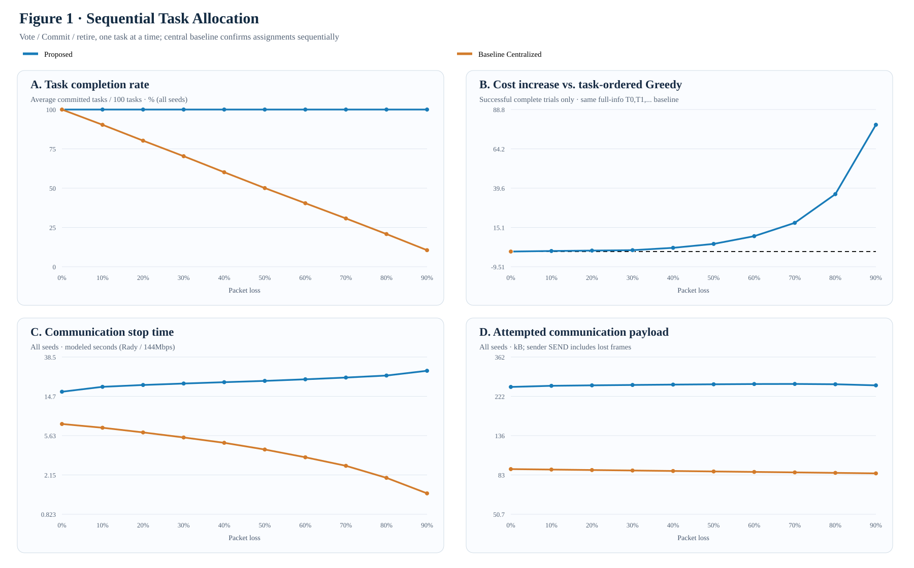
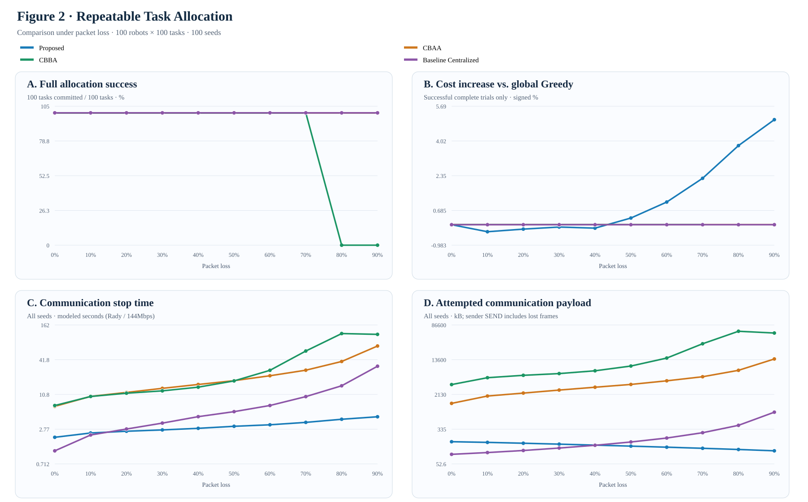

# 大規模多機器人系統之民主式任務分配

**研究目標：**在不可靠通訊環境下，研究完全去中心化的多機器人任務分配（Multi-Robot Task Allocation, MRTA），並以可重現的實驗評估任務分配正確性、封包遺失率、協調時間與其他原生演算法的表現。**目標期刊：**IEEE Robotics and Automation Letters（RA-L）。

**語言：**[English](README.md) | **繁體中文**

> **測量邊界（請先閱讀）：**本文的「通訊時間」是模擬協定的任務分配／停止時間，**不是** Python 程式執行時間，也**不是**在 100 台實體機器人無線網路上量測的時間。Sender Bytes 指嘗試發送的**應用層**負載，**包含遭丟棄的封包**。模型採用 Rady 等人的真實應用層延遲軌跡，但共享 **144 Mbps 無線服務速率是假設模型**，未經 Wi-Fi MAC/PHY 或 ns-3 驗證。Voting 支付可靠 Commit 通訊成本；其餘演算法依原生停止條件結束，因此其完成保證不完全相同。

## 研究架構與實驗分類

本研究整理成 **A／B／C／D 四大實驗家族**。舊開發編號不再作為主要章節，詳見[歷史實驗索引](docs/EXPERIMENT_LEGACY_INDEX.md)。

| 類別 | 主要研究問題 | 已接受的實驗證據 |
|---|---|---|
| **[A. 正確性](#a-任務分配正確性與分散式共識)** | 去中心化協調能否維持受控的最佳化結果？共識需要多少通訊？ | 完整資訊的 Hungarian 驗證、軌跡抽樣的共識成本 |
| **[B. 掉包率](#b-封包遺失韌性與通訊流量)** | 單輪／多輪方法如何隨掉包率改變完成率、通訊量、模擬時間與成本？ | **P2H 已完成逐任務圖一＋P2G 已完成多輪圖二**；0%～90%，100 Seeds |
| **[C. 時間](#c-協調時間與-deadline-設計)** | 等待、截止時間與共享無線模型各占多少延遲？ | 30% 掉包下的 Deadline 測試及獨立零掉包控制 |
| **[D. 演算法](#d-演算法比較與多任務容量)** | 在相同容量與幾何條件下，原生演算法如何取捨？ | 單任務五方法歷史實驗、獨立容量四的多任務比較 |

### 實作模組與責任

| 責任 | 主要模組 |
|---|---|
| 任務公告與投票 | [任務資訊](democracy_mrta/task_information.py)、[Voting 協調](democracy_mrta/coordination.py)、[多任務 Voting](democracy_mrta/voting_multitask.py) |
| 其他分配演算法 | [原生 CBAA](democracy_mrta/cbaa.py)、[原生 CBBA](democracy_mrta/cbba_multitask.py)；[Price Auction 歷史原始分支](https://github.com/andyfu35/Democracy-based-Task-Allocation-in-a-Large-scale-Multi-robot-System/blob/experiment/e9l-distributed-price-auction/democracy_mrta/price_auction.py) |
| 網路、掉包與模擬時間 | [Network](democracy_mrta/network.py)、[多任務封包](democracy_mrta/multitask_wire.py) |
| 場景、路線與獨立驗證 | [單任務場景](democracy_mrta/scenario.py)、[容量感知場景](democracy_mrta/multitask_scenario.py)、[路線驗證](democracy_mrta/multitask_evaluation.py) |
| 重現實驗 | [實驗程式](experiments/)、[Canonical Protocol](docs/EXPERIMENT_PROTOCOL.md)、[變更紀錄](docs/CHANGE_CONTINUITY.md) |

**架構：**任務公告 → 各機器人自行計算 Cost／路線效用 → 各方法原生的投票、出價、拍賣或 Bundle Consensus → 獨立觀察者驗證分配與訊息紀錄。觀察者**不會**注入全域最佳解，也不代表已支付的分散式終止協定。

## A. 任務分配正確性與分散式共識

**研究問題：**當 **Hungarian 最佳化器固定相同**時，去中心化協調是否仍能達成正確的任務分配？

| 已完成實驗 | 條件 | 驗證結果 |
|---|---|---|
| 完整資訊正確性 | 5 種 Robot／Task 規模，各 100 Seeds，0% 掉包 | **500/500 成功完成**，最佳化差距為零，參考指派無不一致 |
| 真實延遲軌跡抽樣的共識成本 | 2,000 筆原始紀錄，20 個測試 Cell | 100 台機器人／50 個任務時，Democracy-Hungarian：**796.2 ms、201,400 B**；Leader-Hungarian：**477.4 ms、41,600 B** |

完整資訊下可維持最佳化正確性，但去中心化共識仍有額外通訊成本。**本節 Hungarian 控制組不可與 B 節的 Greedy Voting、CBAA 或 CBBA 最佳化品質數據混合比較。**

**原始證據：**[正確性原始資料](results/e0_protocol_correctness/raw/e0_corrected_20261009T141508Z.csv)／[彙總](results/e0_protocol_correctness/summary.csv)；[共識延遲原始資料](results/e1_latency/raw/e1_20261009T144026Z.csv)／[彙總](results/e1_latency/summary.csv)。

先前一次性掉包 Hungarian Voting 探索未達完整逐票接受條件，已歸檔，**不是**上述兩項已完成主張的待補驗證。詳見[歷史索引](docs/EXPERIMENT_LEGACY_INDEX.md)。

## B. 封包遺失韌性與通訊流量：兩次正式實驗均已完成（2026-10-19～20）

本次正式主圖已由使用者完成並提供**原始 ZIP、逐 Seed CSV、統計資料、圖檔與 Manifest**，並經獨立查核。兩張圖都使用 **100 Robots／100 Tasks／單台容量 1／0%～90% 掉包率（每 10% 一點）／100 個配對 Seeds（0～99）**，但**通訊決策規則與成本基準不同**，不能把兩張圖的成本上升百分比當作相同分母。更早的 P2D／P2E 單輪圖與 P2G「整批一次 Vote」舊版圖一仍在 [Canonical 與歷史資料](docs/EXPERIMENT_PROTOCOL.md) 封存，**不是本次最終圖一**。

### 圖一：真正逐任務 Voting vs Baseline Centralized（P2H）

**真實執行流程：** Proposed 按 **T0 投票 → Score → Commit → 移除已分配機器人 → T1 重新投票** 的順序持續到 T99。Cost 最初僅實際發送一次；每個任務最多投一次，**不是先做完 100 個任務的整批 Vote**。**Baseline Centralized** 則是指定的「集中式 Task-Ordered Greedy 基準」：先接收各機器人單次傳送的 Cost，再依任務順序**逐項發送付費 Assignment、收到執行者 Commit 後才決定下一項**；它**不代表所有集中式演算法**。

**A 圖是「平均任務完成率」，不是「100 個任務全部完成的 Seed 比例」。** 定義為 `100 × mean_task_coverage = 100 ×（全部 Seeds 成功 Commit 任務總數）／（100 任務 × 100 Seeds）`。某個 Seed 即使只完成 50 項任務，也應貢獻 50%，而不是 0%。B 是**只針對完整成功 Seeds** 計算、相對同 Seed「完整資訊 Task-Ordered Greedy」的成本差異；若沒有完整成功案例則**留空不填 0**。C 為包含失敗案例的所有 Seeds **模擬原生停止時間**，D 是**所有實際嘗試發送**的應用層 Bytes（包含接收端掉包），以十進位 kB 統計。

| 掉包率 | Proposed 平均任務完成率 | Baseline Centralized 平均任務完成率 | Proposed 成本上升¹ | Proposed／Centralized 模擬停止 (s) | Proposed／Centralized 發送量 (kB) |
|---|---:|---:|---:|---:|---:|
| 0% | **100.00%** | 100.00% | 0.00% | 16.47／**7.48** | 249.25／**89.23** |
| 30% | **100.00%** | 70.33% | +0.85% | 20.13／5.38 | 255.50／87.69 |
| 50% | **100.00%** | 50.06% | +4.77% | 21.47／4.01 | 257.64／86.64 |
| 90% | **100.00%** | 10.54% | +79.26% | 27.50／1.37 | 254.23／84.58 |

¹ 成本僅採計 **100 任務完整分配**的 Seeds。Baseline Centralized 在 10%～90% 掉包下 **沒有完整成功的 Seeds**，因此成本上升**沒有定義**，絕不可誤填 0%。嚴格的「每 Seed 是否 100/100 全部完成」仍保留在 CSV 的 `completion_rate_percent`／`native_complete`，但**不再用於圖一 A**。

**研究解讀與限制：**在目前的通訊規則中，即使 90% Cost／Vote 掉包，Proposed 仍在 100 Seeds 中全部完成 100 項任務；這明顯依賴**本地自投票、至少一張票即可成立的相對多數決，以及模型假設可靠的 Score／Commit**，並非一般無線系統「90% 掉包仍能正常完成」的證明。0% 掉包時逐任務 Proposed **比這個集中式基準耗費更多時間與 Bytes**；90% 掉包時雖然全部完成，但分配成本比完整資訊 Task-Ordered Greedy **高 79.26%**。集中式掉包率高時較早停止，是因為僅分配少數任務就結束，**不能宣稱它成功分配全部任務更快**。

**正式證據：**[圖一 20 組完整來源統計](docs/figures/p2hi/formal/figure1_verified_summary.csv) · [P2H §58 Canonical](docs/EXPERIMENT_PROTOCOL.md) · [P2H 原生可重現指令](docs/P2H_INTERACTIVE_FIGURE1.md) · [兩次完成實驗及通訊模型技術紀錄](docs/COMMUNICATION_MODEL_AND_P2HI_RESULTS_20261020.md)。P2H **2,000 筆新原生案例／20 組統計**；原始執行程式 SHA `a54a13d454bb07cdfa9a20aa53753f9b6f61039d`；原始 ZIP SHA256 `171508bd596060352c7d8a7493c2724e293225b17c9a7af2390713770490373f`。本頁圖一是由已驗證原始摘要重新產生的**衍生圖**，並未覆蓋原始 CSV／Manifest。

### 圖二：多輪決策與指定集中式 Greedy 基準（P2G）

方法只用四個簡短圖例：**Proposed、CBAA、CBBA、Baseline Centralized**。Proposed 是原生**多輪 Global minimum-pair Greedy**，對未完成任務重新產生 Vote／Score／Commit，**不是重傳最初掉包的 Cost**；CBAA／CBBA 都保留**各自的原生 Auction／Consensus 最佳化**，並沒有偷偷改成 Global Greedy。這裡的 **Baseline Centralized** 特指「**未收到 Cost 可以重傳（最多 300 個 Cost 回合）的集中式 Global Greedy 基準**」，完成 Cost 蒐集後執行一次 Greedy 並付費 Assignment／Commit；**不是所有集中式 MRTA 方法的代表**。

**圖二 A 的定義與圖一不同：**圖二 A 是嚴格的「100 個任務全部成功的 Seed 比例」，不是平均部分完成率。B 是完整成功 Seeds 相對**完整資訊 Global minimum-pair Greedy** 的成本差異（也與圖一的 Task-Ordered Greedy 分母不同）；C／D 一樣是所有 Seeds 的模擬原生停止時間與實際嘗試發送量。

| 90% 掉包率，100 Seeds | Proposed | CBAA | CBBA | Baseline Centralized |
|---|---:|---:|---:|---:|
| 完整任務分配成功次數 | **100/100** | 100/100 | 0/100 | 100/100 |
| 成本上升（相對 Global Greedy，僅完整成功） | **+5.04%** | 0.00% | — | 0.00% |
| 模擬原生停止時間，包含失敗 (s) | **4.49** | 71.38 | 112.53 | 32.40 |
| 嘗試發送應用層負載 (kB) | **105.67** | 14,135.60 | 56,343.95 | 828.93 |

90% 掉包下，Proposed 與這個「Cost 可重傳的集中式基準」皆有 100/100 原生完整成功，但 Proposed 的**模擬停止時間約短 7.21 倍、應用層發送量約少 7.84 倍**，代價是分配成本比完整資訊 Global Greedy 高 5.04%。CBBA 雖然完整成功次數為 0/100，但仍保有 **71.90% 的最終無衝突外部觀測提案覆蓋率**；這**不是**有支付可靠 Commit 的完成證明。CBAA／CBBA 原生停止條件與 Proposed／集中式的付費 Commit 保證**不能視為完全相同**，因此不能聲稱 Proposed 在所有網路與所有集中式演算法下都更好。

**正式證據：**[圖二 40 組完整來源統計](docs/figures/p2hi/formal/figure2_verified_summary.csv) · [歷史 P2E／CBAA／CBBA 原始 SHA 驗證彙總](docs/figures/p2de/formal/verified_50point_summary.csv) · [P2G §57 Canonical](docs/EXPERIMENT_PROTOCOL.md) · [兩次完成實驗及通訊模型技術紀錄](docs/COMMUNICATION_MODEL_AND_P2HI_RESULTS_20261020.md)。P2G 原始正式 ZIP 共 **3,000 筆新原生案例**，**其中 1,000 筆 Centralized Cost Retry**進入本次圖二；另外三個方法使用先前驗證的 **3,000 筆歷史原生數據**。P2G 舊圖一的另外 2,000 筆整批 One Shot 資料已封存，**沒有冒充新 P2H 逐任務圖一**。P2G 原始模擬 SHA `7cab1b5f7979b2f45104c529de7e25015b4ff7e8`；使用者原始 ZIP SHA256 `2ba3615e54e91e96cbb606446bbe61cf531e9f23f9552e6a957a635d240fce2c`。

**兩次實驗共同的通訊限制：**延遲採 Rady et al. (2024) 真實工業環境 **ROS 控制封包延遲樣本**，再搭配我們**自行假設 144 Mbps 的共享媒介、排隊／Backoff／ACK 模型**及額外獨立的 Bernoulli Cost／Vote 接收端掉包。TASK、Score、Commit 假設可靠但仍支付發送成本。原始 Rady 實驗**不是** 100 台機器人同時競爭通道；我們也**沒有執行 ns-3，沒有完整碰撞、OFDMA 排程、實際 ARQ 或空間無線衰退模擬**。[完整模型、數學公式、參數與文獻適用範圍](docs/COMMUNICATION_MODEL_AND_P2HI_RESULTS_20261020.md)。

## C. 協調時間與 Deadline 設計

**目前 P2H／P2G 正式比較使用的通訊模型：**延遲依據 [Rady et al. (2024)](https://doi.org/10.1016/j.adhoc.2024.103418) 真實工業環境 ROS 封包量測，固定選取**中距離 LoS（約 60 m）、6 GHz／160 MHz、穩態 120～181 秒**共 **121 個樣本**（平均 **33.593687 ms**、P95 **64.149866 ms**、P99 **159.419021 ms**、最大 **531.535123 ms**）。`democracy_mrta/network.py` 按 Seed／封包鍵決定性抽樣，然後疊加**自行假設**的 144 Mbps、單一共享媒介／兩跳 AP、Airtime／Backoff／ACK 排隊服務與獨立人工掉包。約 **609.113 ms** 的初次 Cost Guard 與自適應 Vote Deadline 都是**這個代理模型裡自行推定**，不是 Rady 論文測到的 100 台機器人 Wi-Fi Deadline。這**不是 ns-3，也不是 100 台實體機器人的實測**。[逐函數、完整公式與六篇文獻的實際角色](docs/COMMUNICATION_MODEL_AND_P2HI_RESULTS_20261020.md) · [BibTeX](docs/references/e9g_wifi_timing.bib)。

**歷史方法注意事項：**本節 E9G／E9I Deadline 圖使用早期序列式 Voting（或各控制組明示的舊協定），**不是**現在 P2-B／P2-C 的批次 Greedy Voting。因此其機器人數量／時間曲線，不能宣稱為當前批次協定的規模延遲。要更新此圖，需要以相同 E9I 規模和 Seeds **只重跑新的 Voting**，而不須重跑未改變的原生 Baseline。

**研究問題：**通訊時間主要來自等待遲到的 Cost／Vote，還是模擬共享媒介封包服務？

### 30% 掉包下的自適應 Deadline

**正式條件：**機器人數 = 任務數，從 5 到 100，每次增加 5；每個規模 **100 Seeds**，Cost 與 Vote 封包遺失率都設定為 **30%**。舊基準與新的 Deadline 策略採配對條件。

在 **100 Robots／100 Tasks** 時，舊的固定 Deadline＋收到票數相對多數決，平均模擬時間 **71.918 s**；採用受保護的一次 Cost 傳輸與自適應 Vote Deadline 後為 **20.132 s**，**模擬時間下降 72.01%**。該規模兩組都完成 **100/100 Seeds**。**不表示**發送資料量也降低 72%，更不表示最佳化品質提升。[20 點原始資料](docs/figures/e9i_cost30/formal/formal_20point_plot_data.csv) · [來源 Manifest](docs/figures/e9i_cost30/formal/formal_publication_manifest.json)。

### 無線模型敏感度：獨立零掉包控制

固定 **100 台機器人、0% 應用層掉包、609.113 ms 任務等待**時，只使用 Rady 延遲的模型為 **68.143 s**，增加假設的 144 Mbps 共享無線服務後為 **68.224 s**，差 **81.722 ms**。這是**零掉包控制**，不是 30% Deadline 實驗的第二條曲線，也不是 100 台實體 Wi-Fi 的量測。[原始資料](docs/figures/e9g_wifi/formal/scaling_20points_verified.csv) · [Manifest](docs/figures/e9g_wifi/formal/publication_manifest.json)。

## D. 演算法比較與多任務容量

**歷史 P1 基準，非最新 P2-C：**以下 P1 圖採早期序列式 Voting，早於批次 Greedy。歷史圖保留五方法擴充比較；**Voting Multi-task 不屬於目前 P2-C 的正式四方法主比較**。P1 原始案例作為歷史證據保留。目前新批次 Voting 的 N=T=100 比較請看 B 節；其他規模需要新的配對 Voting 實驗。

**研究問題：**在相同容量和場景幾何條件下，各演算法的原生分配品質、協調時間、流量和完成率如何取捨？

### 單任務容量一：歷史五原生演算法比較

**P1 正式來源 ZIP 已獨立審計：零資料完整性錯誤。**N=T=25、50、100；每台機器人最多執行 **1 項任務**；各方法原生有損封包的掉包率為 **30%**；每個規模 **100 配對 Seeds**。**五個方法在相同來源 Commit 下都重新執行**，共 **1,500 個原始方法案例**，並非拼接舊的三方法平均數。外部觀察者只在實際原生通訊階段完成後，紀錄首次出現全域唯一可行分配的時刻，不另行送訊息，也不改變機器人；各演算法的原生停止／Guard 另行記錄。

| N=100；30% 掉包；100 Seeds | Voting | 原生 CBAA | Price Auction | Voting Multi-task | 原生 CBBA |
|---|---:|---:|---:|---:|---:|
| **外部首次全域可行（s）** | 20.132 | **7.898** | 119.400¹ | 101.919 | 11.539 |
| 原生協定模擬停止（s） | 20.132 | 13.647 | 135.828 | 101.919 | **12.368** |
| 嘗試發送應用層資料（十進位 kB） | **255.50** | 2,693.04 | 353.94 | 305.39 | 6,488.06 |
| **原生完整完成** | 100/100 | 100/100 | **78/100** | 100/100 | 100/100 |
| 曾觀察到首次可行 | 100/100 | 100/100 | 79/100 | 100/100 | 100/100 |
| 歐氏成本／Hungarian²（越低越好） | 1.3668 | 1.2348 | **1.1173** | 1.3673 | 1.2348 |

¹ Auction 首次可行時間僅對**已觀察到的 79 Seeds**平均；另外 22 個 Guard 失敗案例仍納入 **100 Seeds 的原生停止時間與 Sender Bytes**，未觀察到的首次可行時間**不補值**。² Hungarian 成本比僅採**五方法共同原生完成的相同 78 Seeds**，與表中的無條件成功次數不同。

**重要發現：以相同觀測事件比較，速度排序會反轉。**N100 時，CBAA 首次可行平均為 **7.898 s**，在全部 100 個配對 Seeds 都早於 CBBA 的 **11.539 s**；但 CBBA 自身原生停止平均 **12.368 s**，快於 CBAA 的 **13.647 s**。配對平均差（CBAA − CBBA 首次可行）為 **−3.640 s**，10,000 次配對 Bootstrap 的 95% CI 為 **[−3.939, −3.364] s**。CBAA 與 CBBA 在全部 **300 個 N／Seed 配對場景**產生**完全相同的最終指派**，但 N100 時 CBBA 發送 **2.41 倍**於 CBAA 的應用層 Bytes。因此，此比較主要凸顯原生訊息與停止條件的差別，並非 CBAA／CBBA 指派品質差別。

**完成率與品質取捨：**Price Auction 的共同成功樣本 Hungarian 成本比最低，但在 N100 原生完成率僅 **78%**。1,500 個原始案例中，**1,476** 原生完成、**1,478** 曾出現首次外部可行解；全部 **24** 次原生 Guard 失敗都屬 Auction（N50 有 2 次、N100 有 22 次）。其中 2 個原生終點失敗已先有外部可行解，證明**原生停止與外部首次可行不可互換**。

**限制：**Voting 會支付 Score／Commit 通訊成本，其餘方法採自身原生停止或觀察者終止條件；首次可行只是一個唯讀模擬事件，**不是**已支付的分散式終止或共同知識。即使幾何、Seeds 和測量方式匹配，各方法的有損封包類別與目標函數仍有差異。時間採 Rady 應用層延遲和假設的 144 Mbps 共享無線模型，**不是** 100 台實體機器人的 Wi-Fi 實測時間。

**正式證據：**[P1 原始 ZIP 獨立審核](docs/P1_FORMAL_100SEED.md) · [15 列原始 Summary](docs/figures/p1/formal/original_summary_p1.csv) · [五方法共同成功品質](docs/figures/p1/formal/original_same_success_quality_p1.csv) · [機器審核結果](docs/figures/p1/formal/p1_independent_original_zip_audit.json) · [預先註冊的原生實作](docs/P1_MATCHED_FIVE_NATIVE.md)。更早期 **20 種規模的歷史描述性比較**另存於 [E9N 審核](docs/E9N_FORMAL_100SEED.md) 和[原始圖](docs/figures/e9n/formal/primary_five_method_time_bytes_success.svg)，並未覆蓋或更名。

### 多任務分配：獨立容量四測試組

**正式條件：**25 Robots、100 Tasks、每台最多 **4 Tasks**、30% 掉包、100 配對 Seeds。更正後的完整原始 ZIP、路線與封包帳本皆已獨立驗證。

| 容量四指標 | Voting Multi-task | 原生 CBBA |
|---|---:|---:|
| 分配完整完成 | **100/100** | **100/100** |
| 模擬分配／停止時間 | 63.023 s | **6.878 s** |
| Sender Payload | **116.83 kB** | 1,006.87 kB |
| 全機器人總行駛距離 | 1,319.76 m | **1,209.48 m** |
| 最長機器人路線（Makespan） | **134.55 s** | 148.64 s |

**總路線長度**與**最長路線時間**是不同目標；物理路線 Makespan 也不是任務分配協調時間。此容量四結果**不可**當作容量一圖上的一個資料點。[獨立來源驗證報告](docs/E9M_CORRECTED_ORIGINAL_ZIP_AUDIT_100SEED.md)。

## 剩餘驗證與後續研究（兩張 B 類主圖已完成）

先前優先要求的「五種原生方法、相同外部量測邊界」比較**已完成並通過來源驗證**。不會自動重跑歷史探索實驗，也不會無故增加新最佳化 Baseline。詳見[研究收斂計畫](docs/RESEARCH_CLOSURE_PLAN.md)。

| 若要提出的論文主張 | 需要追加的驗證 |
|---|---|
| **真實網路／Wi-Fi 通訊時間** | 先以封包層模擬或受控多主機量測驗證假設的 144 Mbps 共享無線服務與封包時序；若只主張**模擬通訊時間**，則不強制追加。 |
| **容量四多任務可擴展性** | 需要時再預先指定一個額外 C4 規模（例如 50R／200T）；目前 25R／100T 只有一個有效實驗點，不可稱為完整規模曲線。 |
| **未完成的探索控制** | 僅封存，不強制補跑。 |

## 可重現性、歷史紀錄與主要限制

- [歷史內部實驗索引](docs/EXPERIMENT_LEGACY_INDEX.md) · [歷史結果明細](docs/EXPERIMENT_RESULTS_ARCHIVE_20261012.md) · [舊 README 快照](docs/README_PRE_ABCD_20261013.md)。
- [跨實驗資料審核](docs/EXPERIMENT_RESULTS_AUDIT_20261012.md) · [Canonical Protocol](docs/EXPERIMENT_PROTOCOL.md) · [變更紀錄](docs/CHANGE_CONTINUITY.md) · [文獻](docs/references/e9g_wifi_timing.bib)。
- [P1 五原生方法來源審核](docs/P1_FORMAL_100SEED.md) · [E9N 單任務歷史來源審核](docs/E9N_FORMAL_100SEED.md) · [E9M 多任務來源審核](docs/E9M_CORRECTED_ORIGINAL_ZIP_AUDIT_100SEED.md)。原始 ZIP 以原狀保留於個人檔案庫，其 SHA-256 識別資訊已記錄。

**比較邊界不可混淆：**方法原生停止時間 ≠ 所有演算法共同且已支付的終止保證；合成時序的掉包研究 ≠ Rady 無線代理模型；容量 1 ≠ 容量 4；歷史彙總來源 ≠ 新重新執行的配對原生來源。本文**沒有**主張已完成 100 台機器人實體 Wi-Fi 部署實驗。
