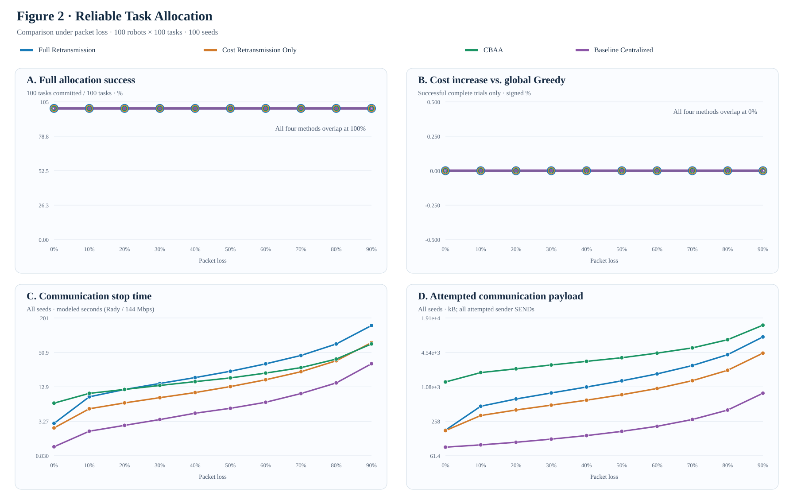

# 大規模多機器人系統之民主式任務分配

**研究目標：**在不可靠通訊環境下，研究完全去中心化的多機器人任務分配（Multi-Robot Task Allocation, MRTA），並以可重現的實驗評估任務分配正確性、封包遺失率、協調時間與其他原生演算法的表現。**目標期刊：**IEEE Robotics and Automation Letters（RA-L）。

**語言：**[English](README.md) | **繁體中文**

> **測量邊界（請先閱讀）：**本文的「通訊時間」是模擬協定的任務分配／停止時間，**不是** Python 程式執行時間，也**不是**在 100 台實體機器人無線網路上量測的時間。Sender Bytes 指嘗試發送的**應用層**負載，**包含遭丟棄的封包**。模型採用 Rady 等人的真實應用層延遲軌跡，但共享 **144 Mbps 無線服務速率是假設模型**，未經 Wi-Fi MAC/PHY 或 ns-3 驗證。Voting 支付可靠 Commit 通訊成本；其餘演算法依原生停止條件結束，因此其完成保證不完全相同。

## 研究架構與實驗分類

本研究整理成 **A／B／C／D 四大實驗家族**。舊開發編號不再作為主要章節，詳見[歷史實驗索引](docs/EXPERIMENT_LEGACY_INDEX.md)。

| 類別 | 主要研究問題 | 已接受的實驗證據 |
|---|---|---|
| **[A. 正確性](#a-任務分配正確性與分散式共識)** | 去中心化協調能否維持受控的最佳化結果？共識需要多少通訊？ | 完整資訊的 Hungarian 驗證、軌跡抽樣的共識成本 |
| **[B. 掉包率](#b-封包遺失韌性與通訊流量)** | 單輪／多輪方法如何隨掉包率改變完成率、通訊量、模擬時間與成本？ | P2D／P2E 兩張四面板曲線，0%～90%，100 Seeds |
| **[C. 時間](#c-協調時間與-deadline-設計)** | 等待、截止時間與共享無線模型各占多少延遲？ | 30% 掉包下的 Deadline 測試及獨立零掉包控制 |
| **[D. 演算法](#d-演算法比較與多任務容量)** | 在相同容量與幾何條件下，原生演算法如何取捨？ | 單任務五方法歷史實驗、獨立容量四的多任務比較 |

### 實作模組與責任

| 責任 | 主要模組 |
|---|---|
| 任務公告與投票 | [任務資訊](democracy_mrta/task_information.py)、[Voting 協調](democracy_mrta/coordination.py)、[多任務 Voting](democracy_mrta/voting_multitask.py) |
| 其他分配演算法 | [原生 CBAA](democracy_mrta/cbaa.py)、[原生 CBBA](democracy_mrta/cbba_multitask.py)；[Price Auction 歷史原始分支](https://github.com/andyfu35/Democracy-based-Task-Allocation-in-a-Large-scale-Multi-robot-System/blob/experiment/e9l-distributed-price-auction/democracy_mrta/price_auction.py) |
| 網路、掉包與模擬時間 | [Network](democracy_mrta/network.py)、[多任務封包](democracy_mrta/multitask_wire.py) |
| 場景、路線與獨立驗證 | [單任務場景](democracy_mrta/scenario.py)、[容量感知場景](democracy_mrta/multitask_scenario.py)、[路線驗證](democracy_mrta/multitask_evaluation.py) |
| 重現實驗 | [實驗程式](experiments/)、[Canonical Protocol](docs/EXPERIMENT_PROTOCOL.md)、[變更紀錄](docs/CHANGE_CONTINUITY.md) |

**架構：**任務公告 → 各機器人自行計算 Cost／路線效用 → 各方法原生的投票、出價、拍賣或 Bundle Consensus → 獨立觀察者驗證分配與訊息紀錄。觀察者**不會**注入全域最佳解，也不代表已支付的分散式終止協定。

## 通訊模型（計算公式、符號與參數）

目前的通訊模型包含四個獨立部分：**(1) 由真實 ROS 控制訊息量測資料抽樣的延遲、(2) 可選用的單一共享 Wi-Fi 媒介 PHY／MAC 簡化模型、(3) 每個接收端的封包遺失與 Deadline 判定、(4) 發送端實際嘗試傳送的應用層 Bytes**。以下是**本研究程式實作的數學模型**，並非某篇論文直接提出的完整原式。實際責任模組為 [network.py](democracy_mrta/network.py) 的 **load_rady_latency_profile**、**EmpiricalLatencySampler.sample_ms**、**BernoulliLossSampler.is_delivered**、**WifiCausalTimingSampler.sample_packet_ms**、**summarize_network**，以及 [coordination.py](democracy_mrta/coordination.py) 內原生協定的訊息發送函數。部分早期實驗只抽樣 Rady 延遲，**沒有啟用**共享媒介計算；以下完整封包公式描述的是較新實驗使用的**可選共享媒介模型**。

### 1. 實測延遲資料與輸入條件

[Rady 等人（2024）的工業機器人 Wi-Fi 量測資料](https://github.com/minarady1/wifi_for_industrial_robotics/tree/1996e5bb69b9ba4d25060cbc14838ddedf65cff2)提供的是**ROS 應用層控制封包延遲**，並不是 100 台模擬機器人的封包層紀錄。本研究預設選取 **Location 2（約 60 m、視線可見 LoS）**、**ax_160mhz_6ghz（Wi-Fi 6E／6 GHz／160 MHz）**，及原始控制紀錄的 **120～181 秒**時間區間；篩選後共有 **121 筆有效延遲樣本**。篩選時只接受有限、非負且時間戳落在上述含端點區間內的延遲值。依實驗 Seed 和封包 Key，以 SHA-256 決定性地選取其中一筆樣本，記為 $D_i^{\mathrm{Rady}}$（毫秒）。此方式為**逐封包重新抽樣**，不代表保留原量測紀錄的時間相關性或空間相關性。

舊版 Rady-only 模型直接使用該筆抽樣延遲；啟用共享媒介後，則只加入經下式扣除假設參考服務時間後的**剩餘延遲**。模型**不會**根據模擬場景中每對機器人的實際距離重新校準 Wi-Fi 連線。

### 2. 封包無線傳輸與因果延遲公式

對第 $i$ 次實際嘗試發送的應用層封包，令 $L_i$ 為封包長度（**Bytes**）、$R$ 為假設的 PHY 傳輸速率（**Mbps**）、$H$ 為每一無線跳（hop）的額外 MAC 資料量，則**單跳傳輸時間（airtime）**為：

$$
T_{\mathrm{air},i}
=\frac{t_{\mathrm{pre}}}{1000}
+\frac{8(L_i+H)}{1000R}
\qquad[\mathrm{ms}].
$$

模型讓每一跳都支付 AIFS 等待及依 Seed 決定的退避時槽（Backoff）。整個封包的**退避時間**與**無線媒介服務時間**分別為：

$$
T_{\mathrm{bo},i}
=\sum_{\ell=0}^{h_i-1}
\frac{t_{\mathrm{AIFS}}+k_{i\ell}t_{\mathrm{slot}}}{1000},
\qquad
k_{i\ell}\in\{0,\ldots,CW_{\min}\},
$$

$$
S_i=h_iT_{\mathrm{air},i}
+T_{\mathrm{bo},i}
+a_i\frac{t_{\mathrm{ACK}}}{1000}.
$$

其中 $h_i$ 表示模擬的無線跳數，$a_i$ 表示計入 MAC ACK 的跳數，$k_{i\ell}$ 是以 Seed、封包 Key 及跳數產生的**可重現偽隨機整數**，並非真實碰撞後的指數退避重傳。模型假設機器人透過一個 AP 通訊，且**所有封包共用一個需依序使用的無線媒介**：

| 封包類型 | $h_i$ | $a_i$ | 假設傳輸路徑 |
|---|---:|---:|---|
| TASK 任務公告 | 1 | 0 | AP 向機器人廣播一跳 |
| 機器人間 Broadcast（例如以廣播發送的 Cost／Vote／Score／Commit） | 2 | 1 | Robot → AP 上行（計 ACK）→ AP 廣播下行（不按接收者分別 ACK） |
| 機器人間 Unicast（例如傳送 Cost 到集中式協調者） | 2 | 2 | Robot → AP → 指定接收者，兩跳都計 ACK |

設 $e_i$ 為目前決策 Epoch 的起始時間、$s_i$ 為該 Epoch 內本封包準備發送的時間；則封包的**絕對釋放時間**為 $r_i=e_i+s_i$。如果 $f_{i-1}$ 是前一封包結束共享媒介佔用的時間（初始 $f_0=0$），則：

$$
Q_i=\max(0,f_{i-1}-r_i),
\qquad
f_i=\max(r_i,f_{i-1})+S_i.
$$

這裡 $Q_i$ 就是因為其他封包先佔用共享媒介所增加的**排隊等待時間**，而 $f_i$ 是目前封包完成無線服務的時刻。

Rady 的真實 ROS 延遲本來就包含部分無線傳輸服務時間；若把原始延遲直接再加上整套新計算的 PHY／MAC 時間，可能**重複計算**。因此本模型先假設一個 **16 Bytes、單跳且有 ACK 的參考 ROS 封包**，估算其平均服務時間：

$$
T_{\mathrm{ref}}
=\frac{t_{\mathrm{pre}}}{1000}
+\frac{8(L_{\mathrm{ref}}+H)}{1000R}
+\frac{t_{\mathrm{AIFS}}+\tfrac12 CW_{\min}t_{\mathrm{slot}}+t_{\mathrm{ACK}}}{1000}.
$$

Rady 實測資料可加入的剩餘量為 $\varepsilon_i=\max(0,D_i^{\mathrm{Rady}}-T_{\mathrm{ref}})$。故封包的**模擬到達時間**與**通訊延遲**為：

$$
t_i^{\mathrm{arrival}}=f_i+\varepsilon_i,
\qquad
T_i^{\mathrm{comm}}=t_i^{\mathrm{arrival}}-r_i
=Q_i+S_i+\varepsilon_i.
$$

將所有項目展開，可得到目前程式使用的**完整可選共享媒介通訊公式**：

$$
\boxed{
T_i^{\mathrm{comm}}=
Q_i+
h_i\left(\frac{t_{\mathrm{pre}}}{1000}
+\frac{8(L_i+H)}{1000R}\right)
+\sum_{\ell=0}^{h_i-1}
\frac{t_{\mathrm{AIFS}}+k_{i\ell}t_{\mathrm{slot}}}{1000}
+a_i\frac{t_{\mathrm{ACK}}}{1000}
+\max(0,D_i^{\mathrm{Rady}}-T_{\mathrm{ref}})
}
$$

**此公式所有時間項目的單位都是毫秒（ms）。**特別注意：共享媒介在 $f_i$ 就釋放，**不會**再被同一封包後續的 Rady 剩餘延遲持續佔住；因此後續封包傳輸可以與先前封包的剩餘延遲重疊。各演算法的**總任務分配／停止時間**必須根據原生事件、Commit、Deadline 或 Guard 的時間順序求出，**不能直接加總所有封包的 $T_i^{\mathrm{comm}}$**。

### 3. 數學符號對照表

| 代號 | 代表意義 | 單位／說明 |
|---|---|---|
| $i$ | 第 $i$ 次實際應用層 SEND，依封包釋放時間排序 | 封包事件編號 |
| $j$ | 第 $i$ 次 SEND 的潛在接收者 | 接收者編號 |
| $\ell$ | 第 $i$ 封包中的無線跳次序 | $0,\ldots,h_i-1$ |
| $L_i$ | 第 $i$ 封包真正送出的應用層負載大小，不含假設 MAC 開銷 | Bytes，依演算法與封包內容改變 |
| $R$ | 假設的實體層 PHY 速率，不是實測吞吐量 | Mbps |
| $H$ | 每一無線跳附加的 MAC 封包開銷 | Bytes |
| $h_i$ | 封包模擬傳送時經過的無線跳數 | TASK 為 1；機器人間訊息為 2 |
| $a_i$ | 需要計入 MAC ACK 的跳數 | 0、1 或 2，見上方傳輸路徑表 |
| $k_{i\ell}$ | 第 $i$ 封包在第 $\ell$ 跳使用的退避時槽數 | 整數，介於 0 與 $CW_{\min}$ |
| $t_{\mathrm{pre}}$ | PHY Preamble（實體層前導訊號）時間 | 微秒 $\mu$s |
| $t_{\mathrm{AIFS}}$ | AIFS（仲裁訊框間隔）等待時間 | 微秒 $\mu$s |
| $t_{\mathrm{slot}}$ | Backoff Slot（退避時槽）時間 | 微秒 $\mu$s |
| $t_{\mathrm{ACK}}$ | 單次假設 MAC ACK 服務時間 | 微秒 $\mu$s |
| $CW_{\min}$ | 起始競爭窗口所允許的最大退避時槽索引 | 無單位整數 |
| $e_i,s_i,r_i$ | Epoch 起始時間、該 Epoch 內 SEND 時刻及絕對釋放時間，$r_i=e_i+s_i$ | ms |
| $f_{i-1},f_i$ | 前一封包／目前封包釋放共享媒介的時刻 | 絕對模擬時間 ms |
| $Q_i$ | 本封包等候共享媒介可用的排隊時間 | ms |
| $T_{\mathrm{air},i}$ | 本封包的單跳無線傳輸時間 | ms |
| $T_{\mathrm{bo},i}$ | 本封包所有跳數的 AIFS 加退避時間 | ms |
| $S_i$ | 本封包全部無線跳的 airtime、Backoff 與 ACK 服務總時間 | ms |
| $D_i^{\mathrm{Rady}}$ | 依 Seed／Key 從 Rady 實測資料抽樣的 ROS 延遲 | ms |
| $L_{\mathrm{ref}}$ | 假設的參考 ROS 控制訊息大小 | Bytes |
| $T_{\mathrm{ref}}$ | 假設的參考單跳封包平均服務時間 | ms |
| $\varepsilon_i$ | 扣除參考服務時間後未重複計算的實測剩餘延遲 | ms |
| $t_i^{\mathrm{arrival}}$ | 本封包的模擬接收端到達時刻 | 絕對模擬時間 ms |
| $T_i^{\mathrm{comm}}$ | 本封包從釋放到到達的通訊延遲 | ms |

| $p_{\mathrm{loss}}$ | 設定某封包類型在指定接收端的遺失機率 | 機率 $[0,1]$；依 Cost／Vote 等階段指定 |
| $u_{ij}$ | 第 $i$ 封包對第 $j$ 接收者，以 Seed／Key 決定的偽隨機數 | $[0,1)$ 範圍內的偽均勻數 |
| $X_{ij}$ | 接收成功指標：收到為 1、掉包為 0 | 二元值，取決於 $u_{ij}$ 與 $p_{\mathrm{loss}}$ |
| $d_{ij}$ | 第 $j$ 接收者在該訊息階段適用的決策 Deadline（若有啟用） | 絕對模擬時間 ms |
| $Y_{ij}$ | 同時符合接收成功與截止時間的可使用訊息指標 | 二元值；無 Deadline 時 $Y_{ij}=X_{ij}$ |
| $\mathcal{S}_{\mathrm{emitted}}$ | 真正產生的 SEND 事件集合，不包含發送前被 Budget 拒絕的訊息 | 所有已嘗試傳送的實體 SEND 集合 |
| $B_{\mathrm{app}}^{\mathrm{sender}}$ | 發送端實際嘗試的應用層總流量，包含所有掉包嘗試 | Bytes；圖表 kB = Bytes／1,000 |
| $B_{\mathrm{hop,proxy}}$ | 依無線跳數估算的等效傳輸量，並非實際空中擷取流量 | 模擬位元組等效值 |

### 4. 目前使用的參數設定表

| 參數 | 目前共享媒介主要設定 | 來源與性質 |
|---|---:|---|
| Rady 實測位置與模式 | Location 2；約 60 m LoS；Wi-Fi 6E 6 GHz / 160 MHz | Rady 原始實測資料選擇 |
| Rady 取樣區間／有效筆數 | 120～181 s／121 筆 | 原始 ROS 控制封包延遲篩選 |
| $R$ | **144 Mbps** | **假設值**，並非 Rady 的實際連線速率；600、1,200 Mbps 另作 E9G 敏感度測試 |
| $H$ | 每跳 **64 Bytes** | 假設 MAC 額外負載 |
| $t_{\mathrm{pre}}$ | **120 $\mu$s** | 假設 PHY 前導時間 |
| $t_{\mathrm{AIFS}}$ | **34 $\mu$s** | 假設通道存取等待 |
| $t_{\mathrm{slot}}$ | **9 $\mu$s** | 假設退避時槽 |
| $CW_{\min}$ | **15**，因此 $k_{i\ell}=0,\ldots,15$ | 假設退避窗口 |
| $t_{\mathrm{ACK}}$ | 每個需 ACK 的跳數 **45 $\mu$s** | 假設 MAC ACK 成本 |
| $L_{\mathrm{ref}}$ | **16 Bytes** | 假設參考 ROS 控制封包 |
| $L_i$ | 每個原生封包真正編碼後的大小 | 依演算法實際 SEND，**並非固定 16 Bytes** |
| $p_{\mathrm{loss}}$ | 依實驗指定，例如 0%～90%、每 10% 一點 | **外加的 Bernoulli 掉包假設**，不是由 Rady 掉包資料直接擬合 |

### 5. 封包遺失、Deadline 與通訊量公式

對第 $i$ 次 SEND 與接收端 $j$，先用實驗 Seed／封包 Key 產生可重現的偽隨機均勻數 $u_{ij}\in[0,1)$，由**接收端 Bernoulli 掉包模型**決定封包是否收到：

$$
X_{ij}=\mathbf{1}\{u_{ij}\ge p_{\mathrm{loss}}\},
\qquad
\Pr(X_{ij}=1)=1-p_{\mathrm{loss}}.
$$

對存在決策截止時間 $d_{ij}$ 的 Cost／Vote 等封包，真正能被決策使用還必須**及時到達**：

$$
Y_{ij}=X_{ij}\,
\mathbf{1}\{t_i^{\mathrm{arrival}}\le d_{ij}\}.
$$

其中 $X_{ij}=1$ 表示接收成功，而 $Y_{ij}=1$ 才表示**成功且在 Deadline 前可使用**。若該階段沒有截止時間限制，就使用 $Y_{ij}=X_{ij}$。即使封包物理上送達，太晚的 Cost／Vote 仍可能不被原生投票階段採納。此掉包率依接收端判斷，**並非** Burst Loss、碰撞或距離衰減的真實無線模型；新模型也**沒有**暗中幫丟失封包進行 Wi-Fi 重傳。現有 Voting 主實驗設定 Cost／Vote 為可掉包類別，TASK／Score／Commit 依該實驗的可靠控制訊息假設處理。

通訊量採**發送端實際嘗試傳送的應用層 Bytes**，即使接收端全部掉包也照算：

$$
B_{\mathrm{app}}^{\mathrm{sender}}
=\sum_{i\in\mathcal{S}_{\mathrm{emitted}}}L_i,
\qquad
B_{\mathrm{app}}^{\mathrm{sender}}[\mathrm{kB}]
=\frac{B_{\mathrm{app}}^{\mathrm{sender}}[\mathrm{B}]}{1000}.
$$

其中 $\mathcal{S}_{\mathrm{emitted}}$ 是**實際已發送事件集合**。**一次 Broadcast 只計一次 SEND**，不乘上接收者人數；若因發送 Budget 不足而在 SEND 產生前被拒絕，則不計入。程式另可產生**模擬無線跳等效 Bytes** 作為診斷：

$$
B_{\mathrm{hop,proxy}}=\sum_{i\in\mathcal{S}_{\mathrm{emitted}}}h_i(L_i+H).
$$

但這個 $B_{\mathrm{hop,proxy}}$ **不是 README 圖中使用的應用層 Sender Bytes**，也不是真正包含重傳的空中擷取流量。原生停止時間、單封包延遲與 Python 計算執行時間是三個不同指標。

### 6. 數值計算範例（僅示意，非真實量測樣本）

假設傳送一次 **100 Bytes 的機器人間 Broadcast**，選擇 $R=144$ Mbps、$h_i=2$、$a_i=1$，兩跳 Backoff 時槽分別是 $k_{i0}=4$、$k_{i1}=10$，共享媒介暫時沒有排隊（$Q_i=0$），並假設 Rady 抽到的示例延遲為 $D_i^{\mathrm{Rady}}=20$ ms。代入後：

$$
T_{\mathrm{air},i}=0.129111\ \mathrm{ms/hop},\quad
T_{\mathrm{bo},i}=0.194000\ \mathrm{ms},\quad
S_i=0.497222\ \mathrm{ms},
$$

$$
T_{\mathrm{ref}}=0.270944\ \mathrm{ms},\quad
\varepsilon_i=19.729056\ \mathrm{ms},\quad
\boxed{T_i^{\mathrm{comm}}\approx20.226278\ \mathrm{ms}}.
$$

這次 Broadcast 的圖表用**應用層 Sender Bytes 為 100 B**，而額外的無線跳等效診斷是 $2(100+64)=328$ B。即使有接收端掉包，這次 SEND 已支付的兩項發送負載都不會消失。

### 7. 論文來源、使用範圍與限制

| 研究文獻 | 本專案採用的部分、與未採用的部分 |
|---|---|
| [Rady 等人（2024），*How does Wi-Fi 6 fare? An industrial outdoor robotic scenario*](https://doi.org/10.1016/j.adhoc.2024.103418) | 使用真實的工業 ROS 控制封包延遲與[固定版本資料](https://github.com/minarady1/wifi_for_industrial_robotics/tree/1996e5bb69b9ba4d25060cbc14838ddedf65cff2)；**不是** 100 台機器人網路實測 |
| [Bianchi（2000），IEEE 802.11 DCF 分析](https://doi.org/10.1109/49.840210) | 參考 CSMA／CA 媒介競爭及 Backoff 概念；**沒有**實作該論文的碰撞／重傳固定點方程 |
| [Montgomery 與 Candell（2024），NIST IR 8506](https://doi.org/10.6028/NIST.IR.8506) | 參考商用 AP 啟動 OFDMA 的實際限制；目前模型**沒有實作 OFDMA** |
| [Liu 與 Choi（2023），Wi-Fi 6 量測](https://doi.org/10.1145/3579451) | 作為多裝置 Wi-Fi 6 量測參考；**沒有**使用該文資料擬合目前延遲 |
| [ns-3 Wi-Fi 模型文件](https://www.nsnam.org/docs/models/html/wifi-design.html) | 未來可用於封包層校準；**目前並未執行 ns-3** |

目前模型**沒有真正模擬** AP 封包碰撞、CW 自適應增長、每台 STA 的 EDCA 佇列、OFDMA／RU 排程、MAC 重傳或有相關性的空間干擾。144 Mbps 是**假設的服務速率**，不是從 Rady 的 60 m LoS 實驗直接量得的有效傳輸速率；實測延遲的剩餘量拆分也是模型近似，而非可獨立量測的分量。因此本研究可宣稱的是**模擬應用層通訊時間與實際嘗試發送的應用層負載**，不是 100 台真實機器人在 Wi-Fi PHY／MAC 上量測的通訊效能。完整實驗條件見 [Canonical Experiment Protocol](docs/EXPERIMENT_PROTOCOL.md) 第 35～38 節及[通訊模型文獻清單](docs/references/e9g_wifi_timing.bib)。

## A. 任務分配正確性與分散式共識

**研究問題：**當 **Hungarian 最佳化器固定相同**時，去中心化協調是否仍能達成正確的任務分配？

| 已完成實驗 | 條件 | 驗證結果 |
|---|---|---|
| 完整資訊正確性 | 5 種 Robot／Task 規模，各 100 Seeds，0% 掉包 | **500/500 成功完成**，最佳化差距為零，參考指派無不一致 |
| 真實延遲軌跡抽樣的共識成本 | 2,000 筆原始紀錄，20 個測試 Cell | 100 台機器人／50 個任務時，Democracy-Hungarian：**796.2 ms、201,400 B**；Leader-Hungarian：**477.4 ms、41,600 B** |

完整資訊下可維持最佳化正確性，但去中心化共識仍有額外通訊成本。**本節 Hungarian 控制組不可與 B 節的 Greedy Voting、CBAA 或 CBBA 最佳化品質數據混合比較。**

**原始證據：**[正確性原始資料](results/e0_protocol_correctness/raw/e0_corrected_20261009T141508Z.csv)／[彙總](results/e0_protocol_correctness/summary.csv)；[共識延遲原始資料](results/e1_latency/raw/e1_20261009T144026Z.csv)／[彙總](results/e1_latency/summary.csv)。

先前一次性掉包 Hungarian Voting 探索未達完整逐票接受條件，已歸檔，**不是**上述兩項已完成主張的待補驗證。詳見[歷史索引](docs/EXPERIMENT_LEGACY_INDEX.md)。

### 舊版一次批次投票比較（非逐任務投票）

**協定區別：**這是已經驗證的 **P2G 一次批次投票**，**不是**新版 P2H 逐任務投票。每台機器人依自己收到的 Cost 先規劃 T0～T99 任務順序，再把完整候選指派透過 **一次批次 Vote** 廣播出去，由原生 Score／Commit 處理；**不會每個任務重新投票、Commit、退休機器人後再規劃**。對照組為一次接收 Cost、批次決策的特定 Centralized Task-Ordered Greedy Baseline。設定為 100 台機器人、100 個任務、容量 1、每個掉包率 100 個配對 Seeds；成本分母和新版 P2H 圖一同樣採完整資訊 **Task-Ordered Greedy**，但通訊過程及 Commit 時序不同。

此圖 A 面板使用所有 Seeds 的**平均已指派任務比例**，由原始審核通過的 P2G 彙總資料重新繪製，不再把「只有 99/100 個任務」視為 0% 完成。**90% 掉包**時，一次批次 Proposed 完成 **16.12%** 的任務，集中式基準完成 **10.54%**，兩者皆無完整完成 100 個任務的 Seeds。新版 B 節 P2H 逐任務 Proposed 則達 **100%** 平均完成比例，但傳輸次數與時序不同，因此這是**不同協定的描述性對照**，不能把差距全部歸因於逐任務機制本身。未完整成功的成本留空、不補零；提早失敗停止不等於成功完成更快；發送量包括接收端掉包的 SEND。[P2G 原始方法與審核](docs/P2G_TWO_FIGURES.md) · [20 組來源彙總](docs/figures/p2g/formal/verified_figureA_20point_summary.csv)。

## B. 封包遺失韌性與通訊流量

**2026-10-21 更新之主要比較：**圖一仍為真正逐任務投票與 Cost 僅交換一次的 Task-Ordered Centralized Greedy 基準；圖二改為 **Full Retransmission、Cost Retransmission Only、CBAA、Baseline Centralized** 四條曲線，舊版 Proposed 多輪決策及 CBBA 不再出現在*主要圖二*，但歷史 P2G 原始證據保留。兩圖皆為 100 Robots、100 Tasks、capacity=1、0%～90% 掉包率（間距 10%），每組 100 Seeds。**圖一成本分母是完整資訊 Task-ID-Ordered Greedy；圖二分母是完整資訊 Global Minimum-Pair Greedy，兩者不可混為一談。**

### 圖一：逐任務任務分配

Proposed 對 T0 至 T99 逐一投票，每個任務只嘗試一次，收到票後產生 Score／Commit、退休已指派機器人，再進行下一個任務。集中式基準只使用首次實際收到的 Cost，逐任務支付 Assignment 與 Commit 傳輸。圖一 A 為**平均已完成任務比例**，不是全任務完成才算成功。

90% 掉包時，Proposed **100% 任務完成比例、100/100 Seeds 全部完成**；這個**不重傳 Cost 的特定集中式基準**僅有 10.54% 平均任務完成比例、0/100 Seeds 全部完成。Proposed 為 254.23 kB、模擬停止時間 27.50 s；集中式為 84.58 kB、1.37 s，後者因**未全部完成便停止**，不能稱為成功完成速度更快。Proposed 成本上升 **+79.26%**，其分母為**完整資訊 Task-ID-Ordered Greedy**，不是圖二 Global Greedy。

0% 掉包時雙方皆 100/100 全部完成，對 Task-ID Greedy 成本差異皆為 0%；Proposed 16.47 s／249.25 kB，集中式 7.48 s／89.23 kB。正式資料 **2,000 筆、20 組；266,856 項獨立稽核、0 錯誤**。Proposed 高成功率依賴本地自投票、一張收到的正票即可形成相對多數，以及可靠 Score／Commit；不能外推成真實無線網路下的一般成功保證。

[正式 P2H 獨立審核](docs/P2H_FORMAL_100SEED_AUDIT.md) · [20 組已驗證統計](docs/figures/p2h/formal/verified_20point_summary.csv) · [P2H 規格](docs/P2H_INTERACTIVE_FIGURE1.md)。

### 圖二：可靠 Cost／Vote 重傳比較

**保留四種方法：** **Full Retransmission**（P2I：Cost 與 Vote 原封包均使用 ACK 確認並對缺失資料重傳）、**Cost Retransmission Only**（P2I：Cost 可靠補傳後，每台機器人僅發送一次可能掉包的 Batch Vote）、**CBAA**（原生共識拍賣方法）及 **Baseline Centralized**（單一協調者對缺失 Cost 補傳，再執行一次 Global Greedy 的特定集中式基準）。P2I 的兩個模式皆為**一次決策回合**，並非舊版最多 300 輪重新決策。舊 Proposed 與 CBBA 僅從主要圖二移除，原始 P2G 歷史圖與來源未刪除；單一集中式基準不代表所有集中式演算法。

**90% 掉包率、各方法 100 Seeds：**四種方法皆為 100/100 完整完成，對**完整資訊 Global Minimum-Pair Greedy** 的平均成本差異皆為 **0%**。Full Retransmission 為 **148.53 s／8,661.80 kB**；Cost Retransmission Only 為 **75.08 s／4,405.01 kB**；CBAA 為 **71.38 s／14,135.60 kB**；Baseline Centralized 為 **32.40 s／828.93 kB**。只補傳 Cost 相對完整重傳，時間降低 **49.45%**、發送量降低 **49.14%**，但本次的特定集中式基準仍在時間與 Bytes 上優於兩個 P2I 模式。兩個 P2I 模式都能完整指派，與原生**本地自投票、一票相對多數及可靠 Score／Commit** 有關，不能宣稱實體網路也完全可靠。

**計量與資料限制：** Bytes 計入每次實際嘗試的 DATA SEND、重傳及有計費的應用層 Cost／Vote bitmap ACK；封包即使掉包仍計入發送量。P2I 之 ACK、TASK、Score、Commit 採可靠控制訊息假設；未模擬 ACK 掉包、RF 碰撞、MAC 重傳、OFDMA 或實體 100 台機器人量測。CBAA 原生結束條件與 Proposed 的付費 Commit 並不完全相同。P2I 是 **2,000 筆新執行案例**；CBAA 與 Centralized 為歷史來源資料而非本次重跑。集中式曲線的時間與 kB 使用**舊版已驗證 P2G SVG tooltip 四位小數**，未冒稱有更高精度。全部 40 組繪圖資料獨立保存並標明來源，未完成案例不可把成本差異補零。

[圖二 40 組來源資料](docs/figures/p2i/formal/verified_40point_summary.csv) · [P2I 正式資料稽核](docs/P2I_FORMAL_100SEED_AUDIT.md) · [P2I 原生實驗規格](https://github.com/andyfu35/Democracy-based-Task-Allocation-in-a-Large-scale-Multi-robot-System/blob/experiment/p2i-cost-vote-ackretry-20261021/docs/P2I_RELIABLE_TRANSPORT.md)。

## C. 協調時間與 Deadline 設計

**歷史方法注意事項：**本節 E9G／E9I Deadline 圖使用早期序列式 Voting（或各控制組明示的舊協定），**不是**現在 P2-B／P2-C 的批次 Greedy Voting。因此其機器人數量／時間曲線，不能宣稱為當前批次協定的規模延遲。要更新此圖，需要以相同 E9I 規模和 Seeds **只重跑新的 Voting**，而不須重跑未改變的原生 Baseline。

**研究問題：**通訊時間主要來自等待遲到的 Cost／Vote，還是模擬共享媒介封包服務？

### 30% 掉包下的自適應 Deadline

**正式條件：**機器人數 = 任務數，從 5 到 100，每次增加 5；每個規模 **100 Seeds**，Cost 與 Vote 封包遺失率都設定為 **30%**。舊基準與新的 Deadline 策略採配對條件。

在 **100 Robots／100 Tasks** 時，舊的固定 Deadline＋收到票數相對多數決，平均模擬時間 **71.918 s**；採用受保護的一次 Cost 傳輸與自適應 Vote Deadline 後為 **20.132 s**，**模擬時間下降 72.01%**。該規模兩組都完成 **100/100 Seeds**。**不表示**發送資料量也降低 72%，更不表示最佳化品質提升。[20 點原始資料](docs/figures/e9i_cost30/formal/formal_20point_plot_data.csv) · [來源 Manifest](docs/figures/e9i_cost30/formal/formal_publication_manifest.json)。

### 無線模型敏感度：獨立零掉包控制

固定 **100 台機器人、0% 應用層掉包、609.113 ms 任務等待**時，只使用 Rady 延遲的模型為 **68.143 s**，增加假設的 144 Mbps 共享無線服務後為 **68.224 s**，差 **81.722 ms**。這是**零掉包控制**，不是 30% Deadline 實驗的第二條曲線，也不是 100 台實體 Wi-Fi 的量測。[原始資料](docs/figures/e9g_wifi/formal/scaling_20points_verified.csv) · [Manifest](docs/figures/e9g_wifi/formal/publication_manifest.json)。

## D. 演算法比較與多任務容量

**歷史 P1 基準，非最新 P2-C：**以下 P1 圖採早期序列式 Voting，早於批次 Greedy。歷史圖保留五方法擴充比較；**Voting Multi-task 不屬於目前 P2-C 的正式四方法主比較**。P1 原始案例作為歷史證據保留。目前新批次 Voting 的 N=T=100 比較請看 B 節；其他規模需要新的配對 Voting 實驗。

**研究問題：**在相同容量和場景幾何條件下，各演算法的原生分配品質、協調時間、流量和完成率如何取捨？

### 單任務容量一：歷史五原生演算法比較

**P1 正式來源 ZIP 已獨立審計：零資料完整性錯誤。**N=T=25、50、100；每台機器人最多執行 **1 項任務**；各方法原生有損封包的掉包率為 **30%**；每個規模 **100 配對 Seeds**。**五個方法在相同來源 Commit 下都重新執行**，共 **1,500 個原始方法案例**，並非拼接舊的三方法平均數。外部觀察者只在實際原生通訊階段完成後，紀錄首次出現全域唯一可行分配的時刻，不另行送訊息，也不改變機器人；各演算法的原生停止／Guard 另行記錄。

| N=100；30% 掉包；100 Seeds | Voting | 原生 CBAA | Price Auction | Voting Multi-task | 原生 CBBA |
|---|---:|---:|---:|---:|---:|
| **外部首次全域可行（s）** | 20.132 | **7.898** | 119.400¹ | 101.919 | 11.539 |
| 原生協定模擬停止（s） | 20.132 | 13.647 | 135.828 | 101.919 | **12.368** |
| 嘗試發送應用層資料（十進位 kB） | **255.50** | 2,693.04 | 353.94 | 305.39 | 6,488.06 |
| **原生完整完成** | 100/100 | 100/100 | **78/100** | 100/100 | 100/100 |
| 曾觀察到首次可行 | 100/100 | 100/100 | 79/100 | 100/100 | 100/100 |
| 歐氏成本／Hungarian²（越低越好） | 1.3668 | 1.2348 | **1.1173** | 1.3673 | 1.2348 |

¹ Auction 首次可行時間僅對**已觀察到的 79 Seeds**平均；另外 22 個 Guard 失敗案例仍納入 **100 Seeds 的原生停止時間與 Sender Bytes**，未觀察到的首次可行時間**不補值**。² Hungarian 成本比僅採**五方法共同原生完成的相同 78 Seeds**，與表中的無條件成功次數不同。

**重要發現：以相同觀測事件比較，速度排序會反轉。**N100 時，CBAA 首次可行平均為 **7.898 s**，在全部 100 個配對 Seeds 都早於 CBBA 的 **11.539 s**；但 CBBA 自身原生停止平均 **12.368 s**，快於 CBAA 的 **13.647 s**。配對平均差（CBAA − CBBA 首次可行）為 **−3.640 s**，10,000 次配對 Bootstrap 的 95% CI 為 **[−3.939, −3.364] s**。CBAA 與 CBBA 在全部 **300 個 N／Seed 配對場景**產生**完全相同的最終指派**，但 N100 時 CBBA 發送 **2.41 倍**於 CBAA 的應用層 Bytes。因此，此比較主要凸顯原生訊息與停止條件的差別，並非 CBAA／CBBA 指派品質差別。

**完成率與品質取捨：**Price Auction 的共同成功樣本 Hungarian 成本比最低，但在 N100 原生完成率僅 **78%**。1,500 個原始案例中，**1,476** 原生完成、**1,478** 曾出現首次外部可行解；全部 **24** 次原生 Guard 失敗都屬 Auction（N50 有 2 次、N100 有 22 次）。其中 2 個原生終點失敗已先有外部可行解，證明**原生停止與外部首次可行不可互換**。

**限制：**Voting 會支付 Score／Commit 通訊成本，其餘方法採自身原生停止或觀察者終止條件；首次可行只是一個唯讀模擬事件，**不是**已支付的分散式終止或共同知識。即使幾何、Seeds 和測量方式匹配，各方法的有損封包類別與目標函數仍有差異。時間採 Rady 應用層延遲和假設的 144 Mbps 共享無線模型，**不是** 100 台實體機器人的 Wi-Fi 實測時間。

**正式證據：**[P1 原始 ZIP 獨立審核](docs/P1_FORMAL_100SEED.md) · [15 列原始 Summary](docs/figures/p1/formal/original_summary_p1.csv) · [五方法共同成功品質](docs/figures/p1/formal/original_same_success_quality_p1.csv) · [機器審核結果](docs/figures/p1/formal/p1_independent_original_zip_audit.json) · [預先註冊的原生實作](docs/P1_MATCHED_FIVE_NATIVE.md)。更早期 **20 種規模的歷史描述性比較**另存於 [E9N 審核](docs/E9N_FORMAL_100SEED.md) 和[原始圖](docs/figures/e9n/formal/primary_five_method_time_bytes_success.svg)，並未覆蓋或更名。

### 多任務分配：獨立容量四測試組

**正式條件：**25 Robots、100 Tasks、每台最多 **4 Tasks**、30% 掉包、100 配對 Seeds。更正後的完整原始 ZIP、路線與封包帳本皆已獨立驗證。

| 容量四指標 | Voting Multi-task | 原生 CBBA |
|---|---:|---:|
| 分配完整完成 | **100/100** | **100/100** |
| 模擬分配／停止時間 | 63.023 s | **6.878 s** |
| Sender Payload | **116.83 kB** | 1,006.87 kB |
| 全機器人總行駛距離 | 1,319.76 m | **1,209.48 m** |
| 最長機器人路線（Makespan） | **134.55 s** | 148.64 s |

**總路線長度**與**最長路線時間**是不同目標；物理路線 Makespan 也不是任務分配協調時間。此容量四結果**不可**當作容量一圖上的一個資料點。[獨立來源驗證報告](docs/E9M_CORRECTED_ORIGINAL_ZIP_AUDIT_100SEED.md)。

## 剩餘驗證與後續研究

先前優先要求的「五種原生方法、相同外部量測邊界」比較**已完成並通過來源驗證**。不會自動重跑歷史探索實驗，也不會無故增加新最佳化 Baseline。詳見[研究收斂計畫](docs/RESEARCH_CLOSURE_PLAN.md)。

| 若要提出的論文主張 | 需要追加的驗證 |
|---|---|
| **真實網路／Wi-Fi 通訊時間** | 先以封包層模擬或受控多主機量測驗證假設的 144 Mbps 共享無線服務與封包時序；若只主張**模擬通訊時間**，則不強制追加。 |
| **容量四多任務可擴展性** | 需要時再預先指定一個額外 C4 規模（例如 50R／200T）；目前 25R／100T 只有一個有效實驗點，不可稱為完整規模曲線。 |
| **未完成的探索控制** | 僅封存，不強制補跑。 |

## 可重現性、歷史紀錄與主要限制

- [歷史內部實驗索引](docs/EXPERIMENT_LEGACY_INDEX.md) · [歷史結果明細](docs/EXPERIMENT_RESULTS_ARCHIVE_20261012.md) · [舊 README 快照](docs/README_PRE_ABCD_20261013.md)。
- [跨實驗資料審核](docs/EXPERIMENT_RESULTS_AUDIT_20261012.md) · [Canonical Protocol](docs/EXPERIMENT_PROTOCOL.md) · [變更紀錄](docs/CHANGE_CONTINUITY.md) · [文獻](docs/references/e9g_wifi_timing.bib)。
- [P1 五原生方法來源審核](docs/P1_FORMAL_100SEED.md) · [E9N 單任務歷史來源審核](docs/E9N_FORMAL_100SEED.md) · [E9M 多任務來源審核](docs/E9M_CORRECTED_ORIGINAL_ZIP_AUDIT_100SEED.md)。原始 ZIP 以原狀保留於個人檔案庫，其 SHA-256 識別資訊已記錄。

**比較邊界不可混淆：**方法原生停止時間 ≠ 所有演算法共同且已支付的終止保證；合成時序的掉包研究 ≠ Rady 無線代理模型；容量 1 ≠ 容量 4；歷史彙總來源 ≠ 新重新執行的配對原生來源。本文**沒有**主張已完成 100 台機器人實體 Wi-Fi 部署實驗。
