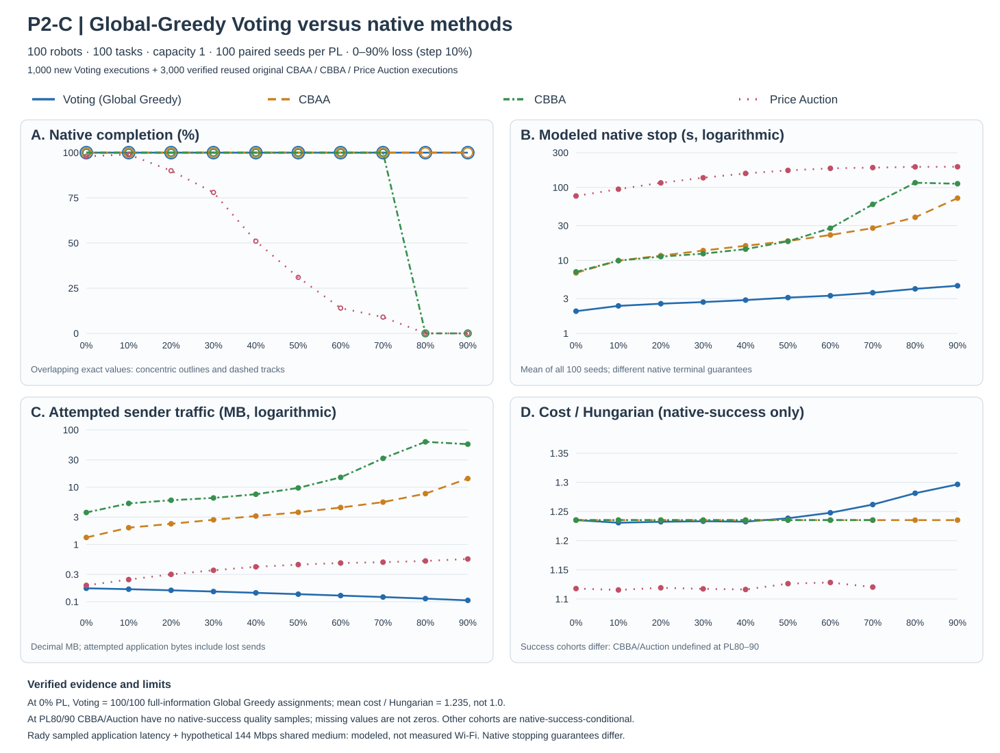

# P2-C formal: Global Greedy Voting × 100 paired seeds × 10 receiver-loss levels

**Status: independently audited COMPLETE (2026-10-13).** Original user-uploaded Mac ZIP `p2c_global_greedy_100seed.zip` contains **1,000 newly executed Global Greedy Voting cases** (PL 0,10,…,90%, Seeds 0..99) plus **3,000 exactly reused original CBAA/CBBA/Price Auction cases**. Both source streams were independently verified per case, with **zero discrepancies across 71,156 check invocations**. This is a native simulated model result, not a physical Wi-Fi field test. No original baseline algorithm was rerun.

## Immutable source, exact executed code and independent checks

- **New original P2-C ZIP:** `p2c_global_greedy_100seed.zip` (1,705,448 bytes), SHA256 `f50068e4569771538f3083b8434bc91bce1f42bdec44e8feb74407be90682055`. The run manifest identifies *executed Git* `8038370205d586c697295b42eb255812be7aa88e`, UTC completion `2026-10-13T14:52:04.135167+00:00`; study identifier `P2C_1000_global_greedy_voting_plus_3000_SHA_pinned_baselines_C1`.
- **Original new source files inside ZIP:** `per_seed_p2.csv` SHA256 `a5f6c59837b80596066752c6546a37a387b4ccf177f8d4f1c03c527309a4a5fe` (exactly 1,000 new Voting); `per_seed_p2_combined.csv` SHA256 `859ad11170a387c6d950b7bde82857e6370b4d1cfa1803b62984090eff698448` (exactly 4,000 combined); `summary_p2.csv` SHA256 `1f6077ee3ec0deed1ec90b7d90f0b8547330a66b97f12dbc76389bd4dfb722ac` (40 recomputed groups); `summary_voting_p2b.csv` SHA256 `4fd6e858b21fede6efaac66dc39f1e7289e7221c3eaea04b0adef4ad93c97c3b` (10 Voting-only groups; *filename retained for runner backwards compatibility, content is P2-C*); original user-run `packet_loss_robustness.svg` SHA256 `615e024a83e13a4e1d354550b47353dfc1704642575d68e1a728817c21a89a1c`. All manifest member hashes, ZIP CRC and 1,000 original terminal method lines match.
- **Unchanged original baselines:** `p2_loss10_100seed.zip` original ZIP SHA256 `1d08a167308b9368ee2a764737066223ac041a5bd6508621c7b6cd0320036bb9`, 4,000-row original source CSV SHA256 `78c4871a9f0e391c11c92ace9c2b532695d2a2c4ca40d31166e31bf89901e5fc`, executed original Git `f514cfa3613e7b0bad5c739d136b09fea8c3f92c`. The 3,000 reused baseline rows are **identical in every original field**. Each of the 4,000 final rows retains `source_role` and per-method original executed `source_git_sha`. The earlier P2-B Task-ID Voting archive SHA256 `acd3dd389303a58cb27a16f46f29b6008f8b4678ff786d249e13caf60d61c08a` is historical and was not edited.
- **Independent audit:** recomputed all 100 deterministic 100m scenes, 100 Hungarian minima by SciPy, and per-case one-to-one assignment feasibility. There are **3,293 fully feasible final outcomes** (3,270 method-native successes plus 23 feasible cases not meeting baseline method-native terminal guards), of which **all 1,000 new Voting outcomes are fully feasible and natively successful**. Recalculated actual physical 100-task Euclidean total distance, Hungarian ratio/gap and makespan for each complete case, preserved blanks on incomplete cases, and checked all source SHA and loss/seed/method uniqueness. Verified all 1,000 Voting sender frame counts/payload sums and TASK+Cost+Vote/Score+Commit time additivity; recomputed all 40 four-way statistics and 10 Voting-only groups; matched all 1,000 original log lines. **Errors: 0**.
- **0% PL actual native Vote/Score/Commit proof:** every one of 100 new Voting assignments, including exact robot-task pair IDs, matches an **independently calculated exhaustive Global lowest-cost-pair Greedy** oracle. Original CBAA and CBBA at 0% match those same exact pairs in 100/100 seeds each. All 100 new Voting native results are one batch epoch; per-case TASK is **one logical announcement, 3 physically framed sends**, Cost **100 original sends exactly once**, then actual batch Vote/Score and reliable Commit. Greedy / Hungarian mean = **1.2352608182858986**, while Greedy / the same complete-information Greedy = **1.000000**. Hungarian was never the executed Voting assignment solver.

## New P2-C versus accepted old P2-B Task-ID Greedy (all 100 paired seeds per PL)

| PL | New Global Greedy cost/Hungarian | Old Task-ID cost/Hungarian | Relative cost reduction | New modeled native stop | Old modeled native stop |
|---:|---:|---:|---:|---:|---:|
| 0% | 1.2353 | 1.3512 | 8.6% | 2.014 s | 2.027 s |
| 10% | 1.2308 | 1.5154 | 18.8% | 2.382 s | 2.584 s |
| 20% | 1.2324 | 1.6751 | 26.4% | 2.551 s | 2.805 s |
| 30% | 1.2333 | 1.8249 | 32.4% | 2.686 s | 3.120 s |
| 40% | 1.2326 | 2.0031 | 38.5% | 2.859 s | 3.551 s |
| 50% | 1.2385 | 2.1854 | 43.3% | 3.094 s | 4.110 s |
| 60% | 1.2479 | 2.3994 | 48.0% | 3.285 s | 4.745 s |
| 70% | 1.2619 | 2.7027 | 53.3% | 3.607 s | 5.843 s |
| 80% | 1.2814 | 3.1209 | 58.9% | 4.075 s | 7.727 s |
| 90% | **1.2966** | **3.8404** | **66.2%** | **4.494 s** | **11.742 s** |

At 90% the mean new Voting attempted sender traffic is **105.671 kB** versus old P2-B **142.008 kB**, a 25.6% reduction. Both versions maintain 100/100 native success at every PL. The combined **planner and received-Score priority** were modified together; these experiments do not isolate each contribution individually. If one wants causal attribution by function, conduct an explicit separate ablation.

**Paired 10,000-bootstrap (RNG 20261013, percentile95%, reduction in ratios of mean values; no network generalization claim):** at PL90, assignment-ratio reduction **66.24% [65.09%,67.34%]** and modeled-stop reduction **61.73% [60.23%,63.14%]**. At PL30: ratio reduction **32.42% [30.69%,34.16%]**, stop reduction **13.91% [10.45%,17.14%]**. At PL0, modeled-stop reduction 0.64% CI [−1.32%,2.57%], so there is no strong paired evidence for a speed change at 0% even though cost improves. These CIs quantify variation across 100 selected simulation Seeds only.

## Comparing original native methods under extreme loss

| PL90 method | Native full completion | Mean modeled native STOP | Mean sender payload | Mean native-success Cost/Hungarian |
|---|---:|---:|---:|---:|
| **New Voting (Global Greedy)** | **100/100** | **4.494 s** | **105.671 kB** | **1.2966** |
| CBAA | **100/100** | 71.383 s | 14,135.600 kB | **1.2353** |
| CBBA | 0/100 | 112.530 s (guard) | 56,343.948 kB | missing |
| Price Auction | 0/100 | 192.190 s (guard) | 558.031 kB | missing |

Voting uses **99.25% fewer attempted application sender bytes** than original CBAA at PL90; its 4.494-second mean native stop is **93.70% less** than CBAA's 71.383-second mean native stop. The quality gap, both successful across the **same 100 Seeds**, is 1.2966 vs1.2353: ~**4.96%** higher Hungarian-normalized cost ratio. The CBAA *first externally feasible* time at PL90 averages **12.770 s**, also slower than Voting's first complete native-paid Commit (~4.494s), but **do not confuse this with identical global knowledge/terminal certificates**. At PL0, both Voting/CBAA/CBBA have identical exact Global Greedy assignments, while Price Auction native success is only 98/100 and its successful-only mean quality 1.1178.

## Why the change works; exact time/traffic boundaries

| Phase modeled seconds | New P2-C at PL0 | New P2-C at PL90 |
|---|---:|---:|
| TASK once (3 frames) | 0.076 | 0.076 |
| Initial Cost once (100 frames) | 0.489 | 0.609 |
| Batch Vote+Score | 0.983 | 2.859 |
| Commit | 0.467 | 0.950 |
| **Total modeled native STOP** | **2.014** | **4.494** |
| Mean batch voting epochs | **1.00** | **7.34** |

At PL90, the previous Task-ID Greedy required **20.78** mean batch epochs; new Global Greedy requires **7.34**, with Cost rows still sent only once. Fewer post-snapshot retries and globally ranked Score decisions coincide with reduced native latency/traffic. No packet loss class, timing sampler, deadline rule, sender byte unit, Vote/Score wire encoding, safety invariant, robot/task count or original external baseline was silently changed.

**Task-ID order bias resolved at 0%:** previous P2-B average Task0–19 distance **5.66m** vs Task80–99 **33.06m**; P2-C averages **12.89m vs12.92m**, respectively. Thus the last task block no longer pays an exaggerated assignment distance. This is a descriptive task-position comparison, not proof of Hungarian optimality. At PL10/20/30 the mean P2-C ratio can be slightly **below** the deterministic full-information Global Greedy average, because diverse partially received local votes can yield some lower-cost permutations; Global Greedy is a *heuristic*, not a theoretical cost lower bound. Do not force those values to >=1 or interpret every below-Greedy local outcome as data corruption.

## Four-panel figure and source integrity

[40-group verified derived source](figures/p2c/formal/verified_40point_summary.csv) · [ZIP SHA and figure-provenance manifest](figures/p2c/formal/source_manifest.json).

The original user-run `packet_loss_robustness.svg` remains SHA-pinned and intact, but its source plotting owner uses all-four-method *common successful Seeds* for panel D; this cohort becomes empty at PL80/90, so a value there is **undefined**, not a poor quality of zero. Our publication-only new D is explicitly **each method's own natively successful cases**, so Voting and CBAA still show all 100 successful Seeds at 80%/90%. Auction and CBBA show **no plotted quality** when zero successful, and original Auction lower-PL estimates condition on substantially smaller samples. A displays exact coincident completion values with rings/dashes (no artificial y shifts), while B/C use logarithmic y scales so fast/low-traffic methods are visible. These **distinct success-denominator definitions are not interchangeable**; both original sources remain provenance-attributed. Publish native completion and the denominator beside any allocation-quality claim.

## Scope and reproducibility limits

This result demonstrates Global Greedy Voting is a plausible **fast, communication-efficient, high-completion** alternative in the fixed P2-C simulator, with a nontrivial but fairly small high-loss cost penalty versus CBAA. It does **not** claim globally optimal Hungarian assignment, physical Wi-Fi packet robustness, full terminal-certificate equivalence, fairness across algorithms' guard limits, or generalization to different robot/task densities. The experiment uses Rady-sampled application latency, a *hypothetical 144Mbps shared-medium model*, lossy per-receiver Cost and Vote, and **reliable TASK / Voting Score / executor Commit**. Thus real RF congestion/burst-loss, unreliable Score, density/scale and deadline behavior remain future research risks.

**No native baseline was rerun, and no executable runtime source was modified as part of this acceptance documentation.** Existing original P2-B report/ZIP and source Git remain historical. Original README C/D/other different-scale experiments are explicitly old protocols; they are not automatically converted to new Global Greedy Voting evidence.

